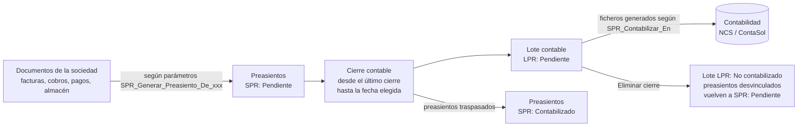
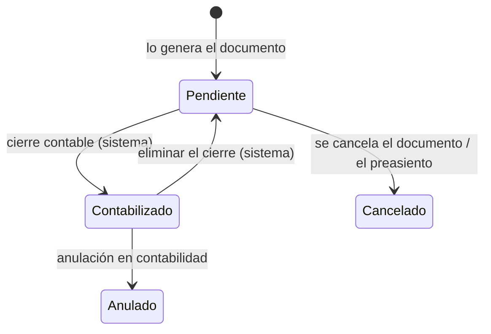
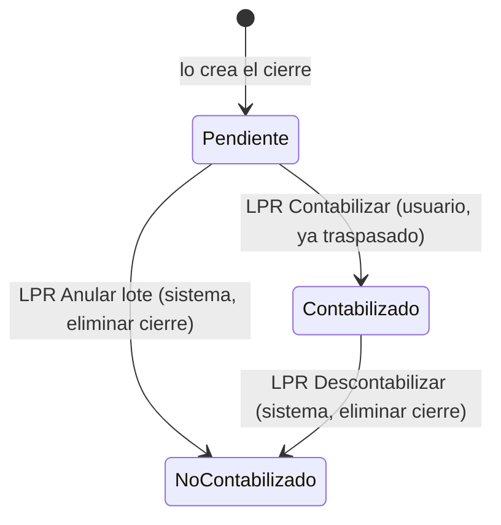

# Proceso de cierre contable

Guía del circuito completo por el que los preasientos que genera Se10 (facturas, cobros, pagos y
movimientos de almacén) se traspasan a la contabilidad de una sociedad mediante un **cierre
contable**, y de cómo se deshace. Describe el proceso tal y como está construido hoy en Se10; al final
se indican los puntos abiertos.

## 1. Visión general

```
DOCUMENTOS ──► PREASIENTOS ──► CIERRE CONTABLE ──► LOTE CONTABLE ──► CONTABILIDAD
(facturas,     (SPR: Pendiente)  (sociedad, desde    (ficheros NCS     (NCS / ContaSol)
 cobros,                          último cierre       o ContaSol)
 pagos,                           hasta fecha)        preasientos:
 almacén)                                             SPR: Contabilizado
```



Un cierre contable **barre, para una sociedad, todos sus preasientos pendientes desde la fecha del
último cierre hasta la fecha que se indica**, genera con ellos un **lote contable** con la información
a traspasar a la contabilidad y da esos preasientos por **contabilizados**. La única manera de
deshacerlo es **eliminar (anular) el cierre**, lo que cancela el lote, desvincula los preasientos y los
devuelve a pendientes de contabilizar.

## 2. Elementos que intervienen

| Elemento | Negocio en Se10 | Qué recoge | Lo crea |
|---|---|---|---|
| Preasiento | `Preasiento` (`PreasientoDtm`) | Asiento propuesto de un documento: sociedad (por su CG), fecha contable, ejercicio, negocio y documento de origen, apuntes | El propio documento al registrarse, si la sociedad tiene activados sus preasientos |
| Cierre contable | `CierreContable` (`CierreContableDtm`) | Sociedad, lote contable generado y fecha **hasta** la que se ha cerrado (`CerradaEl`) | El trabajo sometido *Crear cierre contable* |
| Lote contable | Circuito documental del tipo `LPR: Preasientos` (`CircuitoDocDtm`, parámetro `CAD_Tipo_Para_Lote_de_Preasientos`) | Los preasientos traspasados (vinculados al lote) y los ficheros para importar en la contabilidad | El método de exportación configurado en `SPR_Contabilizar_En` |
| Parámetros de preasientos | Parámetros de negocio `SPR_*` del negocio `Preasiento` | Qué documentos generan preasientos, cómo y en qué sistema se contabilizan | Mantenimiento de parámetros y, los de la sociedad, su *Información contable* |

## 3. Qué sociedades se pueden cerrar

En la modal *Crear cierre* solo se ofrecen las sociedades (filtro `FiltroParaSociedadesACerrar`):

- **gestionadas** (tienen al menos un centro gestor),
- que **no son de autónomos** (su NIF no es de persona física),
- y de las que el usuario conectado es **interventor**.

**Los autónomos no hacen cierres contables.** Tributan en **estimación directa** y su sistema, por
ahora, es el de **NCS**: se contabilizan desde las *estimaciones directas* (circuito documental del
tipo `CAD_Tipo_Para_Estimacion_Directa`, método `EstimacionDirectaEnNcs`), no mediante preasientos.
Tampoco se cierran las sociedades configuradas en `SPR_Contabilizar_En` con el método de estimación
directa de NCS (`EsDeEstimacionDirecta`); para todas ellas la *Información contable* de la sociedad no
está disponible.

## 4. La parametrización: cómo se generan los preasientos y dónde se contabilizan

El comportamiento lo deciden los **parámetros de preasientos** (`enumParametrosDePreasiento`). Todos se
pueden gestionar desde el **mantenimiento de parámetros** del negocio *Preasiento*; los que afectan
directamente a una sociedad también desde la propia **sociedad**, en su ampliación *Información
contable* (editable si el usuario puede parametrizar, es gestor de la sociedad y esta es gestionada).

**Desde la sociedad (Información contable)**

| Campo | Parámetro | Para qué sirve |
|---|---|---|
| CG documental | `SPR_Sociedad_CG_Documental` | Centro gestor de la sociedad donde se crean sus lotes contables |
| Último cierre | — (se lee del último `CierreContable`) | Solo informativo: fecha hasta la que está cerrada |
| Contabilizar en | `SPR_Contabilizar_En` | Sistema contable: **NCS** (`ContabilizarEnNcs`) o **ContaSol** (`ContabilizarEnContasol`) |
| Dígitos | `SPR_Contabilizar_En.Digitos` | Dígitos de las cuentas auxiliares: NCS siempre 11; ContaSol entre 4 y 10 (8 por defecto) |
| Plan contable | `SPR_Plan_Contable` | Identificador del plan contable de la sociedad en la contabilidad |
| Preasientos de emitidas / recibidas / cobros / pagos / almacén | `SPR_Generar_Preasiento_De_FacturaEmitida`, `_FacturaRecibida`, `_Cobro`, `_Pago`, `_Almacen` | Qué documentos de la sociedad generan preasientos (almacén, por defecto no) |
| Relanzar la activación de preasientos | — | Vuelve a someter *Activar preasientos de la sociedad* si la última activación terminó con errores |

**Solo desde el mantenimiento de parámetros** (comunes a todas las sociedades o por elemento)

| Parámetro | Para qué sirve |
|---|---|
| `SPR_Codigos_De_Diario` | Código de diario por tipo de preasiento |
| `SPR_Codigos_De_Actividad` | Código de actividad por sociedad, negocio y tipo |
| `SPR_CtaBancaria_CtaContable`, `SPR_Cuenta_De_Caja`, `SPR_Tarjeta_CtaContable` | Cuentas contables de tesorería |
| `SPR_CodigosPorNaturaleza` | Concepto e IVA contable por naturaleza |
| `SPR_Naturalezas_De_Materiales`, `_De_Suministros`, `_De_Arrendamiento` | Naturalezas con tratamiento contable propio |
| `SPR_Usa_Roi` | Si la sociedad está en el ROI |
| `SPR_Negocio_Origen` | Negocio que origina cada tipo de preasiento |
| `SPR_Tipo_De_Archivador` | Archivador donde se guardan los ficheros generados |
| `SPR_RegenerarLote_Para`, `SPR_CuentasDeTerceros_En` | Acciones para regenerar un lote y para generar las cuentas de terceros |
| `SPR_Usuarios_Con_Permiso_Para_Generar` | Usuarios que pueden generar preasientos manualmente |
| `SPR_NCS_Conceptos_De_Gasto` | Conceptos de gasto de la estimación directa de NCS (autónomos) |
| `SPR_Etapa_Pendiente`, `_Contabilizado`, `_Cancelado`, `_Anulado` | Estados de preasiento que forman cada etapa |

**Activar los preasientos de un negocio en una sociedad.** Al marcar en la sociedad que un negocio
genera preasientos se somete el trabajo *Activar preasientos de la sociedad*, que preasienta los
documentos que aún no tienen preasiento. Los que tienen fecha contable **anterior al último cierre** se
crean directamente como **contabilizados** (ese periodo ya está traspasado); el resto queda pendiente.

## 5. El proceso paso a paso

### Paso 1. Los documentos generan sus preasientos

- Cada factura emitida o recibida, cobro, pago o movimiento de almacén de una sociedad que tiene
  activado su negocio genera un preasiento en **SPR: Pendiente**, con la fecha contable del documento.
- Si la fecha contable es **anterior al último cierre** de la sociedad, el preasiento se crea con la
  **fecha del último cierre** (y su ejercicio), ya que lo anterior está cerrado
  (`AjustarFechaContableAlUltimoCierre`).
- **Excepción: las facturas emitidas no se mueven.** Se contabilizan con su fecha de devengo, que es la
  declarada en Verifactu como fecha de operación; moverla llevaría el IVA repercutido a otro periodo.
  Si es anterior al último cierre se da un error: hay que eliminar los cierres posteriores a esa fecha.

### Paso 2. Pedir el cierre

Desde *Cierres contables* → *Crear cierre*, el usuario indica:

| Dato | Regla |
|---|---|
| Sociedad | Una de las que se pueden cerrar (apartado 3) |
| Último cierre | Informativo; si nunca se ha cerrado, el **1 de enero del año en curso** |
| Cerrar hasta | Posterior al último cierre y **no posterior a hoy**; su año es el **ejercicio** que se cierra |
| Contabilizar en | NCS o ContaSol; si cambia respecto a lo configurado, se actualiza `SPR_Contabilizar_En` |
| Dígitos | NCS 11 (bloqueado); ContaSol los de la sociedad o 8 |

Antes de someter el trabajo se valida (`SometerCrearCierreContable`):

1. El ejercicio no es futuro ni anterior en más de un año al actual.
2. El usuario es **interventor** de la sociedad.
3. La fecha *Cerrar hasta* es válida (posterior al último cierre, no posterior a hoy).
4. **Hay algo que traspasar**: preasientos pendientes del ejercicio con fecha contable desde el último
   cierre (incluido) hasta *Cerrar hasta* (no incluido).
5. **No quedan pendientes de ejercicios anteriores**: si los hay, hay que darlos por contabilizados o
   cerrar antes ese ejercicio.
6. Para ContaSol, la sociedad tiene definidas las cuentas de tesorería.

Si todo es correcto se somete el trabajo **Crear cierre contable** a la cola de trabajos.

### Paso 3. El trabajo de cierre

Al ejecutarse (`TrabajosContables.CrearCierreContable`):

1. **Revalida** la fecha y que haya preasientos: entre el sometimiento y la ejecución se ha podido hacer
   otro cierre. Si no se cumple, lo anota en la traza y termina.
2. Fija el **desde** del barrido: la fecha del último cierre.
3. Abre **una sola transacción** y pone un **semáforo de cierre** (`CCT`) sobre la sociedad con la fecha
   *hasta*. Mientras dura, ningún otro proceso puede **crear, eliminar ni cancelar** preasientos de la
   sociedad con fecha contable anterior a la de cierre.
4. **Ajusta los pendientes anteriores al último cierre**, si quedara alguno, llevándolos a la fecha de
   ese cierre (salvo facturas emitidas, que dan error). Cada ajuste queda en la traza.
5. **Genera el lote contable** con el método configurado en `SPR_Contabilizar_En` de la sociedad:
   - selecciona los preasientos **pendientes** de la sociedad con fecha contable
     `desde ≤ fecha < hasta` y del ejercicio del cierre;
   - descarta, anotando el motivo en el trabajo y en el preasiento, los que no estén bien formados
     (`DimeSiEstaBien`) o ya estén vinculados a otro lote;
   - cancela los que deban cancelarse por estarlo su documento de origen;
   - pasa el resto a **SPR: Contabilizado**;
   - crea el **lote contable** (circuito documental `LPR`, en el CG documental de la sociedad), le
     **vincula los preasientos** y le anexa, bloqueados, los ficheros para la contabilidad:
     - **NCS**: el diario XML y las cuentas de terceros;
     - **ContaSol**: un zip con los ficheros de importación (APU, IVS, IVR, PRO y CLI);
   - marca los proveedores y clientes como **migrados** al plan contable de la sociedad;
   - deja en el lote una observación con el enlace al trabajo que lo generó.
6. **Registra el cierre** (`RegistrarCierre`): sociedad, lote y `CerradaEl` = fecha *hasta*.
7. Confirma la transacción y quita el semáforo. Si algo falla **se deshace todo** y el error queda en
   el trabajo.

### Paso 4. Traspaso a la contabilidad

- El usuario descarga los ficheros del lote y los importa en NCS o ContaSol.
- Cuando lo ha traspasado, ejecuta en el lote la transición **LPR: Contabilizar** (de *Pendiente* a
  *Contabilizado*).
- Mientras el lote está abierto se puede **regenerar** (ContaSol) si hubiera que volver a importar.

### Paso 5. Qué queda bloqueado tras el cierre

- Un preasiento con fecha contable **anterior al último cierre** está, para el sistema, contabilizado:
  **no se puede cancelar** (`ValidarQueNoEstaCerrado`).
- Los nuevos documentos con fecha anterior al cierre se preasientan con la **fecha del cierre**
  (paso 1), salvo las facturas emitidas.
- Las devoluciones de pedido no pueden tener fecha anterior al último cierre.
- No se puede volver a cerrar hasta una fecha igual o anterior al último cierre.

## 6. Marcha atrás: eliminar el cierre

La **única forma de deshacer un cierre es eliminarlo** (menú *Eliminar cierre* en *Cierres contables*),
que somete el trabajo **Eliminar cierre contable**:

1. Solo se puede eliminar **el último cierre** de la sociedad; si tiene cierres posteriores hay que
   eliminarlos antes, de más reciente a más antiguo (`MotivoParaNoAnularElCierre`, que se comprueba al
   someter y otra vez al ejecutar).
2. En una transacción, con semáforo `ALCT` sobre el lote y como administrador:
   - el lote transita, por una transición del sistema, a **LPR: No contabilizado** (cancelado), tanto si
     estaba *Pendiente* como *Contabilizado*;
   - al cancelarse (`TrasCancelarCad`), **cada preasiento del lote vuelve a SPR: Pendiente** y se
     **desvincula del lote**, con su traza;
   - se **elimina el registro del cierre**, con lo que el último cierre de la sociedad pasa a ser el
     anterior (o el 1 de enero si no hay ninguno).
3. Los preasientos quedan otra vez **pendientes de contabilizar** y entrarán en el próximo cierre.

> Si el lote ya se había importado en la contabilidad, eliminar el cierre **no borra nada en NCS ni en
> ContaSol**: hay que deshacer allí el asiento a mano.

## 7. Estados

**Preasiento**



**Lote contable**



| Etapa del lote | Estado | Qué se puede hacer |
|---|---|---|
| `CAD_Etapa_Abierto` | LPR: Pendiente | Descargar e importar los ficheros, regenerar, marcar como contabilizado, eliminar el cierre |
| `CAD_Etapa_Cerrado` | LPR: Contabilizado | Consulta; eliminar el cierre si es el último |
| `CAD_Etapa_Cancelado` | LPR: No contabilizado | Solo consulta |

## 8. Consulta de cierres

La vista *Cierres contables* muestra, por cada cierre: sociedad, lote, **desde** (el *hasta* del
cierre anterior o el 1 de enero de su año), **hasta** (`CerradaEl`), cuándo se cerró, si **es el último
cierre** y cuántos preasientos de cada origen lleva: **recibidas, emitidas, cobros, pagos y almacén**.
Se puede filtrar por sociedad, fecha de cierre y lote.

## 9. Qué existe hoy en Se10

| Pieza | Dónde |
|---|---|
| Modal *Crear cierre* y menú *Eliminar cierre* | `CrearCierreContableDto`, `DescriptorDeCierresContables`, `CierresContablesController` |
| Sociedades que se pueden cerrar | `FiltrosDeSociedades.FiltrarPorSociedadesACerrar` |
| Validaciones, semáforo, ajuste de fechas, alta y baja del cierre | `GestorDeCierresContables` |
| Trabajos *Crear cierre contable* y *Eliminar cierre contable* | `TrabajosContables` |
| Selección de preasientos y generación del lote NCS / ContaSol | `ExportacionesDePreasientos`, `LoteContableConNcs`, `LoteContableConContasol` |
| Devolver los preasientos a pendiente al cancelar el lote | `ExtensoresDeCircuitosDoc.TrasCancelarCad`, `ExtensorDePreasientos.AnularContabilizacion` |
| Información contable de la sociedad | `InformacionContableDeSociedadDto`, `ExtensorDeSociedades.InformacionContable` / `PersistirInformacionContable` |
| Activación de preasientos de una sociedad | `TrabajosContables.ActivarPreasientosDeLaSociedad`, `ActivacionDePreasientos` |
| Estimación directa de autónomos (NCS) | `ExportacionesDePreasientos.EstimacionDirectaEnNcs` |

## 10. Puntos a revisar

1. **Lote contable sin cierre.** Sigue existiendo el trabajo *Crear lote contable* (con filtros,
   *descontabilizar* y *respetar fecha contable*), que también registra un cierre, pero con
   `CerradaEl` = momento de creación en lugar de una fecha de corte. Conviene decidir si se retira en
   favor del cierre o si debe dejar de registrar cierre.
2. **Anular lote frente a eliminar cierre.** Desde los circuitos documentales también se puede someter
   *Anular lote contable*, que hoy hace lo mismo que *Eliminar cierre*. Si la única vía debe ser el
   cierre, habría que retirar esa opción para los lotes que tienen cierre.
3. **Lote ya importado.** Eliminar un cierre cuyo lote está en *LPR: Contabilizado* no avisa de que hay
   que deshacer los asientos en la contabilidad externa; se podría pedir confirmación expresa.
4. **Cambio de sistema contable en el cierre.** Elegir otro sistema en la modal cambia
   `SPR_Contabilizar_En` de la sociedad para siempre, no solo para ese cierre.
5. **Autónomos en otros sistemas.** Hoy la estimación directa solo está en NCS; si se añadiera otro
   sistema habría que parametrizar el método de estimación directa por sociedad.
