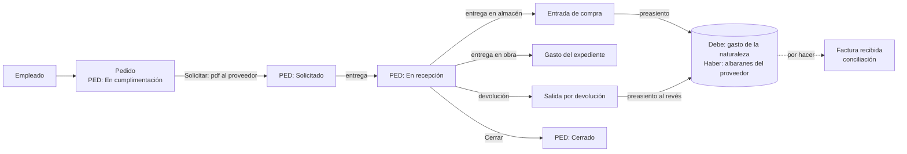
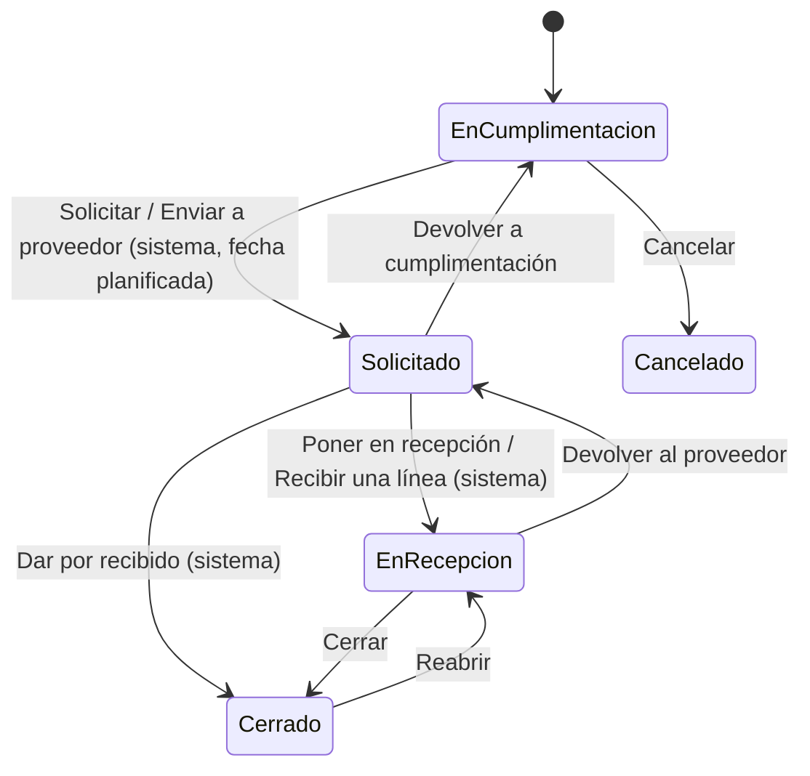

# Proceso de compra de materiales y servicios

Guía del circuito completo desde que alguien de la empresa necesita material o un servicio hasta
que se concilia lo recibido con la factura del proveedor. Describe lo que **hace hoy Se10** y, al
final, la parte que queda por construir: la conciliación con las facturas recibidas.

## 1. Visión general

```
EMPLEADO ──► PEDIDO ──► PROVEEDOR ──► ENTREGAS ──┬──► ALMACÉN  (materiales) ──► PREASIENTO DE GASTO ──┐
             (PED: En cumplimentación)           │                                                     ├──► CONCILIACIÓN CON
                                                 └──► OBRA DEL EXPEDIENTE (materiales y servicios) ────┘     LA FACTURA RECIBIDA
                                                           ▲                                                  (por hacer)
                                     DEVOLUCIONES ─────────┘ (deshacen parte de una entrega)
```



## 2. Documentos que intervienen

| Documento | Negocio en Se10 | Qué recoge | Lo crea |
|---|---|---|---|
| Pedido | `Pedido` (`PedidoDtm`) | Proveedor, contacto, destino (almacén o expediente), contrato, fechas (pedir, entregar, recibido, cerrado) | El empleado que necesita la compra |
| Línea de pedido | `LineaDeUnPedidoDtm` | Unitario o partida alzada, concepto, cantidad, precio y descuento. También admite líneas de comentario | El empleado, en la edición del pedido |
| Entrega | `RecepcionDeLineaDtm` | Lo que el proveedor entrega de una línea: fecha, cantidad, precio, descuento y destino (almacén **o** obra del expediente) | Quien gestiona el pedido, al recibir la mercancía o el servicio |
| Devolución | `DevolucionDeEntregaDtm` | Lo que se devuelve de una entrega: fecha, cantidad y motivo | Quien gestiona el pedido |
| Movimiento de almacén | Entrada de compra / salida por devolución de compra | Stock y valor que entra o sale del almacén | El sistema, al entregar o devolver en un almacén |
| Preasiento | `PreasientoDtm` del negocio de almacén | Asiento de gasto contra la cuenta de albaranes del proveedor | El sistema, al crear el movimiento de almacén |
| Factura recibida | `FacturaRecibida` (`FacturaRecDtm`) | La factura del proveedor | Administración. **Hoy no está vinculada al pedido** |

**¿A dónde puede ir una entrega?** Lo decide el destino de la cabecera, que se puede cambiar en
cada entrega:

| Destino | Qué admite | Qué genera |
|---|---|---|
| **Almacén** | Solo materiales del catálogo (unitarios de naturaleza `Material`, no partidas alzadas). El almacén ha de estar activo | Entrada de compra, stock y valor al precio neto, y el **preasiento de gasto** |
| **Obra del expediente** | Cualquier clase: materiales, mano de obra, servicios, partidas alzadas. El expediente no puede estar terminado ni cancelado | Suma en los **gastos del expediente** (apartado *Recepciones de pedido*). **No genera preasiento** |

Si el pedido va a un almacén, al solicitarlo se valida que todas sus líneas (salvo los comentarios)
sean materiales del catálogo. El almacén y el expediente han de ser de la misma sociedad que el
pedido.

## 3. El proceso paso a paso

### Paso 1. El empleado cumplimenta el pedido

- Se da de alta el pedido: **proveedor**, contacto, **destino de las entregas** (almacén o
  expediente) y, si procede, el contrato o expediente al que se imputa.
- Se añaden las líneas: unitario (o partida alzada), concepto, cantidad, precio y descuento.
- Estado: **PED: En cumplimentación**. Las líneas solo se pueden modificar en esta etapa.
- *Fecha de pedir* (`PedidoEl`) es, mientras se cumplimenta, la **fecha planificada** para
  solicitarlo. Un trabajo diario del sistema (a la 1 de la mañana) solicita automáticamente los
  pedidos con importe cuya fecha ha llegado (transición del sistema *Enviar a proveedor*).
- Desde aquí se puede **Cancelar** (PED: Cancelado), indicando el motivo.
- Para repetir un pedido se puede usar **Copiar pedido**. Copia la cabecera y las líneas en un
  pedido nuevo en cumplimentación, sin fechas, archivo, entregas ni devoluciones.

> La etapa de **aprobación** (PED: En aprobación, con *Aprobar*, *Enviar al proveedor* y *Devolver
> a cumplimentación*) está definida pero desactivada: hoy el pedido pasa directamente de
> cumplimentación a solicitado.

### Paso 2. Solicitar: el pedido se envía al proveedor

- Con la transición **Solicitar** el pedido pasa a **PED: Solicitado**.
- Al solicitar se valida que tenga destino de las entregas y que, si va a un almacén, solo lleve
  materiales del catálogo. Si el proveedor está de baja, se avisa.
- *Fecha de pedir* pasa a ser hoy, y el sistema genera el **pdf del pedido**, lo anexa y lo envía al
  proveedor.
- Si hay que corregir algo, **Devolver a cumplimentación** lo devuelve a la etapa inicial. El pdf
  emitido se renombra como antiguo y queda anexado como constancia.

### Paso 3. Recibir: las entregas

El proveedor puede entregar todo de una vez o en varias entregas. Cada entrega de una línea es un
registro en el grid de **Entregas** del pedido.

| Acción | Qué hace |
|---|---|
| **Recepcionar línea** | Registra una entrega de la línea con la cantidad, precio, descuento, fecha y destino que se indiquen |
| **Recibida** (tick verde en la línea) | Entrega lo **pendiente** de la línea, con fecha de hoy |
| **Dar por entregado** | Entrega lo pendiente de **todas** las líneas, en la fecha indicada |
| **Dar por recibido** | Desde solicitado, cierra el pedido y entrega lo pendiente de todas las líneas |

Reglas:

- La **primera entrega** pasa el pedido de solicitado a **PED: En recepción** (transición del
  sistema *Recibir una línea*) y anota esa fecha como *Recibido el* de la cabecera.
- Las modales proponen la **fecha de hoy**. Una fecha anterior movería los movimientos de almacén
  posteriores, que pueden estar ya contabilizados.
- La fecha no puede ser posterior a hoy ni anterior a la creación del pedido ni a su fecha de pedir.
- **Nunca se entrega más de lo pedido.** *Pendiente = pedido − (recibido − devuelto)*: lo
  devuelto puede volver a entregarse.
- Solo registra o cancela entregas **quien gestiona el pedido**.
- En el grid de líneas se ve, por cada línea, lo entregado, lo devuelto y lo **pendiente**.

Si la entrega es en un **almacén**, se crea la **entrada de compra**. Esta entrada:

- suma el stock al precio neto de descuento;
- recalcula el PMP;
- genera el preasiento (paso 5);
- recalcula los movimientos posteriores del mismo material y almacén.

Si la entrega es en la **obra de un expediente**, no hay movimiento de almacén. El importe neto
se suma a los **gastos del expediente**, y la entrega se ve en el apartado **Recepciones de pedido**
de su edición.

### Paso 4. Devolver al proveedor

Desde el grid de entregas se puede **devolver** parte o toda una entrega. Las devoluciones se ven en
el grid de **Devoluciones** del pedido.

- Se puede devolver con el pedido **en recepción o cerrado**, y solo lo hace quien gestiona el pedido.
- Una entrega admite varias devoluciones, pero entre todas no pueden superar lo entregado.
- El **motivo** es obligatorio.
- La **fecha** de la devolución ha de estar entre *máx.(fecha de la entrega, último cierre
  contable de la sociedad)* y hoy.
- Lo devuelto se valora al precio y descuento **de la entrega**.
- Si la entrega fue a un **almacén**, se crea una **salida por devolución de compra** que saca el
  stock y genera el preasiento al revés (paso 5). El almacén ha de estar activo.
- Si fue a la **obra del expediente**, lo devuelto se descuenta de sus gastos.
- Lo devuelto vuelve a quedar pendiente de entregar en la línea.
- **Imprimir** (pie del grid de devoluciones) genera el pdf con todas las devoluciones del pedido.
  Se anexa a sus archivos como *Devolucion-[referencia]-[nº].pdf*, para enviarlo al proveedor.

### Paso 5. Contabilidad: el preasiento de gasto

Cada movimiento de almacén de una compra genera un **preasiento** del negocio de almacén. Se fecha
en la fecha del movimiento y equivale a registrar la factura **sin impuestos**:

| Hecho | Debe | Haber | Importe |
|---|---|---|---|
| Entrega en almacén | Cuenta de **gasto** de la naturaleza del material | **Albaranes pendientes de factura** del proveedor (`CTA_Cuenta_De_Albaran`, por defecto `400900`, + código contable del proveedor con 4 dígitos) | Cantidad × precio − % descuento |
| Devolución de esa entrega | Albaranes pendientes de factura del proveedor | Cuenta de gasto de la naturaleza | Cantidad devuelta × precio − % descuento de la entrega |

Requisitos:

- El proveedor ha de tener **código contable**.
- La naturaleza del material ha de tener **cuenta de gasto**.
- Ha de estar parametrizado el tipo de preasiento del negocio de almacén.
- La sociedad del almacén ha de usar preasientos de almacén. En sociedades de autónomos no se
  preasienta.

El preasiento sigue el circuito habitual: pendiente → **lote contable** → contabilizado. **Una vez
contabilizado ya no se puede cancelar** la entrega o la devolución que lo generó.

Así, la cuenta de albaranes del proveedor acumula en el haber **lo recibido y aún no facturado**.
Esa cuenta es la que se saldará al conciliar con la factura (paso 7).

### Paso 6. Cerrar el pedido

- **Cerrar** pasa el pedido de en recepción a **PED: Cerrado**, con fecha de cierre de hoy. Las
  fechas se corrigen con *Modificar cabecera*.
- **Reabrir** lo devuelve a en recepción.
- **Devolver al proveedor** pasa el pedido de en recepción a solicitado. Antes hay que cancelar
  todas sus entregas, porque en solicitado no puede haber nada entregado.

### Paso 7. Conciliación con la factura recibida (por hacer)

Es el paso que cierra el circuito. Hoy la factura recibida se registra y preasienta por su cuenta,
sin saber de qué pedido ni de qué entregas viene. Ver la sección 7.

## 4. Marcha atrás

| Situación | Cómo | Condiciones |
|---|---|---|
| Entrega equivocada | **Cancelar entrega** (grid de entregas) | Pedido en recepción, sin devoluciones de esa entrega, almacén activo y preasiento **sin contabilizar**. Se borra la entrada, se anula el preasiento y se recalculan los movimientos posteriores. Queda una traza en el pedido |
| Devolución equivocada | **Cancelar devolución** (grid de devoluciones) | Almacén activo y preasiento de la salida sin contabilizar. Se borra la salida y queda una traza |
| Pedido solicitado con errores | *Devolver a cumplimentación* | Sin entregas |
| Pedido en recepción que vuelve a solicitado | *Devolver al proveedor* | Cancelar antes todas las entregas |
| Pedido cerrado por error | *Reabrir* | — |
| El pedido ya no hace falta | *Cancelar* | Solo en cumplimentación |

Para **cambiar** una entrega o devolución no se modifica: se cancela y se vuelve a registrar.

## 5. Estados del pedido



| Etapa | Estado | Qué se puede hacer |
|---|---|---|
| `PED_Etapa_De_Cumplimentacion` | PED: En cumplimentación | Editar cabecera y líneas, solicitar, cancelar, copiar |
| `PED_Etapa_De_Aprobacion` | PED: En aprobación | (desactivada) |
| `PED_Etapa_De_Solicitud` | PED: Solicitado | Recepcionar (pasa a recepción), dar por recibido, devolver a cumplimentación |
| `PED_Etapa_De_Recepcion` | PED: En recepción | Entregar, cancelar entregas, devolver, cerrar |
| `PED_Etapa_Cerrado` | PED: Cerrado | Devolver entregas, reabrir |
| `PED_Etapa_Devuelto` | PED: Devuelto | Definido como terminado, pero hoy ninguna transición llega a él |
| `PED_Etapa_Cancelado` | PED: Cancelado | Solo consulta |

## 6. Resumen contable

| Hecho | Debe | Haber | Importe |
|---|---|---|---|
| Entrega en almacén | Gasto de la naturaleza | Albaranes pendientes de factura del proveedor | Neto de la entrega |
| Devolución de una entrega en almacén | Albaranes pendientes de factura del proveedor | Gasto de la naturaleza | Neto de lo devuelto |
| Entrega / devolución en obra de expediente | — (sin preasiento) | — | Suma / resta en los gastos del expediente |
| Factura recibida (hoy) | Gasto de la naturaleza de cada línea + IVA soportado | Proveedor | Total de la factura |
| Factura recibida (objetivo, ver 7) | Albaranes pendientes de factura + IVA soportado (+ diferencias) | Proveedor | Total de la factura |

## 7. Lo que falta: conciliar con las facturas recibidas

### El problema de hoy

Una compra a un almacén que luego se factura carga **el gasto dos veces**:

1. la entrega: *Debe gasto / Haber albaranes*;
2. la factura recibida: *Debe gasto + IVA / Haber proveedor*.

La cuenta de albaranes queda con saldo que nunca se cancela. En la obra del expediente pasa lo
mismo con los gastos del expediente si la factura también se imputa a él: cuenta la recepción y
cuenta la base imponible de la factura.

### Propuesta de conciliación

1. **Vincular la factura con lo recibido.** Al registrar la factura recibida, el usuario elige el
   proveedor y Se10 le muestra sus **entregas pendientes de facturar** (netas de devoluciones), de
   uno o varios pedidos. Marca las que cubre la factura.
2. **Comparar importes.** Por cada entrega conciliada se compara lo recibido (cantidad × precio −
   descuento) con lo facturado. Las diferencias de precio o cantidad se muestran antes de aceptar.
3. **Preasiento de la factura conciliada.** Para lo conciliado, la factura carga la cuenta de
   **albaranes** en lugar de la de gasto, porque el gasto ya se contabilizó en la entrega:

   | Debe | Haber |
   |---|---|
   | Albaranes pendientes de factura del proveedor (por lo recibido) | Proveedor (total factura) |
   | IVA soportado | |
   | Gasto de la naturaleza (diferencia de precio, si la factura es mayor) | |

   Si la factura es menor que lo recibido, la diferencia va al haber del gasto.
4. **Estado de la entrega.** Cada entrega pasa a *facturada*: ya no se puede cancelar ni devolver
   sin abonar la factura. El pedido podría cerrarse solo cuando todo lo entregado esté facturado.
5. **Devoluciones después de facturar.** Si se devuelve algo ya facturado, se espera el **abono**
   del proveedor y se concilia con la devolución, igual que la factura con la entrega.

### Piezas a construir

| Pieza | Estado |
|---|---|
| Vínculo entrega ↔ línea de factura recibida (tabla de conciliación) | **Por hacer** |
| Selector de entregas pendientes de facturar al registrar la factura | **Por hacer** |
| Importe pendiente de facturar por entrega, línea y pedido (columnas y filtros) | **Por hacer** |
| Preasiento de la factura recibida contra albaranes en lo conciliado | **Por hacer**: `ExtensorDePreasientos.Preasentar(FacturaRecDtm)` carga siempre el gasto |
| Impedir cancelar o devolver una entrega facturada | **Por hacer** |
| Abonos del proveedor conciliados con devoluciones | **Por hacer** |
| Informe del saldo de albaranes por proveedor (recibido y no facturado) | **Por hacer** |

### Puntos a decidir antes de programar

1. **Granularidad.** ¿Se concilia por entrega, por línea de pedido o por pedido completo? Por
   entrega es lo más exacto, porque cada entrega tiene su precio, descuento y preasiento.
2. **Entregas en obra.** Hoy no se preasientan. ¿Se preasientan igual que las de almacén (gasto
   contra albaranes), para que la conciliación sea la misma en los dos casos? Si no, al conciliar
   hay que evitar que el gasto cuente dos veces en el expediente.
3. **Tolerancia.** ¿A partir de qué diferencia entre lo recibido y lo facturado se bloquea la
   conciliación o se pide confirmación?
4. **Diferencias de precio y PMP.** Si la factura cambia el precio, ¿se ajusta el valor de la
   entrada en el almacén (y el PMP y los movimientos posteriores) o la diferencia va directamente a
   gasto?
5. **Facturas sin pedido.** ¿Se siguen permitiendo facturas recibidas sin pedido (como ahora) o se
   exige pedido para ciertos proveedores o naturalezas?
6. **Cierre automático.** ¿El pedido se cierra solo cuando todo lo entregado está facturado?
7. **Estado *PED: Devuelto*.** Hoy ninguna transición llega a él. ¿Se usa para el pedido devuelto
   por completo, se elimina, o se reutiliza como *facturado*?
