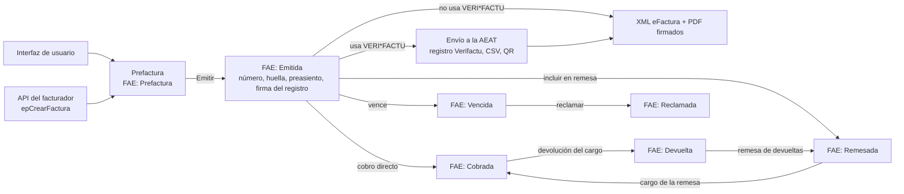
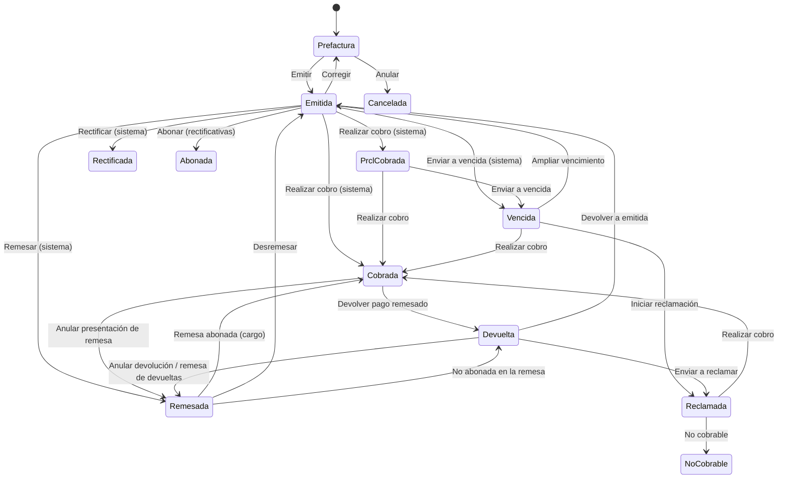
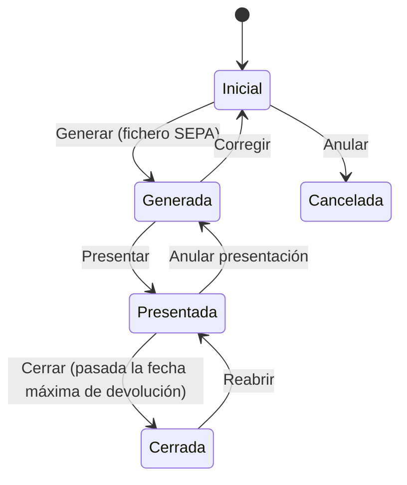

# Proceso de una factura emitida

Guía del circuito completo de una factura a un cliente. Empieza cuando se crea la prefactura y
termina cuando se cobra. En medio están la emisión, la comunicación a la AEAT (con o sin
VERI\*FACTU), la firma, el pdf y el cobro, sea directo o por remesa bancaria. Describe lo que
**hace hoy Se10** y, al final, lo que falta o conviene revisar.

La factura se puede crear y emitir de dos formas, que terminan en el mismo código:

- desde la **interfaz de usuario** (mantenimiento de *Facturas emitidas*);
- llamando a la **API REST del facturador** (`/Facturador/...`), autenticada con el `apiKey` del
  facturador de la sociedad. El detalle de la API está en [Facturador.md](../Facturador.md).

## 1. Visión general

```
                 UI ─┐
                     ├──► PREFACTURA ──► EMITIR ──┬──► VERI*FACTU: envío a la AEAT ──┐
 API (facturador) ───┘   (FAE: Prefactura)        │    (trabajo, individual o lote)  ├──► XML eFactura + PDF ──► FIRMA
                                                  └──► sin VERI*FACTU ───────────────┘    (anexados)
                                                              │
                                    preasiento de ingresos ◄──┘
                                                              │
               ┌──────────────── COBRO DIRECTO (contado, transferencia, carta de pago) ──► FAE: Cobrada
 FAE: Emitida ─┤
               └──────────────── REMESA DE COBRO (SEPA pain.008) ──► CARGO ──► FAE: Cobrada
                                        │                                │
                                        └──── DEVOLUCIÓN DEL CARGO ◄─────┘──► FAE: Devuelta ──► reclamar / remesar de nuevo
```



## 2. Documentos que intervienen

| Documento | Negocio en Se10 | Qué recoge | Lo crea |
|---|---|---|---|
| Factura emitida | `FacturaEmitida` (`FacturaEmtDtm`) | Cliente, centro gestor, tipo, clase de emisión, fechas (devengo, emisión, vencimiento), número, huella y firma | El usuario, la API del facturador u otros procesos |
| Línea de factura | `LineaDeUnaFaeDtm` | Concepto, cantidad, precio, descuento, IVA, unidad y naturaleza. También admite comentarios | El usuario, la API o el proceso que factura |
| Petición al facturador | `PeticionDeFacturaEmtDtm` | Cada llamada a la API: operación, JSON recibido, factura creada, error y guids de consulta | El facturador |
| Log de envío | `LogDeEnvioDeFacturaDtm` | Cuándo se pidió el envío a la AEAT y cuándo terminó (`EnviadaEl`) | La emisión, si se usa VERI\*FACTU |
| Registro Verifactu | `VerifactuDtm` (ampliación de la factura) | CSV y respuesta de la AEAT, URL del QR, huella, archivador con lo enviado y recibido | El trabajo de envío a la AEAT |
| Preasiento | `PreasientoDtm` de la factura | Asiento de ingresos | La emisión |
| Cobro | `CobroDeFaeDtm` | Fecha, importe, clase (contado, transferencia, carta de pago, remesa) y cuentas | El usuario, o la remesa al cargarse |
| Remesa de cobro | `RemesaFae` (`RemesaFaeDtm`) | Sociedad, cuenta de abono, acreedor, presentador, fechas (generada, presentada, cargar, cargada) y el fichero SEPA | El usuario |
| Factura de una remesa | `FacturaEmtDeUnaRemesaDtm` | Factura incluida, fecha de cargo, fecha de devolución, fecha máxima de devolución y motivo | El usuario, al incluir facturas en la remesa |

## 3. El proceso paso a paso

### Paso 1. Crear la prefactura

Toda factura nace como **prefactura** (**FAE: Prefactura**). Es un borrador sin número: se puede
editar, imprimir como prefactura o anular (*FAE: Anular*, con motivo).

**Desde la interfaz.** Se da de alta en *Facturas emitidas*: cliente, centro gestor, tipo de
factura, clase de emisión, fecha de devengo y líneas. También se crean prefacturas desde otros
negocios:

| Origen | Cómo |
|---|---|
| Presupuesto | `CrearPrefactura(PresupuestoDtm)`: copia las líneas del presupuesto |
| Contrato | `CrearPrefactura(ContratoDtm)` |
| Parte de trabajo | `CrearPrefactura(ParteTrDtm)`, o incluir un parte en una factura existente como línea alzada |
| Planificación de venta | `CrearPrefactura(PlanificacionDeVentaDtm)` |
| Tareas | *Facturar tareas* (`epFacturarTareas`) |
| Otra factura | *Copiar* (`epCopiarUnaFae`) |
| Rectificación | *Hacer rectificativa* (`epHacerRectificativa`) |

**Desde la API (facturador).** Un sistema externo envía el JSON de la factura (cliente por NIF y
líneas con códigos propios). El JSON de mapeo del facturador traduce esos códigos a unidades,
naturalezas, IVAs e IRPFs de Se10. Hay dos formas de llamar:

- **Directa:** `POST /Facturador/epCrearFactura?nif=…&apiKey=…`.
- **En dos pasos:** primero `GET /Facturador/epSolicitarFacturador` devuelve un guid que caduca al
  minuto y solo vale una vez. Después se llama a `POST /Facturador/epCrearFacturaConGuid`.

Si el cliente no existe, antes se puede crear con `epCrearCliente`. La API **crea la prefactura
y la emite en la misma llamada** (paso 2): no deja nada en borrador salvo que falle la emisión.

| Clase de emisión (`enumClaseDeEmision`) | Qué se genera al emitir |
|---|---|
| `eFactura32` / `eFactura322` | XML Facturae (original) y un PDF *COPIA-…* |
| `Impresa` | Solo el PDF *Fac-…* (original). **No admite VERI\*FACTU** |

### Paso 2. Emitir

La transición **FAE: Emitir** pasa la prefactura a **FAE: Emitida**. En la interfaz es una
transición más. La API la aplica sola tras crear la prefactura (`EmitirYObtenerResultado`).

Antes de emitir se valida (`AntesDeEmitirFactura`):

- que tenga líneas y que se pueda firmar con XAdES;
- el IVA de las líneas y el IRPF;
- los requisitos de la AEAT si se usa VERI\*FACTU: estructura de auditoría y que la rectificada
  no esté cancelada;
- la dirección fiscal del cliente. Con VERI\*FACTU es obligatoria. En exportación no puede ser
  nacional, y en las intracomunitarias el cliente ha de tener VAT. Si no está sujeta o está
  exenta, se completa la información fiscal;
- que el centro administrativo, si lo hay, esté activo;
- el periodo de facturación, si el tipo lo exige;
- que las tareas asociadas estén terminadas.

Después se hace lo siguiente:

1. **Fechas.** *Emitida el* es ahora. La *fecha de devengo* (`FacturadaEl`) no puede ser
   posterior a la emisión y, si no se ha indicado, es la de emisión. El año de la factura es el
   del devengo.
2. **Numeración.** La serie sale del tipo de factura (o de la serie de rectificativas). El número
   es el siguiente de la sociedad en ese año y serie. Se valida que la fecha no sea anterior a la
   última emitida de la serie.
3. **Vencimiento.** Se calcula con los días del tipo de factura (30 por defecto) y se anota un
   evento de vencimiento en la agenda.
4. **Huella** (VERI\*FACTU). Es un hash del NIF del emisor, el número, la fecha de expedición, el
   tipo, la cuota, el importe total, la huella de la factura anterior y la fecha y hora de
   generación. Encadena cada factura con la anterior.
5. **Preasiento de ingresos** (paso 7), si la sociedad usa preasientos de facturas emitidas.
6. **Firma del registro**, si el parámetro `FAE_SII_Firmar` lo pide para la sociedad. Se firman
   la huella, la firma de la factura anterior y las fechas con el certificado de la sociedad.

Si es rectificativa, la factura rectificada pasa a **FAE: Rectificada**.

Al terminar la emisión (`TrasEmitirFactura`) se recalcula el avance del contrato si hay contrato.
Además, los partes facturados se dan por facturados.

### Paso 3. Comunicar a la AEAT: con o sin VERI\*FACTU

Justo después de emitir, tanto la interfaz (`FacturasEmtController.DespuesDeTransitar`) como la
API deciden qué hacer:

**¿Usa VERI\*FACTU?** Sí cuando se cumplen todas estas condiciones (`UsaVerifactu` y
`VerifactuActivo`):

- el parámetro `FAE_SII_Activo` es `S`;
- la clase de emisión no es `Impresa`;
- el centro gestor y la sociedad no están de baja;
- la sociedad tiene configurada la implantación del SII y el servicio está activo.

**Con VERI\*FACTU** (`GestorDeFacturasEmt.EnviarFacturaAeat`):

- Si la factura anterior de la sociedad ya está comunicada, o no hay anterior, se crea el **log de
  envío**. Al crearlo se somete el trabajo **Enviar la factura a la AEAT**, que se ejecuta en
  segundo plano.
- Si hay facturas anteriores del mismo año **sin comunicar**, se arma un **lote** con ellas y
  esta. Se somete el trabajo **Enviar un lote de facturas a la AEAT**, planificado al minuto,
  para respetar el encadenamiento.
- El trabajo pone un semáforo y envía el alta (`GeneradorSii.AltaDeFacturaSif`). Luego crea el
  **registro Verifactu**: CSV, respuesta, URL del QR y huella. En un archivador SII guarda el
  fichero enviado, la respuesta y la cadena de bloques. Por último anota *Enviada el* en el log y
  deja en la factura una observación con el enlace al trabajo.
- Si el envío **falla** (rechazo de la AEAT u otro error), se somete **Cancelar emisión**. Si la
  factura no llegó a tener registro Verifactu, vuelve a **FAE: Prefactura** con el motivo *Fallo
  al comunicar la factura a la AEAT*. Si ya lo tiene, no se puede cancelar y se anota el error.
- La API responde *Factura emitida y sometido su envío* (individual) o el mensaje de lote.

**Sin VERI\*FACTU** no se comunica nada: se generan los documentos en el momento (paso 4). La
leyenda del pdf no lleva *VERI\*FACTU*, y el QR apunta a la URL de cotejo de facturas no
verificables.

### Paso 4. Documentos: XML, PDF y firma

`GestorDeFacturasEmt.EmitirPdfFactura` genera los documentos. Con VERI\*FACTU lo lanza el trabajo
**Generar factura pdf** al acabar el envío. Sin VERI\*FACTU se llama justo después de emitir.

- Si la clase de emisión no es `Impresa`, se genera el **XML Facturae** (`Fac-[referencia].xml`),
  que es el original. Además se hace un PDF *COPIA-[referencia]-[versión].pdf*.
- Si es `Impresa`, el **PDF** *Fac-[referencia].pdf* es el original.
- El PDF lleva el **QR** y la leyenda VERI\*FACTU, si procede.
- Cada archivo se sube al gestor documental y se vincula a la factura. El original queda como
  *archivo de la factura*.
- **Firma del documento:** si la sociedad tiene **un único certificado** vinculado, cada archivo
  se firma (`FirmarAnexado`) y el firmado queda también anexado. Si la firma falla, la factura no
  se deshace: se deja una traza.
- Desde la interfaz se imprime la *prefactura* o una *copia de factura*. También se puede generar
  un **UBL** (2.1 o 2.5) como copia.
- Desde la API se piden con `epSolicitarPdf` y `epSolicitarXml`, usando los guids permanentes
  recibidos al crear la factura. La respuesta es una URL de descarga válida durante una hora.

Con esto la factura está **emitida, comunicada, firmada e impresa**, y ya se puede cobrar.

### Paso 5. Vencimiento y reclamación

- Un trabajo diario (**Pasar a vencidas las facturas impagadas**) pasa a **FAE: Vencida** las
  facturas emitidas o parcialmente cobradas cuyo vencimiento ha pasado. Las rectificadas o
  rectificativas por diferencias no se tocan.
- *Cambiar vencimiento* (`epCambiarVencimiento`) amplía la fecha. Si estaba vencida, vuelve a
  emitida o a parcialmente cobrada (*FAE: Ampliar vencimiento*).
- **Iniciar reclamación** (con motivo) pasa una vencida a **FAE: Reclamada**. Antes la factura ha
  de tener su archivador de reclamación con algún archivo.
- Una reclamada puede cobrarse o declararse **FAE: No cobrable** (con motivo).
- Otro trabajo diario (**Actualización de facturas emitidas**) hace dos cosas:
  - pasa a cobrada (o a rectificada) las reclamadas que ya están cobradas;
  - pasa a **FAE: Abonada** las rectificativas totalmente abonadas.

### Paso 6. Cobro directo

En el detalle de **Cobros** de la factura se registra cada cobro: contado, transferencia o carta
de pago. Una factura admite varios cobros parciales.

| Regla | Detalle |
|---|---|
| Etapas cobrables | Emitida, parcialmente cobrada, vencida, reclamada, devuelta. No en prefactura, cobrada, no cobrable ni anulada |
| Importe | Mayor que cero y como máximo lo pendiente más la tolerancia (`ToleranciaDeCobro`). Si la factura está rectificada, como máximo lo no rectificado ni abonado |
| Fecha | Entre la emisión de la factura y hoy |
| Cuenta de ingreso | Obligatoria en transferencia y carta de pago: una cuenta activa de la sociedad que factura |
| Modificar | No se modifica: se elimina y se crea de nuevo |
| Remesas | Los cobros de clase *Remesa* no se crean ni se borran a mano: los crea y quita la remesa |

Con cada cobro la factura transita sola (transiciones del sistema *FAE: Realizar cobro*):

- a **FAE: Prcl. Cobrada** si queda algo pendiente;
- a **FAE: Cobrada** si queda saldada.

Al eliminar un cobro (*FAE: Anular cobro*) vuelve a emitida, a parcialmente cobrada o a vencida,
según lo cobrado y el vencimiento.

Los cobros de contado y por transferencia generan su **preasiento de cobro** (paso 7). También
lo generan los cobros por remesa, al cargarla (paso 8d).

### Paso 7. Contabilidad

**Preasiento de la factura**, al emitir (`ExtensorDePreasientos.Preasentar(FacturaEmtDtm)`). Se
fecha en la fecha de devengo:

| Debe | Haber | Importe |
|---|---|---|
| **Cliente** (cuenta contable del cliente) | | Total a pagar: base + IVA − IRPF |
| | **Ingreso** de la naturaleza de cada línea | Base imponible por naturaleza |
| | **IVA repercutido** de cada tipo | Cuota de cada IVA |
| **IRPF** retenido | | Retención de cada tipo |
| **IVA soportado ISP** (si hay inversión del sujeto pasivo) | | Cuota ISP |

Requisitos:

- cada naturaleza ha de tener **cuenta de ingreso**;
- ha de estar parametrizado el tipo de preasiento;
- la sociedad ha de usar preasientos de facturas emitidas.

Al corregir la factura (volver a prefactura) el preasiento se anula.

**Preasiento del cobro**, directo o por remesa, con la fecha del cobro:

| Debe | Haber | Importe |
|---|---|---|
| Cuenta del cobro (banco de la cuenta de ingreso, o caja) | Cliente | Lo cobrado |

En el cobro por remesa, la cuenta de ingreso es la **cuenta de abono de la remesa**. Su cuenta
contable se toma de `SPR_CtaBancaria_CtaContable`, igual que en las transferencias.

Al eliminar un cobro se cancela su preasiento. Si ya está contabilizado no se puede cancelar, y
por eso no se puede eliminar el cobro.

Los preasientos siguen el circuito habitual: pendiente → **lote contable** → contabilizado.

### Paso 8. Remesa de cobro (adeudo directo SEPA)

Las facturas emitidas de clientes con cuenta de pago domiciliada se cobran agrupadas en una
**remesa**. La remesa genera el fichero SEPA *pain.008.001.08* que se presenta al banco.

**8a. Alta de la remesa (REM: Inicial)**

- Datos: centro gestor (y con él la sociedad), **cuenta de abono** y **clase** de la remesa.
  - La cuenta de abono ha de ser de clase *Ingreso* o *Ambas*. De ella se toman la entidad y la
    oficina.
  - La clase es **Facturas emitidas** o **Facturas devueltas** (para volver a remesar impagados).
- El acreedor y su NIF se toman de la sociedad. Presentador, NIF y sufijo del presentador toman,
  si no se indican, los del acreedor.
- Se **incluyen las facturas**, solo mientras la remesa está en *Inicial*. Cada factura:
  - ha de ser de la misma sociedad;
  - ha de estar en la etapa de **emitida** (o de **devuelta**, si la remesa es de devueltas);
  - no puede estar en otra remesa viva;
  - ha de tener importe;
  - su cliente ha de tener una **cuenta bancaria de pago**. El certificado de esa cuenta hace de
    mandato SEPA: su id es el identificador del mandato y su fecha la de firma.
- Al incluirla la factura pasa a **FAE: Remesada**. Al excluirla vuelve a **FAE: Emitida**.

**8b. Generar (REM: Generada)**

- La transición **REM: Generar** exige que la remesa tenga facturas.
- Anota *Generada el* y calcula *Cargar el* como la generación más `REM_DiasDeEsperaDeCargo` días
  (4 por defecto).
- Genera el fichero **SEPA pain.008** (`Rem-[referencia].xml`, adeudos recurrentes `RCUR`) y lo
  anexa como original de la remesa. No se puede quitar ese anexo.
- Crea en la agenda de la sociedad un **evento de cargo** en la fecha *Cargar el*.
- **REM: Corregir** (con motivo) vuelve a *Inicial*: quita el fichero y borra las fechas.

**8c. Presentar (REM: Presentada)**

- El fichero se envía al banco (fuera de Se10) y se aplica **REM: Presentar**. Esto anota
  *Presentada el* y valida que *Cargar el* sea al menos `REM_DiasDeEsperaDeCargo` días posterior.
- Como *Cargar el* se calcula al generar con esos mismos días y no se puede cambiar, hay que
  presentarla el mismo día que se genera. Otro día da error: hay que volver a *Inicial* con
  **REM: Corregir** y generarla de nuevo.
- **REM: Anular presentación** (con motivo) vuelve a *Generada* y borra *Presentada el*. Solo se
  permite si no hay cargos ni devoluciones: antes hay que anular el cargo o las devoluciones.

**8d. Cargo: las facturas quedan cobradas**

- Si nadie la carga a mano, el trabajo diario **Procesos de remesas de cobro** la da por cargada en
  la fecha *Cargar el*: anota *Cargada el* y carga sus facturas.
- Para cargarla a mano, cuando el banco carga los recibos, se usa **Cargar la remesa**
  (`epCargarRemesa`), con la fecha del cargo. Exige **perfil de interventor**, y la fecha nunca puede
  ser futura ni anterior a la generación.
- A cada factura no devuelta se le anota la *fecha de cargo* y la **fecha máxima de devolución**:
  el cargo más `REM_MesesDeEsperaDeDevolucionDeCargos` meses (4 por defecto).
- Por cada factura se crea un **cobro de clase Remesa** contra la cuenta de abono de la remesa y
  la cuenta de pago del cliente. El cobro lleva la **fecha del cargo** y genera su **preasiento de
  cobro** (*Debe banco / Haber cliente*, paso 7). La factura pasa de remesada a **FAE: Cobrada**
  (*FAE: Remesa abonada*).
- **Anular cargo** (`epAnularCargoRemesa`) quita esos cobros, cancelando sus preasientos, y las
  facturas vuelven a **FAE: Remesada** (*FAE: Anular presentación de remesa*). No se puede si
  alguno de esos preasientos ya está contabilizado. Exige **perfil de interventor** y que la remesa
  tenga *Cargada el*. *Cargar el* se conserva, así que el trabajo diario vuelve a cargar la remesa en
  su siguiente ejecución (ver 9).

**8e. Devoluciones de recibos**

Mientras la remesa está presentada, en su detalle de facturas se puede indicar que el cliente
**devolvió** un recibo. Hace falta la fecha y el **motivo**, que es obligatorio.

- Si estaba cargada, se elimina su cobro, cancelando su preasiento, y la factura pasa de cobrada a
  **FAE: Devuelta**. Si el preasiento ya está contabilizado no se puede devolver (ver 9).
- Si aún no estaba cargada, hace falta perfil de interventor, y pasa de remesada a devuelta.
- La fecha no puede ser anterior a la presentación. Pasada la fecha máxima de devolución, hace
  falta perfil de interventor.
- **Anular la devolución** (con un motivo distinto del anterior) la vuelve a cobrada, creando un
  cobro nuevo con la fecha de hoy. Si la remesa no tiene *Cargada el*, hace falta perfil de
  interventor y la factura vuelve a remesada.

Una factura **devuelta** puede seguir tres caminos:

- **FAE: Devolver a emitida** (con motivo), para cobrarla directamente o remesarla de nuevo;
- **FAE: Enviar a reclamar** (con motivo);
- incluirla en una **remesa de devueltas**.

**8f. Cerrar (REM: Cerrada)**

- **REM: Cerrar** solo se permite cuando ha pasado la fecha máxima de devolución: hasta entonces
  el cliente puede devolver cargos. Cerrar no carga las facturas pendientes, a diferencia de las
  remesas de pago.
- El trabajo diario **Procesos de remesas de cobro** cierra solo las remesas presentadas cuya
  fecha máxima de devolución ha pasado.
- **REM: Reabrir** (con motivo) la devuelve a *Presentada*. Solo cambia el estado. Como la fecha
  máxima de devolución ya ha pasado, el trabajo diario la vuelve a cerrar en su siguiente ejecución.
  Volver a cerrarla a mano tampoco cambia nada más.
- **REM: Anular** (con motivo) cancela una remesa inicial. Antes hay que quitarle las facturas.

## 4. Marcha atrás

| Situación | Cómo | Condiciones |
|---|---|---|
| Prefactura que no se va a emitir | *FAE: Anular* | Solo en prefactura. Libera los partes y tareas facturados |
| Factura emitida con errores | *FAE: Corregir* (vuelve a prefactura) | Ha de ser la **última** de su serie, no ser rectificativa, no venir de un parte ni tener partes facturados en sus líneas, no tener cobros y **no haberse comunicado a la AEAT** (ni estar comunicándose). Se anulan el número, el preasiento y los archivos generados |
| Factura comunicada a la AEAT con errores | **Rectificativa** (desde la interfaz o `epRectificarPorDe` en la API) | La original pasa a *Rectificada* y la rectificativa se emite y comunica como una factura más |
| Fallo al comunicar a la AEAT | Automático (*Cancelar emisión*) | Vuelve a prefactura si no hay registro Verifactu |
| Cobro equivocado | Eliminar el cobro | No si es de remesa. Se cancela su preasiento, que no puede estar contabilizado |
| Factura incluida por error en una remesa | Excluirla | Remesa en *Inicial* |
| Remesa generada con errores | *REM: Corregir* | Vuelve a *Inicial* y se borra el fichero SEPA |
| Presentación equivocada | *REM: Anular presentación* | Sin cargos ni devoluciones |
| Cargo equivocado | *Anular cargo* | Remesa presentada con *Cargada el*, perfil de interventor y preasientos de sus cobros sin contabilizar. El trabajo diario vuelve a cargarla en su siguiente ejecución (ver 9) |
| Devolución equivocada | Anular la devolución | Remesa presentada, motivo nuevo. Se crea un cobro nuevo con su preasiento, con la fecha de hoy |
| Remesa cerrada por error | *REM: Reabrir* | Solo cambia el estado. Si no se hace nada, el trabajo diario la vuelve a cerrar |

## 5. Estados de la factura emitida



| Etapa | Estado | Qué se puede hacer |
|---|---|---|
| `FAE_Etapa_Prefactura` | FAE: Prefactura | Editar, imprimir la prefactura, emitir, anular |
| `FAE_Etapa_Emitida` | FAE: Emitida | Cobrar, remesar, corregir, rectificar, cambiar vencimiento |
| `FAE_Etapa_De_Cobro` | Emitida, Prcl. Cobrada, Vencida, Reclamada | Registrar cobros |
| `FAE_Etapa_De_Reclamacion` | Vencida, Reclamada | Reclamar, declarar no cobrable |
| `FAE_Etapa_Remesada` | FAE: Remesada | Esperar el cargo, excluirla de la remesa |
| `FAE_Etapa_Devuelta` | FAE: Devuelta | Devolver a emitida, reclamar, remesar de nuevo |
| `FAE_Etapa_Cobrada` | FAE: Cobrada | Consulta. Anular cobros o devolver el recibo |
| `FAE_Etapa_Rectificada` | FAE: Rectificada | Consulta |
| `FAE_Etapa_Abonada` | FAE: Abonada | Consulta (rectificativas abonadas) |
| `FAE_Etapa_No_Cobrable` | FAE: No Cobrable | Consulta |
| `FAE_Etapa_Anulada` | FAE: Cancelada | Consulta |

## 6. Estados de la remesa de cobro



| Etapa | Estado | Qué se puede hacer |
|---|---|---|
| `REM_Etapa_De_Cumplimentacion` | REM: Inicial | Editar, incluir y excluir facturas, generar, anular |
| `REM_Etapa_Generada` | REM: Generada | Descargar el fichero SEPA, presentar, corregir |
| `REM_Etapa_De_Presentacion` | REM: Presentada | Cargar, anular cargo, devolver recibos, cerrar |
| `REM_Etapa_De_Cierre` | REM: Cerrada | Consulta, reabrir |
| `REM_Etapa_Cancelada` | REM: Cancelada | Consulta |

## 7. Resumen contable

| Hecho | Debe | Haber | Importe |
|---|---|---|---|
| Emisión de la factura | Cliente (+ IRPF retenido, + IVA soportado ISP) | Ingreso de la naturaleza + IVA repercutido | Total de la factura |
| Cobro de contado o por transferencia | Banco / caja | Cliente | Lo cobrado |
| Cobro por remesa (cargo) | Banco de la cuenta de abono de la remesa | Cliente | Lo cobrado |
| Devolución de un recibo remesado | — (se cancela el preasiento del cobro si no está contabilizado, ver 9) | — | — |
| Rectificativa | Igual que la emisión, con importes negativos | | Total rectificado |

## 8. Trabajos del sistema

| Trabajo | Cuándo | Qué hace |
|---|---|---|
| Enviar la factura a la AEAT | Al emitir con VERI\*FACTU | Comunica el alta, crea el registro Verifactu y lanza la generación del pdf |
| Enviar un lote de facturas a la AEAT | Al emitir, si hay anteriores sin comunicar | Comunica en orden las pendientes del año |
| Cancelar emisión | Si falla la comunicación | Devuelve la factura a prefactura si no tiene registro Verifactu |
| Generar factura pdf | Tras comunicar a la AEAT | XML Facturae, PDF y firma de los documentos |
| Firmar factura | A petición | Recalcula la firma del registro |
| Reconstrucción del registro Verifactu | A petición | Rehace el registro Verifactu de una factura comunicada que no lo tiene |
| Pasar a vencidas las facturas impagadas | Diario | Emitidas o parcialmente cobradas con vencimiento pasado → vencidas |
| Actualización de facturas emitidas | Diario | Reclamadas cobradas → cobradas o rectificadas; rectificativas abonadas → abonadas |
| Procesos de remesas de cobro | Diario | En las remesas presentadas sin *Cargada el*, la anota en la fecha *Cargar el* y carga las facturas pendientes de cargo. En ejecuciones posteriores, cierra las que han pasado la fecha máxima de devolución. Deja una observación en las remesas que carga o cierra |

## 9. Lo que falta o conviene revisar

| Pieza | Estado |
|---|---|
| Crear y emitir desde la interfaz y desde la API | Hecho |
| Comunicación VERI\*FACTU individual y en lote, cancelación si falla | Hecho |
| XML Facturae, PDF con QR, UBL y firma de documentos | Hecho |
| Preasiento de la factura y del cobro directo | Hecho |
| Remesa SEPA: generar, presentar, cargar, devolver, cerrar | Hecho |
| Preasiento de los cobros por remesa | Hecho: cada cobro se preasienta al cargar la remesa (*Debe banco / Haber cliente*). Los cobros de remesas cargadas antes de este cambio no tienen preasiento: se genera con la acción *Generar preasiento* del cobro |
| **Devolución con el cobro ya contabilizado** | **Por hacer, ver 9.1.** Hoy la devolución elimina el cobro y cancela su preasiento; si ya está contabilizado (cierre contable posterior al cargo) no se puede devolver |
| **Gastos de devolución** | **Por decidir.** No se registran ni lo que cobra el banco ni su repercusión al cliente. No forman parte de 9.1 |
| Cargo automático de la remesa | Hecho: el trabajo diario da por cargadas, en la fecha *Cargar el*, las remesas presentadas que no se han cargado a mano. Las que ya tenían las facturas cargadas por el trabajo y no tenían *Cargada el* la reciben en su siguiente ejecución |
| **Cargo anulado y trabajo diario** | **Por decidir.** Tras anular un cargo, el trabajo lo repite en su siguiente ejecución. En las remesas de pago se evita blanqueando la fecha, pero aquí *Cargar el* hace falta para calcular la fecha máxima de devolución |
| Evento de cargo en la agenda | **Revisar.** No se elimina al cargar ni al cerrar, a diferencia del evento de pago de las remesas de pago |
| Cargo con facturas devueltas o ya cargadas | Hecho: se saltan esas facturas y se cargan las demás |
| Secuencia SEPA | Todos los adeudos van como recurrentes (`RCUR`). No se distingue el primer adeudo (`FRST`) de un mandato |
| Envío del fichero al banco y lectura de devoluciones | Manual. No se leen los ficheros de devoluciones del banco (pain.002 / camt) |
| Factura desde el documento de venta | Por hacer. Ver *Proceso de venta de materiales y servicios* |

### 9.1. Por hacer: devoluciones de cobro con cierre contable

**Objetivo.** Poder devolver un recibo remesado cuyo cobro ya está contabilizado, y anular esa
devolución, de forma que la contabilidad refleje lo ocurrido.

**Qué se hará al devolver el recibo**

| Situación del cobro | Qué se hace |
|---|---|
| Sin preasiento, o con el preasiento pendiente y fecha contable igual o posterior al último cierre | Como ahora: se elimina el cobro y se cancela su preasiento. No se crea devolución |
| Con el preasiento contabilizado, o con fecha contable anterior al último cierre | El cobro se conserva y se crea una **devolución de cobro** con su preasiento (*Debe cliente / Haber banco*), con la fecha de la devolución |

**Qué se hará al anular la devolución** (indicar en la remesa que el recibo sí se ha cobrado)

| Situación | Qué se hace |
|---|---|
| No hay devolución de cobro, porque el cobro se eliminó | Como ahora: se crea un cobro nuevo |
| Hay devolución con el preasiento pendiente | Se borra la devolución y se cancela su preasiento. El cobro original vuelve a contar |
| Hay devolución con el preasiento contabilizado | La devolución se conserva. Se crea un **cobro nuevo** automático de clase *Remesa*, con la fecha del último cierre y su preasiento, y se anota en la devolución qué cobro la repuso |

La fecha del último cierre es válida porque el sistema da por cerrado lo anterior a esa fecha, no
la propia fecha.

**Estados de la factura.** Se usan las transiciones que ya hay:

- al devolver, de *Cobrada* a *Devuelta*, con el motivo `DevolverPagoRemesado`;
- al anular, de *Devuelta* a *Cobrada*, por el mismo camino que `TrasRealizarUnCobro`.

Esa lógica se separa de `TrasEliminarUnCobro` y `TrasRealizarUnCobro` para poder usarla sin borrar
ni insertar un cobro, y para que se siga recalculando el avance del contrato.

**Trabajo por fases**

1. **Modelo.**
   - Nueva tabla `DevolucionDeCobroDtm` en el esquema de ventas, que implementa `IUsaPreasiento`.
     Campos: cobro (FK única), recibo de la remesa o remesa (ver *Por confirmar*), fecha de
     devolución, importe, preasiento (único), cobro de reposición (opcional) y auditoría.
   - `CobroDeFaeDtm.IdFacturaRemesada` deja de ser único, porque un recibo puede tener un segundo
     cobro.
   - Migración de ambos cambios.
2. **Negocio *DevolucionDeCobro*.** Hace falta uno propio porque no puede haber dos preasientos
   vivos del mismo negocio y elemento, y el cobro ya tiene el suyo.
   - Alta en `enumNegocio` y sus textos, `NegociosDeSe`, `MetadatosDelNegocio` e `InzNegocio`.
   - En `ExtensorDePreasientos`: `Preasentar(DevolucionDeCobroDtm)`, con el concepto
     *Devolución: Remesa xxxx: Cobro yyyy*, y alta en `Referenciado`, `HayQueCancelarlo`, `Cliente`
     y los textos de cancelación.
3. **Lotes contables.**
   - `LoteContableConNcs`: añadir el negocio en `WriteAsiento`, `WriteCabecera`, `FechaDeEmision` y
     `enumCodigoConcepto`.
   - `LoteContableConContasol`: revisar que admite el negocio nuevo.
   - Los lotes no necesitan recorrer la tabla de devoluciones: recogen los preasientos pendientes, y
     el preasiento se crea al registrar la devolución. Si su fecha es anterior al último cierre, se
     ajusta sola a la fecha del cierre.
4. **Devolver y anular**, en `GestorDeFacturasEmtDeUnaRemesa.AlDevolverORetrocederUnaDevolucion`.
   - Aplicar las dos tablas anteriores.
   - Nueva función para obtener el cobro vivo del recibo: el que no tiene devolución.
   - **Anular cargo** da error si algún recibo de la remesa tiene devoluciones.
5. **Lo cobrado.**
   - `Cobrado()` resta las devoluciones.
   - Al registrar o borrar una devolución se vacían las cachés `Fae_Cobrado` y `Exp_Cobros`.
   - El filtro por importe cobrado de `FiltrosDeFacturasEmt` también resta las devoluciones.
6. **Interfaz.** En la edición de la factura emitida, un panel desplegable *Devoluciones de cobros*
   de solo consulta, como el de cobros, con DTO, gestor y controlador. Columnas: devuelto el, cobro,
   remesa, importe, preasiento y su estado, y repuesto por.
7. **Documentación.** Pasar a este manual el comportamiento final (pasos 7, 8d y 8e, marcha atrás y
   resumen contable).

**Por confirmar antes de empezar**

- **Qué guarda la devolución:** la remesa o el recibo de la remesa (`IdFacturaRemesada`). Se propone
  el recibo, porque de él se obtienen la remesa, la factura y el motivo.
- **Cuándo se crea la devolución:** solo cuando no se puede eliminar el cobro, como se describe
  aquí, o siempre. Crearla siempre deja un único camino y refleja el cargo y la devolución del
  extracto del banco.

**Fuera de este trabajo**

- Las **remesas de pago** (pagos rechazados ya contabilizados) tienen el mismo problema y se
  resolverían igual.
- Los **gastos de devolución**.
