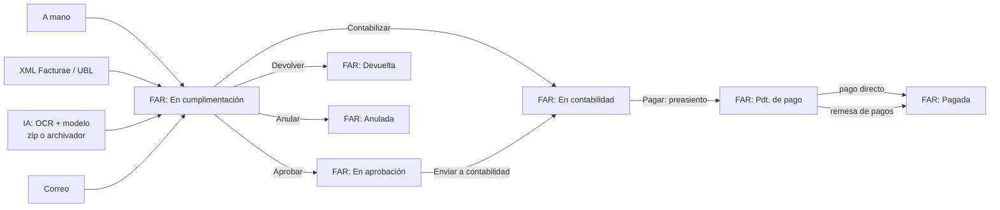
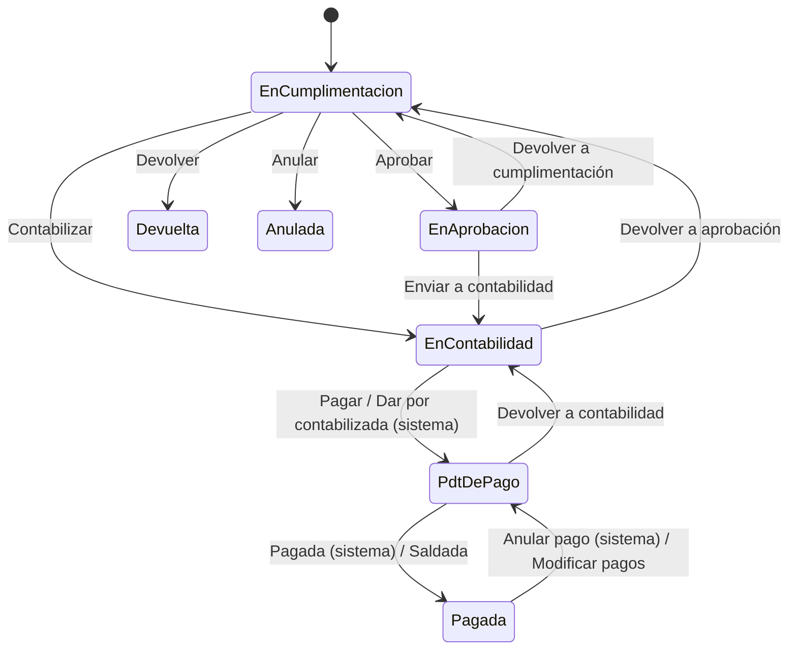
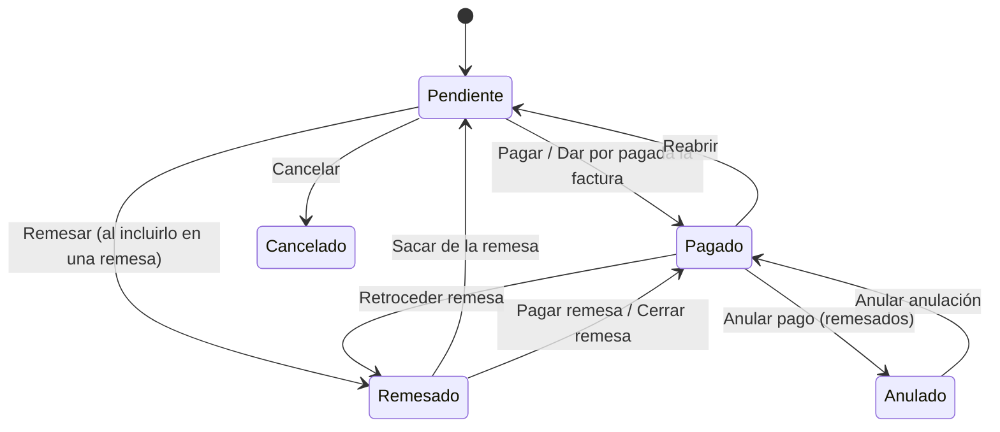
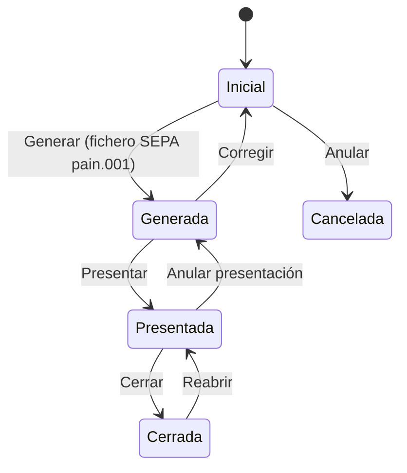

# Proceso de una factura recibida

Guía del circuito de una factura de proveedor. Empieza cuando la factura entra en Se10: a mano,
desde un XML o leída con IA de un pdf o una imagen. Sigue con la revisión, la aprobación y la
contabilidad, y termina cuando la factura está pagada, sea con un pago directo o con una remesa
de transferencias. Describe lo que **hace hoy Se10** y, al final, lo que falta o conviene revisar.

La relación con los pedidos y las entregas de almacén está en *Proceso de compra de materiales y
servicios*. Hoy la factura recibida no se concilia con lo recibido: ver la sección 7 de ese
documento.

## 1. Visión general

```
 A MANO (con o sin propuesta de la IA) ─┐
 XML (Facturae / UBL) ──────────────────┤
 IA POR LOTES (zip o archivador) ───────┼──► EN CUMPLIMENTACIÓN ──► EN APROBACIÓN ──► EN CONTABILIDAD ──► PDT. DE PAGO ──► PAGADA
 CORREO ────────────────────────────────┘    (revisar y completar)                     (fecha contable)    (preasiento)
                                                                                                │
                                         PAGO DIRECTO (contado, tarjeta, domiciliación, transferencia) ──┤
                                         REMESA DE PAGOS (SEPA pain.001) ─────────────────────────────────┘
```



## 2. Documentos que intervienen

| Documento | Negocio en Se10 | Qué recoge | Lo crea |
|---|---|---|---|
| Factura recibida | `FacturaRecibida` (`FacturaRecDtm`) | Proveedor, centro gestor, tipo, número, fechas (emisión, recepción, vencimiento, contable), base imponible, total a pagar, archivo de la factura, contrato o expediente | El usuario, la importación XML, la IA o el correo |
| Línea de factura | `LineaDeUnaFarDtm` | Clase (base imponible, IVA, IRPF), concepto, naturaleza, unidad, cantidad, base, IVA soportado o IRPF | El usuario, o se crean a partir de la cabecera, del XML o de lo que lee la IA |
| Archivo de la factura | `ArchivoDtm` vinculado | El pdf, la imagen o el XML original | El usuario, el zip o el archivador |
| Pago | `Pago` (`PagoDtm`) | Clase (contado, transferencia, remesa), modo (contado, tarjeta, domiciliación), importe, fechas (pagar el, pagado el), cuentas, justificante | El usuario, el alta de la factura (si se marca como pagada) o la transición *Saldada* |
| Remesa de pagos | `RemesaPag` (`RemesaPagDtm`) | Cuenta de pago, fechas (generada, presentada, pagar el, pagada el) y el fichero SEPA | El usuario |
| Pago de una remesa | `PagoDeUnaRemesaDtm` | Pago incluido, fecha de pago, fecha de anulación y motivo | El usuario, al incluir pagos en la remesa |
| Preasiento | `PreasientoDtm` de la factura y del pago | Asiento de gasto y asiento del pago | El paso a pago de la factura y el pago |

## 3. El proceso paso a paso

### Paso 1. La factura entra en Se10

Toda factura empieza en **FAR: En cumplimentación**. Hay cuatro formas de que entre.

#### 1a. Alta a mano

En *Facturas recibidas* se da de alta con:

- proveedor, centro gestor y tipo de factura;
- número de factura, fecha de emisión, fecha de recepción y vencimiento;
- base imponible y total a pagar;
- el **archivo de la factura** (pdf, imagen o XML);
- si procede, el contrato o el expediente al que se imputa.

Al **subir el archivo**, el visor puede proponer los datos. Si es un XML, lo lee directamente. Si
es un pdf o una imagen, lo analiza la **IA** que tenga configurada el usuario. Los datos
propuestos (proveedor, NIF, fechas, base, total, IVA, IRPF, número, concepto, forma de pago) se
vuelcan en el formulario para que el usuario los revise antes de guardar.

**Líneas desde la cabecera.** Si en el alta se indica cantidad, unidad, naturaleza, IVA (e IRPF
si lo hay), base y total, Se10 crea las líneas: base imponible, IVA e IRPF. Antes comprueba que
*total = base + IVA − IRPF*, dentro de la tolerancia `ToleranciaEnImportes`. Si el archivo es un
XML, las líneas se toman del XML.

**Factura ya pagada.** Si en el alta se marca como pagada, se crea a la vez un **pago al
contado**, por tarjeta o por domiciliación, con el justificante si se adjunta (paso 6).

#### 1b. Importar un XML

La opción **Importar factura XML** (`epImportarFarDesdeXml`) pide el proveedor, el centro gestor,
el tipo y el archivo.

- Admite **Facturae 3.2.x** y **UBL 2.1 / 2.5** (`ParsearFarXmlAJson`).
- Crea la factura con sus líneas (`CreadorDeFacturaJson`). Las líneas exentas, las de base con su
  IVA y la retención de IRPF salen del XML.
- Vincula el XML a la factura y lo **bloquea**, para que no se pueda cambiar.

Si el proveedor no existe, **Importar proveedor XML** lo da de alta antes, con los datos del
emisor del XML.

#### 1c. Leer pdf con IA, por lotes

Hay dos formas de lanzarlo:

| Desde | Cómo | Trabajo |
|---|---|---|
| Facturas recibidas | **Crear facturas con IA**: se sube un **zip** con los pdf o imágenes, y se indican centro gestor, tipo y, si se quiere, proveedor | *Crear facturas con Ia* (`TrabajosDeFacturasRec.CrearFarConIa`). Crea un archivador *Facturas a incorporar por IA* e importa en él el zip |
| Un archivador | **Procesar facturas con IA** sobre sus archivos (o los de una carpeta) | *Procesar facturas con IA* (`TrabajosDelSistemaDocumental.ProcesarFarConIa`), con un semáforo para no procesar el mismo archivador dos veces |

Por cada archivo del archivador:

1. Se salta si ya está vinculado a una factura viva o si está cancelado.
2. Se pasa por **OCR** (`ProcesadorOcr`) y por la **IA** configurada para el usuario.
   - Algunas IAs reciben el fichero directamente si admiten su tipo mime.
   - Otras reciben el texto del OCR.
   - El prompt admite reglas propias de la empresa, en el parámetro `IA_Prompt` de las facturas
     recibidas.
3. La IA devuelve un JSON con proveedor, NIF, número, fecha, vencimiento, concepto, base, IVA,
   IRPF y total. Con él se crea la factura (`ExtensorDeFacturasRec.CrearFactura`):
   - **Proveedor:** el indicado en el trabajo o, si no se indicó, se busca por NIF. Si no existe,
     **se crea** con la razón social, el NIF, el correo y el teléfono leídos.
   - **Número y fecha** son obligatorios. La fecha de recepción es la de hoy.
   - Se crea una **línea de base** con la unidad y la naturaleza por defecto (`FAR_Unidad_Medida`,
     `FAR_Naturaleza`).
   - Si *base + IVA − IRPF* cuadra con el total, se crea la **línea de IVA** con el IVA soportado
     del porcentaje calculado. Si hay retención, se crea también la **línea de IRPF**.
   - El archivo queda como archivo de la factura.
4. Si un archivo falla (NIF no válido, factura duplicada, la IA no lo lee...), se deshace solo esa
   factura y el error queda en el trabajo. El archivo se renombra con el prefijo `(pendiente)`
   para volver a procesarlo.

Las facturas creadas así quedan **en cumplimentación** para que alguien las revise. La IA propone
y la persona confirma.

#### 1d. Desde el correo

El importador de correo (`ImportarDelCorreo`) crea la factura con el número, la base y el total
que trae el mensaje. La fecha de recepción es la de hoy.

#### Reglas comunes a todas las altas

- **No se duplica una factura:** el número ha de ser único por proveedor y ejercicio
  (`ValidarNumeroDeFactura`).
- Fechas: la emisión no puede ser posterior a la recepción, y ninguna puede ser futura.
- El contrato, si lo hay, ha de estar vigente o en finalización, y ser del mismo proveedor.
- El expediente, si lo hay, ha de estar en ejecución o terminado.
- Se copia en la factura la dirección fiscal del proveedor.
- Si vence, se anota un evento de vencimiento en la agenda.
- Otras formas de alta: **Copiar** una factura (`CopiarFar`) y **Rectificar** una factura
  (`RectificarFar`), que crea la rectificativa vinculada a la original.

### Paso 2. Revisar y completar (FAR: En cumplimentación)

Mientras está en cumplimentación todo se puede modificar: cabecera, líneas, archivo e
imputaciones. Fuera de esta etapa ya **no se pueden cambiar** el proveedor, el número, las fechas,
la base, el total ni el archivo. Solo hay acciones concretas: cambiar el IVA, cambiar la
naturaleza, cambiar el asunto o imputar y quitar el contrato o el expediente.

Antes de pasar a aprobación o a contabilidad, la factura ha de estar **bien formada**
(`DimeSiEstaBien`):

- el CIF del proveedor ha de ser válido;
- ha de tener líneas;
- la base de las líneas ha de coincidir con la de la cabecera y con la declarada en el IVA;
- si hay varias bases y varios IVAs, cada IVA ha de poder emparejarse con su base;
- el total de las líneas ha de coincidir con el total a pagar;
- ha de tener **archivo de factura**;
- la fecha de emisión no puede ser anterior al año pasado;
- si es negativa, ha de indicar a qué factura rectifica (salvo que `FAR_PermitirFacturasNegativas`
  lo permita).

Salidas de esta etapa:

| Transición | A dónde | Para qué |
|---|---|---|
| **FAR: Aprobar** | En aprobación | Lo habitual: que la valide el responsable |
| **FAR: Contabilizar** | En contabilidad | Saltarse la aprobación |
| **FAR: Devolver** (con motivo) | Devuelta | La factura es errónea y se devuelve al proveedor. Es definitivo: no se reactiva, se crea de nuevo |
| **FAR: Anular** (con motivo) | Anulada | No procede. Es definitivo |

Al devolver o anular:

- se quitan el contrato y el expediente, salvo que los parámetros `FAR_Quitar_Contrato_Al_Anular`
  y `FAR_Quitar_Expediente_Al_Anular` digan lo contrario;
- los pagos al contado se cancelan;
- si hay un pago de otra clase, o con preasiento contabilizado, hay que cancelarlo antes.

### Paso 3. Aprobar (FAR: En aprobación)

- **FAR: Enviar a contabilidad** la pasa a contabilidad.
- **FAR: Devolver a cumplimentación** la devuelve para corregirla.

### Paso 4. Contabilidad (FAR: En contabilidad)

Al entrar en contabilidad (`AntesDeEnviarAContabilidad`):

- todas las líneas de base han de tener **naturaleza**;
- si es rectificativa, se decide su clase: **por diferencias** si cambia la base, **por
  sustitución** si no;
- si el proveedor está de baja, se avisa.

En esta etapa se indica la **fecha contable**. Si el parámetro `FAR_Al_Contabilizar_Indicar_Fecha`
está activo (por defecto, `S`), al pasar a pago se pone la de hoy si no se ha indicado.

Si la factura ya está pagada al llegar aquí, por ejemplo porque se pagó al contado en el alta, y
`FAR_Dar_Por_Contabilizada_Si_Pagada` está activo, pasa sola a pago y de ahí a pagada.

Salidas:

| Transición | A dónde |
|---|---|
| **FAR: Pagar** | Pdt. de pago. Genera el preasiento de gasto (paso 5) |
| **FAR: Devolver a aprobación** (*Rechazada por contabilidad*) | En cumplimentación. Borra la fecha contable. No se permite si tiene pagos confirmados posteriores a su alta |

### Paso 5. Preasiento de gasto

Al pasar a **Pdt. de pago** (`AntesDeEnviarAPagar`) se genera el preasiento de la factura
(`ExtensorDePreasientos.Preasentar(FacturaRecDtm)`). Se fecha en la **fecha contable**:

| Debe | Haber | Importe |
|---|---|---|
| **Gasto** de la naturaleza de cada línea | | Base por naturaleza |
| **IVA soportado** de cada tipo | | Cuota de cada IVA |
| | **Proveedor** (cuenta contable del proveedor) | Total a pagar: base + IVA − IRPF |
| | **IRPF** retenido | Retención de cada tipo |
| | **IVA repercutido ISP** (si hay inversión del sujeto pasivo) | Cuota ISP |

Requisitos:

- cada naturaleza ha de tener **cuenta de gasto**;
- ha de estar parametrizado el tipo de preasiento;
- la sociedad ha de usar preasientos de facturas recibidas.

Si la factura vuelve a contabilidad, aprobación o cumplimentación, el preasiento se anula.

### Paso 6. Pago directo

En el detalle de **Pagos** de la factura se crean los pagos. Una factura admite varios pagos
parciales.

| Clase / modo | Qué pide | Cuándo queda pagado |
|---|---|---|
| Contado, modo *contado* | — | Al crearlo: *pagado el* es hoy, si no se indica otra fecha |
| Contado, modo *tarjeta* | La tarjeta de la sociedad | Al aplicar *PAG: Pagar*. Se paga desde la cuenta de cargo de la tarjeta |
| Contado, modo *domiciliación* | La cuenta de la sociedad donde está domiciliado | Al crearlo. La factura ha de tener archivo |
| Transferencia | La cuenta de pago de la sociedad y la cuenta acreedora del proveedor | Al aplicar *PAG: Pagar*. Si no se indica, *pagado el* es *pagar el* más 2 días |
| Remesa | Nada: sin fecha de pago | Al pagarse la remesa (paso 7) |

Reglas (`ValidarFactura`, `AntesDePagar`):

- el pago ha de ser de la misma sociedad y del mismo proveedor que la factura;
- la factura ha de tener base y líneas;
- el importe no puede superar lo pendiente, con la tolerancia. En una rectificativa el pago es un
  **abono** negativo;
- **justificante:** si `PAG_Validar_Justificante_De_Pago` está activo (por defecto, `S`), un pago
  al contado o por transferencia necesita un archivo anexado para darse por pagado;
- *pagado el* no puede ser futuro. Si *pagar el* es futuro, se anota un evento de pago en la
  agenda;
- al darse por pagado se genera el **preasiento del pago**:

  | Debe | Haber | Importe |
  |---|---|---|
  | Proveedor (o gasto de la naturaleza, en pagos sin factura) | Cuenta del pago: banco, tarjeta o caja | Importe del pago |

Cierre automático:

- Si un único pago salda la factura y tiene justificante (`IntentarCerrarPagoDeFactura`), el pago
  se da por pagado solo.
- Cuando lo pagado salda la factura (`TrasPagar`), la factura pasa a **FAR: Pagada**, contando lo
  rectificado y lo ya devuelto.
- El trabajo diario **Actualización de facturas recibidas** pasa a pagadas las que están en pago
  y ya están saldadas.
- **FAR: Saldada** pasa a pagada a mano una factura pendiente de pago. Si falta algo por pagar,
  crea un pago al contado por lo pendiente y lo da por pagado. No se permite con pagos en curso.

Marcha atrás de un pago:

- **PAG: Reabrir** (con motivo) devuelve el pago a pendiente y anula su preasiento. La factura
  vuelve a **Pdt. de pago** (*FAR: Anular pago*).
- **PAG: Cancelar** cancela un pago pendiente que no esté remesado ni pagado.

### Paso 7. Remesa de pagos (transferencias SEPA)

Los pagos de clase **Remesa** se agrupan en una remesa, que genera el fichero SEPA
*pain.001* de transferencias para el banco.

**7a. Alta (REM: Inicial)**

- Datos: centro gestor (y con él la sociedad), **cuenta de pago** y fecha *pagar el*.
  - La cuenta ha de ser de clase *Pago* o *Ambas*.
  - *Pagar el* no puede ser anterior a hoy.
- Se **incluyen los pagos**. Cada pago:
  - ha de ser de la misma sociedad;
  - ha de ser de clase *Remesa*;
  - ha de estar **pendiente** y sin pagar;
  - no puede estar en otra remesa.
- Al incluirlo el pago pasa a **PAG: Remesado**. Toma la cuenta de pago y la fecha *pagar el* de
  la remesa.
- Al excluirlo vuelve a **PAG: Pendiente**.

**7b. Generar (REM: Generada)**

- Exige que la remesa tenga pagos.
- Anota *Generada el*. Si no hay *pagar el*, lo calcula como la generación más
  `REM_DiasDeTransferencia` días (1 por defecto).
- Genera el fichero **SEPA pain.001** y lo anexa como original de la remesa.
- Crea en la agenda de la sociedad el **evento de pago**.
- **REM: Corregir** (con motivo) vuelve a *Inicial*: quita el fichero y borra las fechas.

**7c. Presentar (REM: Presentada)**

- El fichero se sube al banco (fuera de Se10) y se aplica **REM: Presentar**.
- *Pagar el* ha de ser al menos `REM_DiasDeTransferencia` días posterior a la presentación.
  Para presentar y pagar el mismo día, hay que poner ese parámetro a 0; el mensaje de error
  lo indica.
- **REM: Anular presentación** (con motivo) solo se permite si aún no hay pagos hechos ni
  anulados.

**7d. Pago: las facturas quedan pagadas**

- El trabajo diario **Procesos de remesas de pago** paga, el día *pagar el*, las remesas
  presentadas (`DarPorPagada`) y deja en la remesa la observación *Trabajo que la pagó*, con el
  enlace al trabajo.
- Pagarla en otra fecha (adelantar o pagar a mano) exige **perfil de interventor**.
- Cada pago de la remesa recibe su *pagado el* y pasa de remesado a **PAG: Pagado** (*PAG: Pagar
  remesa*). Se genera su **preasiento de pago**, igual que en un pago directo. Al quedar saldada,
  su factura pasa a **FAR: Pagada**.
- **Anular un pago** de la remesa ya pagada (con fecha y motivo) lo pasa a **PAG: Anulado**, anula
  su preasiento, y su factura vuelve a **Pdt. de pago**. Se usa cuando el banco rechaza una
  transferencia.
- **Anular la anulación** (con un motivo distinto del anterior) lo vuelve a pagado y lo preasienta
  de nuevo.
- **Retroceder el pago** de la remesa devuelve todos sus pagos a remesado, anula sus preasientos y
  blanquea *pagada el* y *pagar el*. Sin *pagar el*, el trabajo diario no la vuelve a pagar: se paga
  con **Dar por pagado** o al cerrarla con **REM: Cerrar**.
- Si un preasiento ya está contabilizado, no se puede anular ni retroceder el pago: antes hay que
  anular el lote contable. Lo que falta para estos casos está en la sección 9.1.

**7e. Cerrar (REM: Cerrada)**

- **REM: Cerrar** exige que haya llegado *pagar el*. Si no hay *pagada el*, se pone la de hoy.
- El mismo trabajo diario cierra las remesas **tres días después** de pagadas.
- **REM: Reabrir** (con motivo) la devuelve a *Presentada*.
- **REM: Anular** cancela una remesa inicial sin pagos.

Desde las remesas se puede **exportar** un conjunto de remesas con sus pagos.

## 4. Marcha atrás

| Situación | Cómo | Condiciones |
|---|---|---|
| Datos equivocados (proveedor, número, fechas, importes, archivo) | Devolver la factura a cumplimentación (*Devolver a cumplimentación* desde aprobación, *Devolver a aprobación* desde contabilidad) | Sin pagos confirmados posteriores a su alta |
| Factura de pago con error contable | *FAR: Devolver a contabilidad* | Se cancela el preasiento |
| La factura es errónea y la corrige el proveedor | *FAR: Devolver* (en cumplimentación) | Definitivo. Cancelar antes los pagos que no sean al contado |
| La factura no procede | *FAR: Anular* | Igual que devolver |
| Factura ya contabilizada con error de importe | **Rectificar** | Se crea la rectificativa vinculada, que sigue su propio circuito |
| IVA o naturaleza equivocados fuera de cumplimentación | *Modificar IVA* / *Modificar naturaleza* | Regenera el preasiento si hace falta |
| Pago equivocado | *PAG: Reabrir* o *PAG: Cancelar* | Reabrir anula su preasiento. Cancelar solo si no está pagado ni remesado |
| Pago incluido por error en una remesa | Excluirlo | Remesa en *Inicial* |
| Transferencia rechazada por el banco | Anular el pago en la remesa | Remesa presentada y pagada |
| Factura pagada que hay que reabrir | *FAR: Modificar pagos* (con motivo) | Vuelve a pdt. de pago |

## 5. Estados de la factura recibida



| Etapa | Estado | Qué se puede hacer |
|---|---|---|
| `FAR_Etapa_De_Cumplimentacion` | FAR: En cumplimentación | Modificar todo, aprobar, contabilizar, devolver, anular |
| `FAR_Etapa_De_Aprobacion` | FAR: En aprobación (y en cumplimentación) | Enviar a contabilidad, devolver a cumplimentación |
| `FAR_Etapa_De_Contabilizacion` | FAR: En contabilidad | Indicar la fecha contable, pagar, rechazar |
| `FAR_Etapa_De_Pago` | FAR: Pdt. de pago | Crear y pagar pagos, remesar, saldar, devolver a contabilidad |
| `FAR_Etapa_Pagada` | FAR: Pagada | Consulta. Modificar pagos |
| `FAR_Etapa_Devuelta` | FAR: Devuelta | Consulta (no reactivable) |
| `FAR_Etapa_Anulada` | FAR: Anulada | Consulta (no reactivable) |

## 6. Estados del pago y de la remesa de pagos





Los abonos (pagos negativos) tienen su propio circuito: *ABO: Pendiente*, *ABO: Abonado* y
*ABO: Cancelado*.

## 7. Resumen contable

| Hecho | Debe | Haber | Importe |
|---|---|---|---|
| Factura a pago (fecha contable) | Gasto de la naturaleza + IVA soportado | Proveedor (+ IRPF retenido, + IVA repercutido ISP) | Total de la factura |
| Pago directo (contado, tarjeta, domiciliación, transferencia) | Proveedor | Banco / tarjeta / caja | Importe del pago |
| Pago por remesa (al pagarse la remesa) | Proveedor | Banco de la cuenta de pago de la remesa | Importe del pago |
| Rectificativa | Igual que la factura, con importes negativos | | Total rectificado |

## 8. Trabajos del sistema

| Trabajo | Cuándo | Qué hace |
|---|---|---|
| Crear facturas con Ia | A petición, con un zip | Importa el zip en un archivador y crea una factura por archivo leído con OCR e IA |
| Procesar facturas con IA | A petición, sobre un archivador | Igual, sobre los archivos de un archivador o carpeta existente |
| Actualización de facturas recibidas | Diario | Pasa a pagadas las facturas en pago ya saldadas |
| Procesos de remesas de pago | Diario | Paga las remesas presentadas el día *pagar el* y, en ejecuciones posteriores, las cierra tres días después de pagadas |

## 9. Lo que falta o conviene revisar

| Pieza | Estado |
|---|---|
| Altas a mano, por XML, con IA (visor y lotes) y por correo | Hecho |
| Aprobación, contabilidad y preasiento de gasto | Hecho |
| Pagos directos con justificante y su preasiento | Hecho |
| Remesa de pagos SEPA pain.001: generar, presentar, pagar, anular, cerrar | Hecho |
| **Conciliación con pedidos y entregas** | **Por hacer**: ver *Proceso de compra de materiales y servicios*, sección 7 |
| Preasiento de los pagos por remesa | Hecho: cada pago se preasienta al darse por pagado en la remesa, o al anular su anulación. El preasiento se anula al retroceder el pago de la remesa o al anular el pago. Los pagos remesados anteriores a este cambio no tienen preasiento: se generan con *Generar preasiento* |
| Pago de remesa con pagos ya pagados | Hecho: se saltan los ya pagados o anulados y se pagan los demás |
| Trabajo diario de remesas de pago | Hecho: ya no deja la transacción abierta. Una remesa que se paga en una ejecución se cierra en una ejecución posterior |
| Días de transferencia del pago directo | **Revisar.** `AntesDePagar` toma los días con `enumParametrosDeRemesasFae.REM_DiasDeEsperaDeCargo` sobre el negocio de pagos (2 por defecto). Parece un parámetro prestado de las remesas de cobro |
| Lectura de devoluciones del banco | Manual: no se leen ficheros de rechazo de transferencias |
| **Anulación de un pago ya contabilizado** | **Por hacer, ver 9.1.** Hoy da error si su preasiento está contabilizado, y solo se puede seguir anulando el lote contable o eliminando su cierre |

### 9.1. Por hacer: anulación de pagos ya contabilizados

**Objetivo.** Poder dar marcha atrás a un pago cuyo preasiento ya está contabilizado, de forma que la
factura vuelva a estar pendiente de pago y la cuenta del banco cuadre con el banco.

**Situación actual.** Si el preasiento del pago está contabilizado, no se puede anular ni retroceder
el pago: da error. El preasiento contabilizado no se puede cancelar.

**Qué se hará.** En ese caso, se creará un **registro de pago anulado** asociado a la factura.

| Momento | Qué pasa |
|---|---|
| Al crear el registro | Se genera en ese momento su preasiento, un **contraasiento** del pago (*Debe banco / Haber proveedor*). La factura vuelve a tener ese importe pendiente y pasa a **FAR: Pdt. de pago** |
| Con su preasiento sin contabilizar | Se puede eliminar el registro. Su preasiento se cancela y la factura vuelve a darse por **pagada** |
| Con su preasiento contabilizado | El registro ya no se puede eliminar |

El pago original no cambia: sigue pagado y con su preasiento contabilizado.

Si el pago no está contabilizado, nada cambia: se anula o retrocede y se cancela su preasiento.

**Por confirmar antes de empezar**

- **Cómo se crea el registro:** automáticamente al anular el pago, o con una opción propia.
- **Qué pagos cubre:** los de remesa y también los directos, que al reabrirse dan el mismo error.
- **Retroceder el pago de una remesa:** hoy, si un solo preasiento está contabilizado, no se retrocede
  ninguno. Hay que decidir si se crea un registro por cada pago contabilizado o si se siguen anulando
  uno a uno.
- **Cómo se vuelve a pagar la factura:** con un pago nuevo, o de otra forma.
- **Fecha del contraasiento:** se propone la de la anulación. Si es anterior al último cierre, tomaría
  la fecha de ese cierre, como los demás preasientos nuevos.
