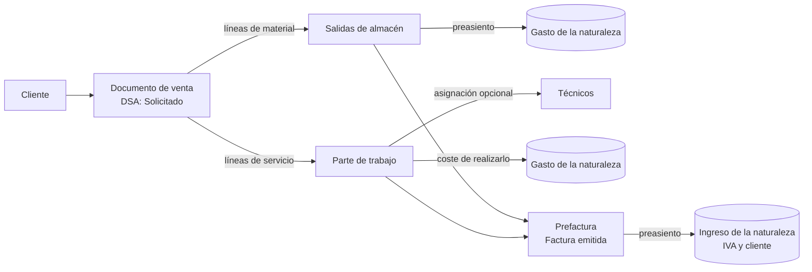
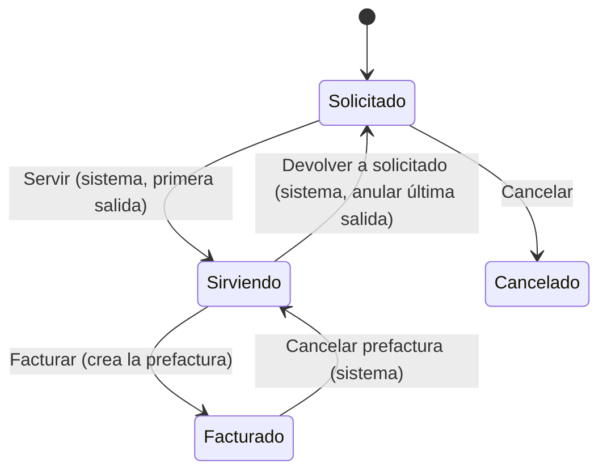

# Proceso de venta de materiales y servicios

Guía del circuito completo desde que un cliente pide algo (material, servicio o ambos) hasta que se
le factura. Describe el **proceso objetivo**; al final se indica qué parte existe ya en Se10 y qué
queda por construir.

## 1. Visión general

```
CLIENTE ──► SOLICITUD ──► DOCUMENTO DE VENTA ──┬──► SALIDAS DE ALMACÉN  (materiales)  ──┐
                          (DSA: Solicitado)    │                                         ├──► PREFACTURA ──► FACTURA
                                               └──► PARTE DE TRABAJO    (servicios)   ──┘
```



La **solicitud del cliente es el propio documento de venta mientras está en la etapa de solicitud**
(`DSA: Solicitado`): no hay un documento intermedio.

## 2. Documentos que intervienen

| Documento | Negocio en Se10 | Qué recoge | Lo crea |
|---|---|---|---|
| Documento de venta | `Venta` (`LOGISTICA.VENTA`) | Cliente, almacén, fecha de solicitud, líneas de unitarios (cantidad, precio de venta, descuento) | El usuario, al recibir la petición del cliente |
| Salida de almacén | Movimiento de almacén de tipo *Venta de materiales* (clase *Salida*) | Material, cantidad y su valor al PMP de la fecha de la salida | El proceso de servir, por cada línea de material |
| Parte de trabajo | `ParteDeTrabajo` (`ParteTrDtm`) | El servicio que hay que prestar, sus líneas y las asignaciones a técnicos | El proceso de servir, con las líneas que no son material |
| Prefactura / factura | `FacturaEmitida` (`FacturaEmtDtm`) | Lo servido (materiales) y lo realizado (partes) | La transición *Facturar* del documento de venta |

**¿Qué línea va a dónde?** Lo decide la **clase de la naturaleza** del unitario de cada línea
(`enumClaseUnitario`):

| Clase de la naturaleza | Destino |
|---|---|
| `Material` | Salida de almacén |
| `ManoDeObra`, `Servicio` | Parte de trabajo |

## 3. El proceso paso a paso

### Paso 1. El cliente solicita: alta del documento de venta

- Se da de alta el documento con el **cliente**, el **almacén** desde el que se servirá el material
  y la **fecha de solicitud**. El centro gestor se toma del almacén.
- Se añaden las líneas: unitario, cantidad, precio de venta y descuento.
- En cada línea se ve el **precio de almacén** (PMP del material a la fecha de solicitud) y el
  **margen** sobre el precio neto. Un margen negativo significa que se vende por debajo del coste.
- Estado: **DSA: Solicitado**. Las líneas solo se pueden modificar en esta etapa.
- Desde aquí se puede **Cancelar** (DSA: Cancelado), indicando el motivo.

### Paso 2. Procesar la solicitud

Al procesar, el documento de venta se reparte en dos caminos según la clase de cada línea.

**2a. Materiales: salidas de almacén**

- Por cada línea de material se crea un movimiento de salida en el almacén del documento.
- La salida **se valora al PMP vigente en la fecha del movimiento**; no cambia el PMP, solo reduce
  el stock. Si no hay stock suficiente, la salida no se puede hacer.
- La **primera salida** ejecuta la transición del sistema **Servir**: el documento pasa a
  **DSA: Sirviendo** y se rellena *Servido el*.

**2b. Servicios: parte de trabajo**

- Con las líneas que no son material se crea un **parte de trabajo** para el mismo cliente.
- El parte se puede **asignar a uno o varios técnicos** (asignaciones con fechas planificadas,
  inicio, fin y duración) o realizarse sin asignar.

### Paso 3. Contabilidad de la salida de almacén

Cada salida genera un **preasiento** del negocio de almacén por *cantidad × PMP a la fecha de la
salida*:

| Debe | Haber |
|---|---|
| Cuenta de gasto de la naturaleza del material | Cuenta del almacén (existencias) |

### Paso 4. Realización del servicio

- Los técnicos realizan el trabajo y el parte avanza hasta su etapa de *pendiente de facturar*.
- Lo que nos cuesta realizarlo (horas, desplazamientos, subcontratas...) es **gasto**, y va a la
  **cuenta de gasto de la naturaleza** del servicio.

### Paso 5. Prefactura

- Con el documento en **DSA: Sirviendo**, la transición **Facturar** crea la **prefactura**: una
  factura emitida en borrador para el cliente.
- En ella se incluyen:
  - las **líneas de material servidas** del documento de venta, al precio de venta y con el descuento;
  - los **partes de trabajo** del documento. Hoy, un parte se incluye como una línea alzada
    *"Parte de trabajo: &lt;referencia&gt;"* por el total del parte.
- El documento queda vinculado a la factura (*Factura emitida*) y pasa a **DSA: Facturado**.

### Paso 6. Factura

- Se emite la factura y se genera su preasiento de ingresos:

| Debe | Haber |
|---|---|
| Cliente | Cuenta de ingreso de la naturaleza de cada línea |
| | IVA repercutido |

- El **margen real** del documento es *ingresos facturados − (gasto de las salidas + gasto de los
  partes)*.

## 4. Marcha atrás

| Situación | Transición | Resultado |
|---|---|---|
| Se anula la **última** salida de almacén del documento | *Devolver a solicitado* (del sistema) | Vuelve a **DSA: Solicitado** y se puede volver a editar |
| Se **cancela la prefactura** | *Cancelar prefactura* (del sistema, desde el extensor de facturas emitidas) | Vuelve a **DSA: Sirviendo** y se desvincula la factura |
| El cliente desiste antes de servir | *Cancelar* | **DSA: Cancelado** |

## 5. Estados del documento de venta



| Etapa | Estado | Qué se puede hacer |
|---|---|---|
| `DSA_Etapa_Solicitud` | DSA: Solicitado | Editar las líneas, procesar, cancelar |
| `DSA_Etapa_Servicio` | DSA: Sirviendo | Servir más material, realizar partes, facturar |
| `DSA_Etapa_Facturacion` | DSA: Facturado | Solo consulta, salvo que se cancele la prefactura |
| `DSA_Etapa_Cancelacion` | DSA: Cancelado | Solo consulta |

## 6. Resumen contable

| Hecho | Debe | Haber | Importe |
|---|---|---|---|
| Salida de material | Gasto de la naturaleza del material | Almacén (existencias) | Cantidad × PMP a la fecha de la salida |
| Coste de realizar el servicio | Gasto de la naturaleza del servicio | Proveedor / personal / caja... | Lo que cueste |
| Factura al cliente | Cliente | Ingreso de la naturaleza + IVA repercutido | Total facturado |

## 7. Qué existe hoy en Se10 y qué falta

| Pieza | Estado |
|---|---|
| Documento de venta: alta, líneas, estados, transiciones, precio almacén y margen | Hecho (falta aplicar la migración) |
| Procesar la solicitud: crear las salidas y el parte desde las líneas | **Por hacer** |
| `Servir`, `DevolverASolicitado`, `CrearPrefactura`, `CancelarPrefactura` | Métodos preparados con `// TODO` en `ExtensorDeVentas` |
| Movimiento de salida de almacén al PMP | Hecho (`CalcularInventarioSalida`) |
| Preasiento de la salida por venta | **Por hacer**: `PreasentarSalidaDelmacen` hoy solo preasienta las devoluciones de compra |
| Parte de trabajo y asignación a técnicos | Hecho |
| Gasto de realizar un parte | **Por definir**: el parte no tiene hoy un concepto de coste |
| Incluir un parte en una factura emitida | Hecho (`IncluirParteEnFactura`, como línea alzada) |
| Incluir las líneas de material del documento de venta en la factura | **Por hacer** |
| Llamar a `CancelarPrefactura` desde el extensor de facturas emitidas | **Por hacer** |

## 8. Puntos a decidir antes de programar

1. **No duplicar el gasto del material.** Hoy la **entrada** de compra ya carga la *cuenta de gasto
   de la naturaleza* contra la cuenta de albaranes. Si además la **salida** carga gasto, el material
   cuenta dos veces como gasto. Hay dos opciones coherentes:
   - la entrada va a una cuenta de **existencias** (3xx) y la salida pasa de existencias a gasto (es
     lo que describe esta guía);
   - la entrada sigue yendo a gasto y la salida **no** genera preasiento; la diferencia de stock se
     ajusta al cierre con la variación de existencias.
2. **Vínculo entre parte y documento de venta.** `ParteTrDtm` no tiene ahora referencia al
   documento de venta. Hace falta un `IdVenta` en el parte (o en sus líneas) para saber qué partes
   facturar con cada documento.
3. **Cómo se mide el coste de un parte**: horas de las asignaciones × coste del técnico, gastos
   imputados (facturas recibidas, tickets) o ambos.
4. **Servicio parcial.** Si no hay stock de todo, ¿se sirve lo que hay y el resto queda pendiente,
   o no se procesa hasta tener todo?
5. **Cuándo se puede facturar**: ¿hace falta que todos los partes estén en su etapa de pendiente de
   facturar, o se puede facturar el material y dejar los partes para otra factura?
6. **Cómo aparecen las líneas en la factura**: una línea por cada línea de material del documento o
   una línea alzada por documento, igual que con los partes.
7. **Precio de almacén frente a coste real.** El margen de las líneas se calcula con el PMP a la
   fecha de **solicitud**, pero la salida se valora al PMP de la fecha de la **salida**. Si entre
   ambas hay compras, el coste real y el margen final pueden ser distintos de los mostrados.
