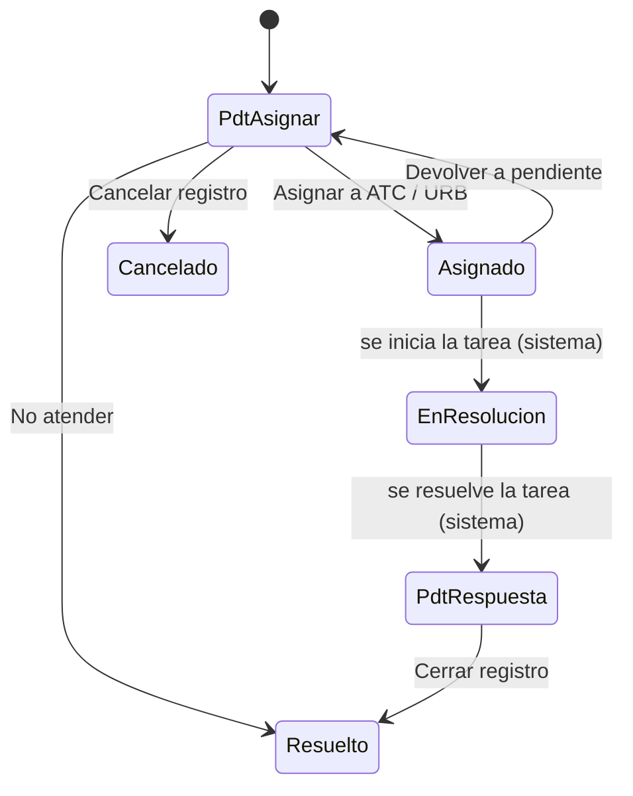

# Gestión de registros de entrada y salida

El registro de entrada/salida recoge las **peticiones que llegan a la organización** (y lo que sale de ella). Un administrativo asigna
cada entrada al **servicio** que ha de resolverla; al hacerlo se crea una **tarea de resolución** y el puesto de trabajo del servicio
recibe permiso de consulta. El registro avanza solo a medida que se mueve su tarea.

## El ciclo de vida de un registro de entrada (resumen del flujo)

El detalle está en la ayuda del proceso (el **?** de la ficha *Registros de E/S* del panel de control).

| Estado | Qué significa |
|---|---|
| **Pendiente de asignar** | Recién registrado. |
| **Asignado a ATC / URB** | En el servicio, con su tarea de resolución creada. |
| **En resolución** | La tarea de resolución está iniciada. |
| **Pdt de respuesta** | Resuelto internamente; falta contestar al interesado. |
| **Resuelto** / **Cancelado** | Finales. |

## ¿Cómo hago...?

### ...para registrar una entrada?

**Crear**: interesado, asunto y documentación (anexe los archivos en el visor).

### ...para enviarla al servicio que la resuelve?

Aplique **Asignar a ATC** o **Asignar a URB**: se crea la tarea *TRR: Resolución de REE* en el centro gestor del servicio. Si se asignó
mal, **Devolver a pendiente**. Si no procede, **No atender** o **Cancelar registro**.

### ...para ver la tarea de resolución?

Menú de relaciones → **Tarea de resolución**. Filtro **Elementos relacionados** → *Tarea* (con / sin, y por tipo de tarea).

### ...para cerrar el registro?

Cuando esté en **Pdt de respuesta** y se haya contestado, **Cerrar registro**.

Los registros también se asocian a expedientes, contratos y pleitos (*Asociar registro de E/S* en esas vistas).

---

#### Detalle técnico

- Controlador: `RegistrosEsController` (Controllers/RegistroEs). Vista: `Views/Administracion/CrudRegistrosEs.cshtml`. Dto:
  `RegistroEsDto`.
- Descriptor: `DescriptorDeRegistrosEs`: relación *Tarea de resolución* y bloque *Elementos relacionados*.
- Flujo: `wwwroot/ayuda/procesos/RegistroEs/RegistroEs_REE_General.md`; tarea `wwwroot/ayuda/procesos/Tarea/Tarea_TRR_Resolucion_de_REE.md`.
- ts: `wwwroot/ts/Administracion/RegistrosEs.ts`.
