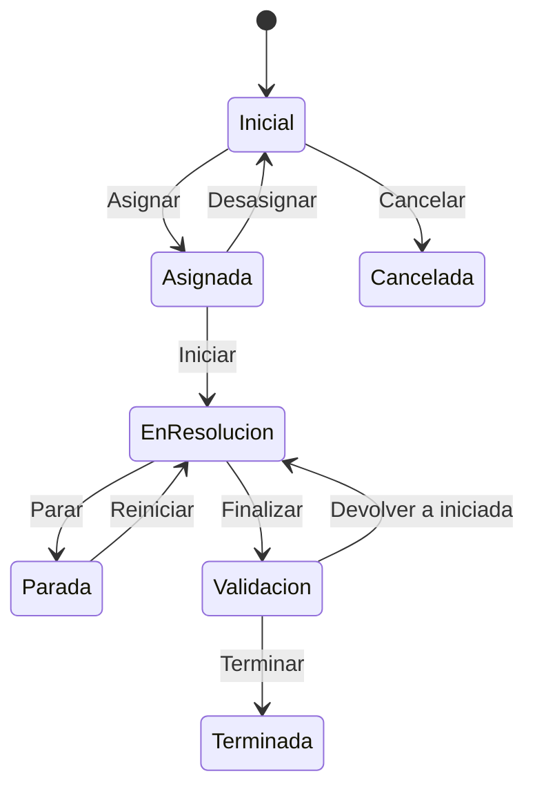

# Gestión de tareas

Una tarea es un **trabajo a realizar** que se asigna a un **responsable**, se planifica (cuándo iniciarla y cuándo terminarla), se
resuelve y se valida. Puede pertenecer a un expediente o a un presupuesto, venir de un registro de entrada, y las facturables se
incluyen en facturas emitidas (*Facturar tareas*). Las tareas se pueden **encadenar** (una se realiza antes o después que otra).

## Tipos de tarea y su ciclo de vida

Cada tipo tiene su flujo; el detalle de cada uno está en la ayuda del proceso (el **?** de la ficha *Tareas* del panel de control):
**PLF: Tarea planificada**, **SSII: Evolutivo**, **SSII: Correctivo**, **SSII: Soporte** (facturable), **TRR: Resolución de REE** (al asignar
un registro de entrada a un servicio). El flujo típico (correctivo / evolutivo):

| Estado | Qué significa |
|---|---|
| **Inicial** | Sin responsable. |
| **Asignada** | Con responsable y planificación. |
| **En resolución** | El responsable trabaja en ella (*Parada* si se detiene). |
| **En validación** | Finalizada por el responsable, pendiente de aceptar. |
| **Terminada** / **Cancelada** | Finales. |

## ¿Cómo hago...?

### ...para crear una tarea?

**Crear**: tipo, centro gestor, solicitante, nombre y descripción; el **responsable** se puede indicar al crear o al asignarla. Complete
la **planificación** (fechas de inicio y fin, durabilidad) en su apartado de la edición.

### ...para crear una tarea a partir de otra?

Menú → **Crear y enlazar** (gestor): elija la tarea origen e indique cómo actúa la original (**ampliación, copia, enlazada**, o si la
nueva va **antes** o **después** que ella), el CG, el tipo, el solicitante y el nombre. Desde la edición, la tarea origen es la que se
edita y no se puede cambiar.

### ...para indicar el orden en que se hacen las tareas?

**Cuándo realizar** (menú de la edición): indique la **Tarea anterior** (se ha de ejecutar antes) y/o la **Tarea posterior**. Para
quitarla, **Eliminar cuándo realizar** (interventor). En validación, terminada o cancelada la secuencia ya no se puede eliminar.

### ...para ver las tareas que hay que hacer en unas fechas?

**Filtros de tareas**: *Iniciar El*, *Terminar antes del*, *Solicitante*; marque **Mostrar datos de planificación** para ver durabilidad y
ejecución. **Relaciones con las tareas**: responsable, expediente, presupuesto y factura (con / sin).

### ...para facturar tareas?

Las tareas facturables terminadas se incluyen en una prefactura con **Facturar tareas** desde *Gestión de facturas emitidas*. Filtre por
*factura* con la opción *sin* para ver lo pendiente de facturar.

### Otras opciones

**Mostrar totales** (menú contextual). En la edición, el apartado de **registros de E/S** vinculados.

---

#### Detalle técnico

- Controlador: `TareasController` (Controllers/Tarea). Vista: `Views/Administracion/CrudTareas.cshtml`. Dto: `TareaDto`.
- Descriptor: `DescriptorDeTareas`: bloques de filtros, ampliación de planificación, registros de E/S, modales *Seleccionar tarea origen*
  (`CopiarTareaDto`) y *Cuándo realizar la tarea* (`CuandoRealizarDto`), totales.
- Flujos: `wwwroot/ayuda/procesos/Tarea/*.md`.
- ts: `wwwroot/ts/Administracion/Tareas.ts`: bloquea el origen de la copia desde la edición, el responsable según estado/permisos,
  habilita *Cuándo realizar* / *Eliminar cuándo realizar* según la etapa y bloquea controles de la planificación.
