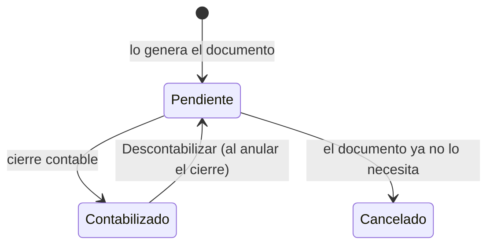

# Gestión de preasientos

Un preasiento es el **asiento contable que genera un documento** antes de pasar a la contabilidad: facturas recibidas (*GAS: Recibidas*),
pagos (*GAS: Pagos*), facturas emitidas (*ING: Emitidas*), cobros (*ING: Cobros*) y movimientos de almacén (*ALM: Almacén*). Queda
**pendiente** hasta que el **cierre contable** de la sociedad lo contabiliza (lo traspasa a la contabilidad en un lote contable). Los
preasientos no se crean ni se modifican a mano: los genera, cancela y regenera el documento de origen.

## El ciclo de vida (resumen del flujo)

El detalle está en la ayuda del proceso (el **?** de la ficha *Preasientos* del panel de control). Todos los tipos comparten flujo y sus
transiciones son del sistema:

| Estado | Qué significa |
|---|---|
| **Pendiente** | Generado por el documento; aún no está en la contabilidad. |
| **Contabilizado** | Incluido en un cierre (lote contable) ya traspasado. |
| **Cancelado** | El documento se canceló, volvió atrás o se regeneró el preasiento (se crea otro). |

Reglas importantes:

- Si la fecha del documento es **anterior al último cierre** de la sociedad, el preasiento se contabiliza con la fecha de ese cierre (lo
  anterior ya está cerrado). Las **facturas emitidas** no se ajustan (su fecha de devengo es la declarada a la AEAT): hay que eliminar el
  cierre.
- Un preasiento con fecha contable anterior al último cierre **no se puede crear, eliminar ni cancelar**: para el sistema está
  contabilizado. Por eso un documento antiguo ya no se puede retroceder si su preasiento está contabilizado.
- Mientras se ejecuta el cierre de una sociedad no se pueden crear, eliminar ni cancelar sus preasientos anteriores a la fecha de cierre.

## ¿Cómo hago...?

### ...para buscar un preasiento?

Filtro **Varios** con prefijos: `p:` preasiento, `r:` referencia, `c:` cuenta, `a:` apunte. Bloque **Datos de preasientos** para más
criterios.

### ...para ver el asiento de un documento?

Abra el preasiento: muestra sus apuntes (cuenta, debe, haber). Desde los movimientos de almacén, pagos y facturas también se llega con
la columna o el enlace *Preasiento*.

### ...para ver saldos por cuenta?

Seleccione los preasientos y, en el menú contextual, **Mostrar totales** (totales por cuenta de la selección).

### ...para contabilizar?

Con un **cierre contable** de la sociedad (*Cierres contables* → *Realizar cierre*). Un administrador puede además **contabilizar un
preasiento** suelto desde su edición.

---

#### Detalle técnico

- Controlador: `PreasientosController` (Controllers/Contabilidad). Vista: `Views/Contabilidad/CrudPreasientos.cshtml`. Dto:
  `PreasientoDto`.
- Descriptor: `DescriptorDePreasientos`: filtro *Varios*, bloque *Datos de preasientos*, totales por cuenta (las opciones de crear lote y
  regenerar están desactivadas).
- Reglas: `GestorDeCierresContables` (ajuste de fecha al último cierre, bloqueos durante el cierre). Flujos:
  `wwwroot/ayuda/procesos/Preasiento/*.md`.
- ts: `wwwroot/ts/Contabilidad/Preasientos.ts`: formatea el asiento y habilita *Contabilizar preasiento* sólo a administradores.
