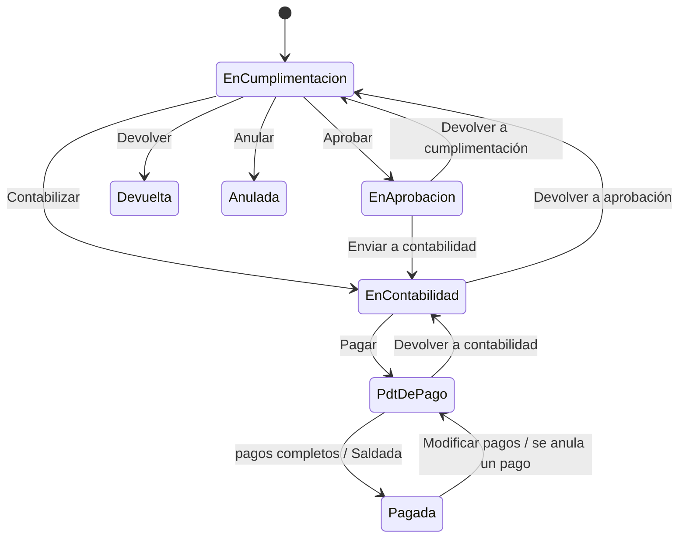

# Gestión de facturas recibidas

Facturas de proveedores. Entran en **cumplimentación** (a mano, importando una eFactura XML, leyéndolas con IA desde un zip o desde el
correo), se revisan y aprueban, se **contabilizan** generando su preasiento de gasto y se **pagan**, directamente o con una remesa de
pagos.

## El ciclo de vida de una factura recibida (resumen del flujo)

El detalle está en la ayuda del proceso (el **?** de la ficha *Facturas recibidas* del panel de control).

| Estado | Qué significa | Qué se puede hacer |
|---|---|---|
| **En cumplimentación** | Recién entrada. | Es el **único estado en que se modifica todo**: cabecera, líneas, archivo, imputaciones. |
| **En aprobación** | La revisa el responsable. | *Enviar a contabilidad* o *Devolver a cumplimentación*. |
| **En contabilidad** | Se indica la fecha contable. | *Pagar* (contabiliza) o *Devolver a aprobación*. |
| **Pdt. de pago** | Contabilizada, con preasiento. | Crear y realizar pagos, *Saldada*, *Devolver a contabilidad* (cancela el preasiento). |
| **Pagada** | Nada pendiente; archivada. | *Modificar pagos* para corregirlos. |
| **Devuelta** / **Anulada** | Definitivas: no se reactivan. | Sólo consulta; si procede, se crea otra. |

Qué exigen las transiciones manuales más usadas:

- **Aprobar** / **Contabilizar**: factura **bien formada**: CIF del proveedor válido, con líneas, bases y totales coherentes con la
  cabecera, **archivo de la factura** anexo, fecha de emisión no anterior al año pasado y, si es negativa, la factura que rectifica.
  Para ir a contabilidad, además, **naturaleza** en todas las líneas de base.
- **Pagar**: pone la fecha contable (hoy si no se indicó) y genera el **preasiento de gasto**; cada naturaleza necesita su cuenta de
  gasto. Si tiene un único pago al contado por el total, lo da por pagado y la factura queda pagada.
- **Saldada**: crea y da por pagado el pago de lo pendiente; no deja si hay pagos en curso.
- **Devolver** / **Anular** (en cumplimentación): piden motivo; quitan contrato y expediente y cancelan los pagos al contado; si hay otros
  pagos o con preasiento contabilizado, cancélelos antes.

## ¿Cómo hago...?

### ...para buscar una factura?

Filtro **Varios** con prefijos: `a:` asunto, `r:` referencia, `p:` proveedor, `f:` nº de factura del proveedor. Bloques: **Datos de las
facturas** (proveedor, base imponible, total, emitida, vence el, importe cobrado) y **Relaciones con las facturas** (expediente,
estimación directa, lote contable, contrato de compra, remesa).

### ...para dar de alta facturas?

- **Crear** a mano: proveedor, datos de la factura y líneas. Si se marca el pago al contado, se elige cuenta o tarjeta.
- Menú contextual → **Importar eFactura**: crea la factura desde el XML (Facturae / UBL). **Importar Proveedor** crea el proveedor desde el XML.
- Menú contextual → **Subir y crear facturas**: suba un **zip** con facturas (pdf/imágenes), el CG y el tipo propuestos; la IA las lee y
  crea las facturas en cumplimentación.
- Menú contextual → **Copiar factura**: a partir de otra factura o plantilla (CG, tipo, proveedor).
- **Rectificar factura**: crea la rectificativa de una factura indicando el nº de factura rectificativa del proveedor.

Después revise, anexe el archivo si falta y aplique *Aprobar* o *Contabilizar*.

### ...para pagar una factura?

En **Pdt. de pago**, apartado **Pagos** de la edición: cree el pago (clase, modo, importe) y, al realizarse, dé el pago por pagado. Cuando
los pagos cubren el total la factura pasa sola a **pagada**. También puede incluirla en una **remesa de pagos**. Para pagarla de una vez
sin ir creando pagos, **Saldada**.

### ...para corregir una factura ya contabilizada?

- Cambios menores: **Cambiar Datos** o **Cambiar Proveedor** (menú de la edición, interventor).
- Cambios de importes o líneas: devuélvala con **Devolver a contabilidad** (cancela el preasiento) y **Devolver a aprobación** hasta
  cumplimentación, corrija y vuelva a avanzarla.
- **Quitar expediente** / **Quitar contrato** (interventor).

### Opciones de administrador

**Generar preasiento** de una factura.

## Ver totales

Seleccione facturas y, en el menú contextual, **Mostrar totales**.

---

#### Detalle técnico

- Controlador: `FacturasRecController` (Controllers/Gastos). Vista: `Views/Gasto/CrudFacturasRec.cshtml`. Dto: `FacturaRecDto`.
- Descriptor: `DescriptorDeFacturasRec`: filtro *Varios*, bloques de filtro, ampliaciones de líneas y pagos, modales de copiar, crear con
  IA (zip), importar eFactura y proveedor, totales, cambiar datos y proveedor, rectificar.
- Reglas: `GestorDeFacturasRec` y `ExtensorDeFacturasRec` (factura bien formada, preasiento de gasto, pagos); parámetros
  `FAR_PermitirFacturasNegativas`, `FAR_Al_Contabilizar_Indicar_Fecha`, `FAR_Quitar_Pagos_Al_Anular`... Flujo:
  `wwwroot/ayuda/procesos/FacturaRecibida/FacturaRecibida_FAR_General.md`.
- ts: `wwwroot/ts/Gasto/FacturasRec.ts`: creación (contrato del proveedor, cuentas y tarjetas del pago al contado), clases de línea
  (bloquea IVA, IRPF, naturaleza, unidad y cantidad según la clase), rectificar sólo cuando procede, pagos sólo en pago.
