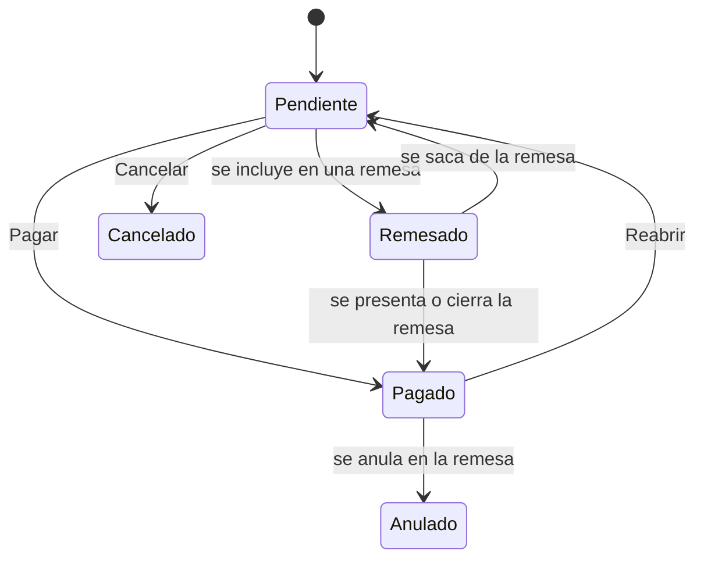

# Gestión de pagos

Un pago es una **salida de dinero** a un proveedor, trabajador o acreedor, normalmente para saldar una **factura recibida**. Puede ser
**de contado** (cuenta o tarjeta), **por transferencia** o formar parte de una **remesa de pagos**. Con el mismo negocio se gestionan
los **abonos** a clientes (devoluciones por facturas emitidas rectificativas), que tienen su propio flujo más corto.

Lo habitual es crear el pago desde el apartado *Pagos* de la factura recibida; aquí se consultan todos y se pueden crear sueltos.

## El ciclo de vida de un pago (resumen del flujo)

El detalle está en la ayuda del proceso (el **?** de la ficha *Pagos* del panel de control).

| Estado | Qué significa | Qué se puede hacer |
|---|---|---|
| **Pendiente** | Por pagar. | Es el **único estado en que se modifica**. *Pagar* o *Cancelar*. |
| **Remesado** | En una remesa de pagos. | Se paga con la remesa; sacarlo de la remesa lo devuelve a pendiente. |
| **Pagado** | Realizado, con preasiento. | *Reabrir* (si no está en remesa). |
| **Anulado** | Pago de remesa no ejecutado o devuelto por el banco. | Sólo desde la remesa. |
| **Cancelado** | No se realizó. | Sólo consulta. |

**Pagar** exige:

- importe no negativo ni mayor que el de la factura, medio de pago activo y naturaleza coherente;
- la factura con su detalle cumplimentado y, en pagos de contado o transferencia, un **justificante de pago** anexo (parámetro
  `PAG_Validar_Justificante_De_Pago`);
- en transferencia, cuenta deudora y acreedora (la fecha de pago se calcula con `REM_DiasDeEsperaDeCargo`); en contado, fecha de pago = hoy;
- no ser de clase remesa (esos se pagan con la remesa) ni tener fecha de pago futura.

Genera el **preasiento** y, si la factura queda sin pendiente, la pasa a **pagada**.

**Cancelar** pide motivo; no deja si está en una remesa o ya tiene fecha de pago; cancela su preasiento. **Reabrir** pide motivo, borra
la fecha de pago y anula el preasiento; la factura vuelve a pendiente de pago.

## ¿Cómo hago...?

### ...para pagar una factura recibida?

1. Abra la factura (en *Pdt. de pago*) y, en su apartado **Pagos**, cree el pago. Si la factura ya está saldada (pagos realizados y en
   curso por el total) no deja crear más.
2. Elija la **clase**:
   - **Contado**: elija el modo y la **cuenta** o **tarjeta** de pago.
   - **Transferencia**: cuenta deudora y cuenta del acreedor (se propone su cuenta de ingreso).
   - **Remesa**: se pagará con una remesa de pagos; la fecha *Pagar el* queda bloqueada.
3. Anexe el **justificante** y aplique **Pagar**.

### ...para ver qué hay que pagar en unos días?

Filtre por **Pagar El** entre fechas. **Pagado El** filtra lo ya pagado e **Importe a pagar** por importe. Otros filtros: acreedor,
factura recibida, cuenta deudora, tarjeta, remesa de pagos y lote contable.

### ...para abonar a un cliente (abono)?

Los abonos tienen tipo **ABO** y su flujo es *Pendiente → Abonado* (o *Cancelado*), con *Reabrir*. Al cancelar un abono, la factura
emitida abonada vuelve a emitida.

### Totales y opciones de administrador

**Mostrar totales** (menú contextual) de los pagos seleccionados. **Generar preasiento** (administrador).

---

#### Detalle técnico

- Controlador: `PagosController` (Controllers/Gastos). Vista: `Views/Gasto/CrudPagos.cshtml`. Dto: `PagoDto`.
- Descriptor: `DescriptorDePagos`: bloque *Filtro de pagos*, ampliación de remesas, totales, *Generar preasiento*.
- Flujos: `wwwroot/ayuda/procesos/Pago/Pago_PAG_General.md` y `Pago_ABO_General.md`.
- ts: `wwwroot/ts/Gasto/Pagos.ts`: según la clase de pago bloquea/blanquea modo, cuenta, tarjeta, cuenta acreedora y *Pagar el*;
  propone la cuenta de ingreso del acreedor; no deja crear pagos si la factura (o la devolución) ya está saldada.
