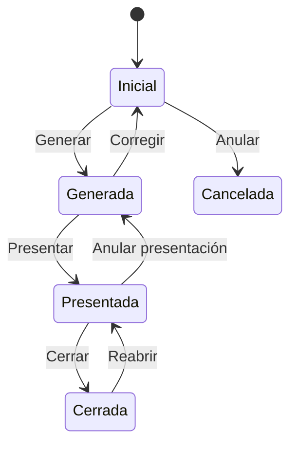

# Gestión de remesas de pago

Una remesa de pago agrupa **pagos a proveedores** para pagarlos en bloque por **transferencia SEPA**. Se crea, se le incluyen los pagos
(de clase *remesa*), se genera el fichero SEPA, se presenta al banco y, cumplida la fecha de pago, se cierra y los pagos quedan pagados.

## El ciclo de vida de una remesa de pago (resumen del flujo)

El detalle está en la ayuda del proceso (el **?** de la ficha *Remesas de pago* del panel de control).

| Estado | Qué significa | Qué se puede hacer |
|---|---|---|
| **Inicial** | Se está preparando. | Es el **único estado en que se modifica** y se **incluyen o excluyen pagos**. |
| **Generada** | Fichero SEPA pain.001 generado y anexado. | *Presentar* o *Corregir* (vuelve a inicial y quita el fichero). |
| **Presentada** | Enviada al banco. | *Adelantar pago*, *Retroceder pago*, anular pagos concretos, *Cerrar*. |
| **Cerrada** | Pagos realizados. | Sólo consulta; *Reabrir*. |
| **Cancelada** | Anulada. | Sólo consulta. |

- **Generar**: al menos un pago; si no tiene **fecha de pago** la calcula (generación + `REM_DiasDeTransferencia` días, 1 por defecto).
- **Presentar**: exige fecha de pago, al menos `REM_DiasDeTransferencia` días posterior a la presentación.
- **Anular presentación**: no deja si ya hay pagos realizados o anulados.
- **Cerrar**: sólo cumplida la fecha de pago; anota la fecha de pago realizado (hoy si no consta) y los pagos remesados pasan a **pagado**.
- **Anular** (inicial): pide motivo; no deja si tiene pagos.

La fecha de pago crea un **evento en la agenda** de la sociedad; si se cambia, se actualizan el evento y la fecha de los pagos.

## ¿Cómo hago...?

### ...para pagar varias facturas con una transferencia?

1. En cada factura recibida, cree el pago con clase **Remesa**.
2. **Crear** la remesa: sociedad (CG) y **cuenta de pago**.
3. En el apartado de **pagos**, **incluya los pagos**: misma sociedad, pagos remesables, **pendientes**, no incluidos en otra remesa ni ya
   pagados. Al incluirlos pasan a **remesado**.
4. **Generar** → descargue el fichero SEPA y envíelo al banco → **Presentar**.
5. Llegada la fecha, **Cerrar**: los pagos quedan pagados y, si las facturas quedan saldadas, pasan a pagadas.

### ...para dar la remesa por pagada antes de la fecha?

Menú de la edición → **Adelantar pago** (interventor, remesa presentada): indique la fecha *Pagada el*.

### ...para deshacer el pago de la remesa?

Menú de la edición → **Retroceder pago** (interventor, remesa presentada).

### ...para anular un pago que el banco no ejecutó?

En el apartado de **pagos** de la remesa presentada, edite el pago e indique la **fecha de anulación** y el **motivo** (obligatorio). No
puede ser anterior a la presentación; si la remesa aún no se ha pagado, hace falta permiso de interventor. El pago pasa a **anulado** y la
factura vuelve a pendiente de pago. Para deshacerlo, borre la fecha con un motivo distinto del anterior.

### ¿Por qué no puedo modificar la remesa?

Sólo se modifica en **inicial**; en los demás estados los datos y los pagos son de consulta (salvo las anulaciones en *presentada*). La
etiqueta de la fecha de pago indica *se pagará el*, *se debería haber pagado el* o *pagado el*.

## Filtros propios

**Datos de las remesas**: *Fec. de generación*, *Fec. de pago*, *Importe remesa*. **Relaciones con las remesas**: factura recibida, pago,
acreedor.

---

#### Detalle técnico

- Controlador: `RemesasPagController` (Controllers/Gastos). Vista: `Views/Gasto/CrudRemesasPag.cshtml`. Dto: `RemesaPagDto`.
- Descriptor: `DescriptorDeRemesasPag`: filtros, ampliación de pagos, modales *Pagar la remesa* (*Adelantar pago*) y *Retroceder pago*
  (interventor).
- Reglas: `GestorDeRemesasPag` y `GestorDePagosDeUnaRemesa` (incluir/excluir en cumplimentación, anulaciones en presentación). Flujo:
  `wwwroot/ayuda/procesos/RemesaPag/RemesaPag_REM_General.md`.
- ts: `wwwroot/ts/Gasto/RemesasPag.ts`: consulta fuera de cumplimentación, opciones de pago sólo a interventores en presentación,
  etiqueta de la fecha de pago y bloqueo de pago y fecha en la edición de los pagos de la remesa.
