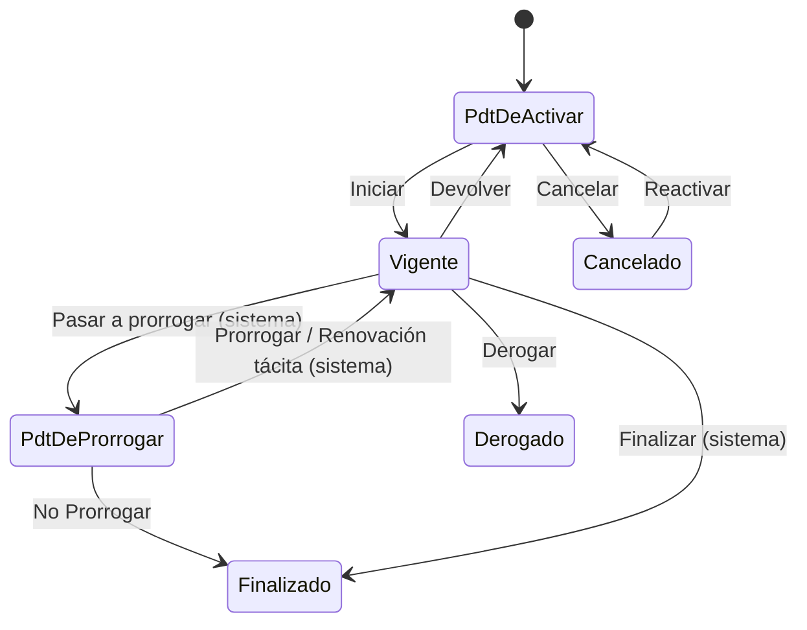

# Gestión de contratos

Un contrato recoge un acuerdo con un **cliente** (contrato de **venta** de servicios, tipo `CTV`) o con un **proveedor** (contrato de
**compra**, tipo `CTC`); las **matrículas de guardería** se gestionan también como contratos. Lleva sus fechas de inicio y fin, su
importe, adendas y bloqueos, prórrogas, avales y la información jurídica. A los de venta se les definen **planificadores de ventas**,
que generan planificaciones, partes de trabajo y prefacturas; a los de compra se les **imputan facturas recibidas**. El **avance** del
contrato acumula lo realizado, facturado y cobrado.

## El ciclo de vida de un contrato (resumen del flujo)

Venta (`CTV`) y compra (`CTC`) tienen el mismo flujo:

| Estado | Qué significa |
|---|---|
| **Pdt. de Activar** (elaboración) | Se está redactando. Aún no se le pueden imputar facturas. |
| **Vigente** | En vigor. Ha de tener **responsable**. |
| **Pdt. de prorrogar** | Ha llegado a su fin y es prorrogable: hay que decidir. |
| **Finalizado** / **Derogado** | Terminados. |
| **Cancelado** | No llegó a activarse; se puede *Reactivar*. |

El trabajo **Motor de contrato** aplica solo las transiciones según las fechas y la **prórroga** del contrato:

- **Iniciar** los contratos en elaboración cuya fecha de inicio ha llegado.
- Al llegar la fecha de fin: si **no es prorrogable**, **Finalizar**; si lo es, **Pasar a prorrogar**; y si la prórroga es **tácita**,
  **Renovación tácita** (vuelve a vigente "Prorrogado por el sistema").
- Avisa por correo a los responsables de lo que ha transitado y de lo que no ha podido transitar, y de los **avales** cuyo plazo ha
  vencido.

Otro trabajo avisa cuando el avance del contrato sobrepasa el **porcentaje de aviso**.

## ¿Cómo hago...?

### ...para crear un contrato?

**Crear** eligiendo el tipo (venta, compra o matrícula). Rellene después las ampliaciones de la edición:

- **Datos de venta** (cliente, inicio y fin) o **Datos de compra** (proveedor, inicio y fin).
- **Importes**: importe, adendado y bloqueo (información sobre importes, adendas y bloqueos del avance).
- **Prórrogas**: clase de prórroga (tácita, expresa o no prorrogable), última prórroga y meses.
- **Aval** (aval solicitado y recibido), **Minuta** (información jurídica), **Lotes**.

Al ponerlo vigente exige un **responsable**. Algunos datos (cliente/proveedor, fechas, importes, prórroga, aval) se bloquean según el
estado y los permisos.

### ...para asociar el contrato a un expediente?

Indique el expediente: ha de ser de la misma sociedad, estar en la etapa que admite asociar contratos y tener acceso a él. Cambiarlo
requiere permiso de interventor.

### ...para imputar facturas recibidas a un contrato de compra?

Seleccione **un** contrato y use **Imputar facturas** (interventor). No se puede con el contrato en elaboración ni cancelado.

### ...para generar el trabajo y la facturación de los contratos de venta?

Desde el menú contextual de la vista (permiso de gestor), cada opción pide un rango de fechas y actúa sobre los contratos vigentes:

1. **Generar planificaciones**: crea las planificaciones de venta de los planificadores pendientes entre esas fechas (también para un
   único contrato desde su menú).
2. **Crear partes de trabajo**: genera los partes de las planificaciones del periodo.
3. **Prefacturar partes de trabajo**: crea las prefacturas de los partes realizados en el periodo.
4. **Prefacturar contratos**: crea prefacturas por contrato.

Si con las fechas indicadas no se genera nada, se avisa (p. ej. *no hay contratos vigentes con planificaciones pendientes*).

En las **matrículas de guardería** las opciones son **Datos para facturar** y **Preparar facturación**.

### ...para ver lo relacionado con un contrato?

Menú de relaciones: **Facturas recibidas**, **Planificaciones**, **Partes de trabajo**, **Facturas emitidas**. En la edición, los apartados
de facturas emitidas (cobrado, pendiente) o recibidas (pagado), **Avances** y **Registros de E/S**.

## Filtros propios

**Filtros de contratos** (importe, responsable, expediente), **Filtros sobre ventas** (cliente, planificación, unitario...) y **Filtros
sobre compras** (proveedor...).

---

#### Detalle técnico

- Controlador: `ContratosController` (Controllers/Juridico). Vista: `Views/Juridico/CrudContratos.cshtml`. Dto: `ContratoDto`.
- Descriptor: `DescriptorDeContratos`: ampliaciones según la clase (venta, compra, matrícula de guardería), opciones de imputar facturas,
  generar planificaciones, crear partes, prefacturar, y los tres bloques de filtro.
- Reglas: `GestorDeContratos` (responsable si vigente, expediente, imputación, generación de planificaciones/partes/prefacturas) y
  `TrabajosDeContratos` (*Motor de contrato*, *Motor de planificador*, aviso de porcentaje). Etapas `enumEtapasDeContratos`; estados y
  transiciones en `Inicializador/Procesos/Jurídico/Contratos/InzContratosDeVenta.cs` e `InzContratosDeCompra.cs` (las automáticas,
  por motivo, en el parámetro `CTR_Aplicar_Transicion`).
- ts: `wwwroot/ts/Juridico/Contratos.ts`: bloqueo de controles de las ampliaciones (datos de venta/compra, saldos, aval, prórroga) y de
  la creación de lotes y planificadores según estado y permisos.
