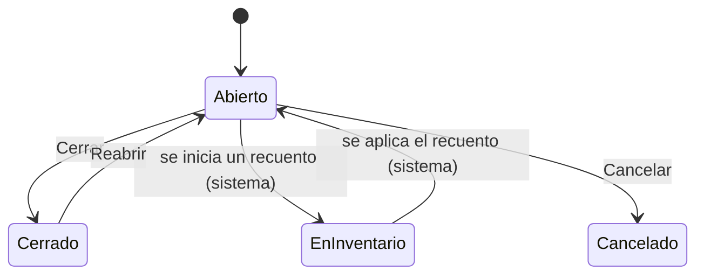

# Gestión de almacenes

Un almacén guarda existencias de materiales (unitarios). Todo lo que entra y sale (compras, ventas, devoluciones, regularizaciones...)
se registra como un **movimiento de almacén**, se valora a precio medio ponderado y se **preasienta** contra las cuentas del almacén.

## El ciclo de vida de un almacén (resumen del flujo)

El detalle está en la ayuda del proceso (el **?** de la ficha *Almacenes* del panel de control).

| Estado | Qué significa | Movimientos |
|---|---|---|
| **Abierto** | En uso. | Admite entradas y salidas. |
| **En inventario** | Se está recontando (regularización iniciada). | Rechaza los movimientos normales: sólo el stock inicial del inventario. |
| **Cerrado** | Sin actividad; se puede reabrir. | Ninguno. |
| **Cancelado** | Dado de baja. | Ninguno. |

*Cerrar* y *Cancelar* (pide motivo) no se pueden con una regularización en curso (iniciada o recontando).

## ¿Cómo hago...?

### ...para crear un almacén?

**Crear** e indique:

- **Cuenta de existencias** (grupo 30, 31 o 32). **Sin ella no se pueden preasentar sus movimientos.**
- **Usa variación de existencias**:
  - **Marcado**: las compras van a la **cuenta de compras** (600/601/602, o la de gasto de la naturaleza si no se indica) y las
    devoluciones a proveedor a la **cuenta de devoluciones** (608); las existencias se cuadran contra la **cuenta de variación**
    (610/611/612; si no se indica se deduce de la de existencias y se crea) en cada cierre contable.
  - **Sin marcar**: cada movimiento va directamente a la cuenta de existencias; las cuentas de compras y devoluciones se blanquean y
    bloquean.
- **Direcciones** del almacén.

### ...para ver lo que hay en un almacén?

Selecciónelo y, en el menú de relaciones, **Inventario** (existencias y valor a una fecha) o **Movimientos** (entradas y salidas).

### ...para comprar, vender o recontar en un almacén?

Menú de relaciones: **Compras**, **Ventas** o **Recuentos** abren esos mantenimientos con el almacén ya fijado en el filtro y propuesto
al crear (si no hay ninguno, pasa directamente a crear).

### ¿Por qué se rechaza un movimiento?

Porque el almacén no está **abierto** (está en inventario por un recuento iniciado, cerrado o cancelado).

---

#### Detalle técnico

- Controlador: `AlmacenesController` (Controllers/Logistica). Vista: `Views/Logistica/CrudAlmacenes.cshtml`. Dto: `AlmacenDto`.
- Descriptor: `DescriptorDeAlmacenes`: menú de relaciones *Compras*, *Ventas*, *Recuentos*, *Inventario*, *Movimientos*.
- Reglas: `ExtensorDeAlmacenes` (Servicios/GestorDeElementos/Extensores/Logistica). Flujo:
  `wwwroot/ayuda/procesos/Almacen/Almacen_ALM_General.md`.
- ts: `wwwroot/ts/Logistica/Almacenes.ts`: navegación con el almacén fijado (restrictor o selector) y blanqueo/bloqueo de las cuentas
  de compras y devoluciones según *Usa variación de existencias*.
