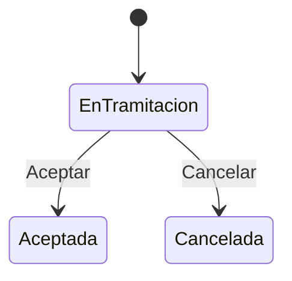

# Gestión de devoluciones de venta

Una devolución de venta recoge lo que un cliente devuelve de las líneas de sus **documentos de venta** ya servidos o facturados. Al
**aceptarla** el material vuelve a entrar en el almacén y se regularizan las facturas. Lo normal es crearlas desde el propio documento
de venta (icono *Devolver* de la línea); aquí se consultan todas y se pueden crear a mano.

## El ciclo de vida (resumen del flujo)

El detalle está en la ayuda del proceso (el **?** de la ficha *Devoluciones de venta* del panel de control).

| Estado | Qué significa | Qué se puede hacer |
|---|---|---|
| **En tramitación** | Se está preparando. Lo que lleva ya cuenta como devuelto, pero no ha entrado en el almacén ni se ha tocado ninguna factura. | Cambiar datos y líneas; *Aceptar* o *Cancelar*. |
| **Aceptada** | El material ha entrado en el almacén y las facturas están regularizadas. | Sólo consulta. |
| **Cancelada** | No se hace; lo que tenía deja de contar como devuelto. | Sólo consulta. |

**Aceptar** exige líneas y fija la fecha de la devolución (la indicada o hoy; no posterior a hoy ni anterior al servicio de las
ventas; si cae en un periodo cerrado se usa el día siguiente al cierre). Por cada línea crea una **entrada en el almacén** al precio al
que salió, la preasienta y genera el **pdf de la devolución**. Después regulariza las facturas:

- **Prefactura**: se le quita lo devuelto.
- **Factura emitida**: se crea una **prefactura rectificativa total** y, si no se ha devuelto todo, una **prefactura de sustitución** con lo
  que realmente se vende. Nunca se emite nada solo: hay que emitirlas desde *Facturas emitidas*.
- **Documento sin facturar**: nada; al facturarlo ya se descuenta lo devuelto.

## ¿Cómo hago...?

### ...para crear una devolución a mano?

1. **Crear** indicando el **cliente**.
2. En las líneas, elija el **Documento de venta** (del mismo cliente, servido o facturado): se cargan sus líneas. Elija el **Material**
   (la línea vendida); se propone la cantidad y se muestran el precio y el descuento de la venta, que no se pueden cambiar.
3. No se puede devolver más de lo que queda por devolver (lo vendido menos lo devuelto en otras devoluciones no canceladas).
4. **Aceptar** con la flecha de transitar.

### ...para devolver desde el documento de venta?

Ver el manual de *Gestión de documentos de venta*: icono **Devolver** de la línea y, después, check verde del apartado *Devoluciones*.

### ¿Por qué no puedo cambiar las líneas?

Sólo mientras la devolución está **en tramitación**.

### ¿Por qué no puedo emitir la factura del cliente?

Porque alguna de sus líneas vendidas tiene una devolución **pendiente de aceptar**: acéptela o cancélela antes.

---

#### Detalle técnico

- Controlador: `DevolucionesDeVentaController` (Controllers/Logistica; `epAceptarDevolucion`). Vista:
  `Views/Logistica/CrudDevolucionesDeVenta.cshtml`. Dto: `DevolucionDeVentaDto`.
- Descriptor: `DescriptorDeDevolucionesDeVenta`: ampliación de líneas (*Documento de venta*, *Material*).
- Reglas: `ExtensorDeDevolucionesDeVenta` (`ValidarLinea`, `AntesDeAceptar`, `RegularizarFacturas`). Flujo:
  `wwwroot/ayuda/procesos/DevolucionVenta/DevolucionVenta_DDV_General.md`. El tipo de devolución se indica en el tipo de documento de
  venta.
- ts: `wwwroot/ts/Logistica/DevolucionesDeVenta.ts`: carga las líneas del documento de venta elegido, propone cantidad, precio y
  descuento (no editables), calcula el importe y sólo deja cambiar líneas en tramitación.
