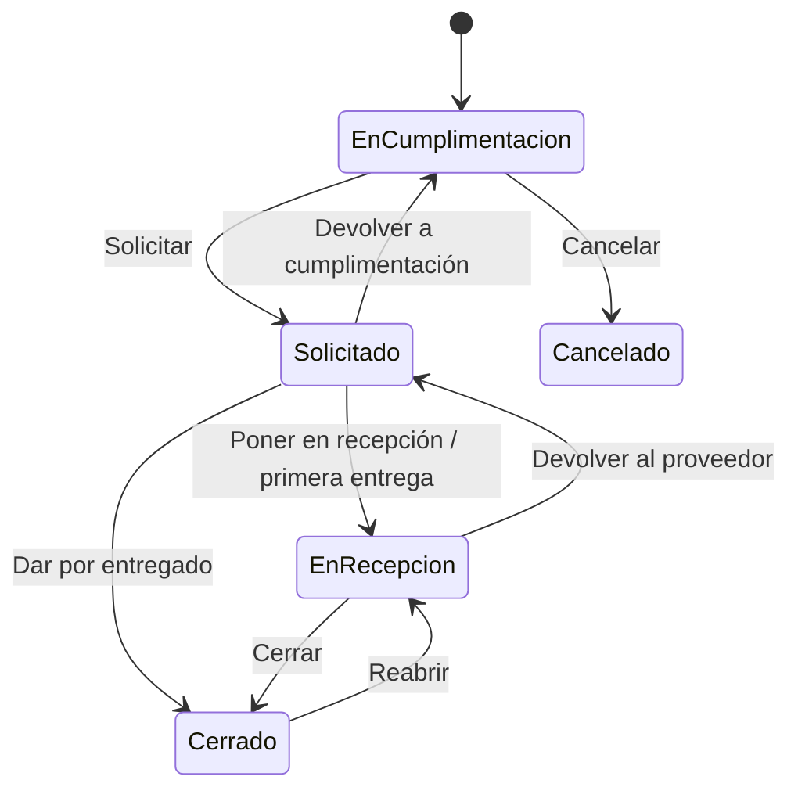

# Gestión de pedidos

Un pedido es la **compra de materiales o servicios a un proveedor**. Se cumplimenta (cabecera y líneas), se solicita al proveedor (se
genera y envía su pdf), se registran las **entregas** (que entran en un almacén o van a la obra de un expediente) y las **devoluciones**
al proveedor, y se cierra.

## El ciclo de vida de un pedido (resumen del flujo)

El detalle está en la ayuda del proceso (el **?** de la ficha *Pedidos* del panel de control).

| Estado | Qué significa | Qué se puede hacer |
|---|---|---|
| **En cumplimentación** | Se está preparando. | Es el **único estado en que se cambian cabecera y líneas**. *Solicitar* o *Cancelar*. |
| **Solicitado** | Enviado al proveedor, sin entregas. | Registrar entregas, *Dar por entregado*, *Devolver a cumplimentación*. |
| **En recepción** | Con entregas. | Más entregas, devoluciones, cancelar entregas, *Cerrar*, *Devolver al proveedor*. |
| **Cerrado** | Todo recibido. | Devoluciones; *Reabrir* para una entrega olvidada. |
| **Cancelado** | Ya no hace falta. | Sólo consulta. |

- **Solicitar**: exige el **destino** de las entregas (almacén o expediente) y, si es un almacén, sólo materiales del catálogo. Genera
  el **pdf del pedido** (firmado si la sociedad tiene certificado), salvo que haya subido uno propio, y **lo envía por correo al
  proveedor**. Los pedidos planificados los solicita un trabajo diario.
- **Devolver a cumplimentación**: pide el motivo; el pdf emitido se conserva renombrado como antiguo.
- **Devolver al proveedor** (en recepción → solicitado): exige **cancelar antes todas las entregas**.
- **Cancelar**: pide el motivo; sólo en cumplimentación.

## ¿Cómo hago...?

### ...para buscar un pedido?

El filtro de texto **Varios** admite prefijos: `n:` nombre, `r:` referencia, `p:` proveedor. En los bloques de filtro: **Datos del
pedido** (proveedor, unitario, importe, entregado, devuelto, fechas...) y **Relaciones con el pedido** (preasiento, lote contable...).

### ...para registrar una entrega?

Con el pedido **solicitado** o **en recepción**, en el apartado de **líneas**:

- **Visto verde** de la línea: entrega **todo lo pendiente** de la línea, al destino de la cabecera y con fecha de hoy, sin modal.
- **Recepcionar línea**: modal en la que indica lo realmente entregado (como mucho lo pendiente), el **destino** (almacén *o* expediente,
  sólo uno; sólo los de la sociedad del pedido) y la fecha (se propone hoy: una fecha anterior movería movimientos de almacén
  posteriores, quizá ya contabilizados).
- **Dar por entregado** (menú de la edición): recepciona todo lo pendiente de todas las líneas y cierra el pedido.

La primera entrega pasa el pedido a **en recepción**. Si el destino es un almacén se crea la **entrada en el almacén** con su preasiento;
si es la obra de un expediente, suma a sus gastos.

### ...para corregir una entrega?

Una entrega registrada sólo se consulta. Para cambiarla, **cancélela** desde el apartado **Entregas** (no puede tener devoluciones) y
vuelva a entregar la línea.

### ...para devolver material al proveedor?

Apartado **Entregas** → **Devolver entrega**: se propone lo que queda por devolver al precio y descuento de la entrega. Indique cantidad,
fecha (entre la entrega y hoy, no anterior al último cierre contable) y **motivo** (obligatorio). Las devoluciones se ven en el apartado
**Devoluciones**, se pueden cancelar (si salió del almacén se borra su salida) e **imprimir** (el pdf se anexa al pedido).

### ...para corregir fechas, el proveedor u otros datos ya solicitado?

**Modificar cabecera** en el menú de la edición (permiso de interventor): corrige, p. ej., la fecha de recepción o de cierre.

### Otras opciones

- **Copiar pedido**: crea uno nuevo a partir de este.
- **Quitar expediente** / **Quitar contrato** (interventor): desvincula el pedido.
- **Mostrar totales** (menú contextual): totales de los pedidos seleccionados.

---

#### Detalle técnico

- Controlador: `PedidosController` (Controllers/Logistica). Vista: `Views/Logistica/CrudPedidos.cshtml`. Dto: `PedidoDto`.
- Descriptor: `DescriptorDePedidos`: filtro *Varios*, bloques *Datos del pedido* y *Relaciones con el pedido*, ampliaciones de líneas,
  entregas y devoluciones, modales *Modificar cabecera*, *Recepcionar línea*, *Dar por entregado*, *Devolver entrega* y totales.
- Reglas: `ExtensorDePedidos` (destino en la sociedad del pedido), `ExtensorDeRecepciones` (`RegistrarRecepcion`,
  `DestinoDeLasEntregas`) y `ExtensorDeDevolucionesDePedido` (`ValidarDevolucion`, `ValidarFechaDeDevolucion`); trabajo
  `TrabajosDePedido.EnviarPedidosPlanificados`. Flujo: `wwwroot/ayuda/procesos/Pedido/Pedido_PED_General.md`.
- ts: `wwwroot/ts/Logistica/Pedidos.ts`: modales de recepción y devolución (proponen lo pendiente, validan cantidades y fechas, envían la
  versión de la entrega), almacenes de la sociedad, destino almacén *o* expediente, entrega completa con el visto verde.
