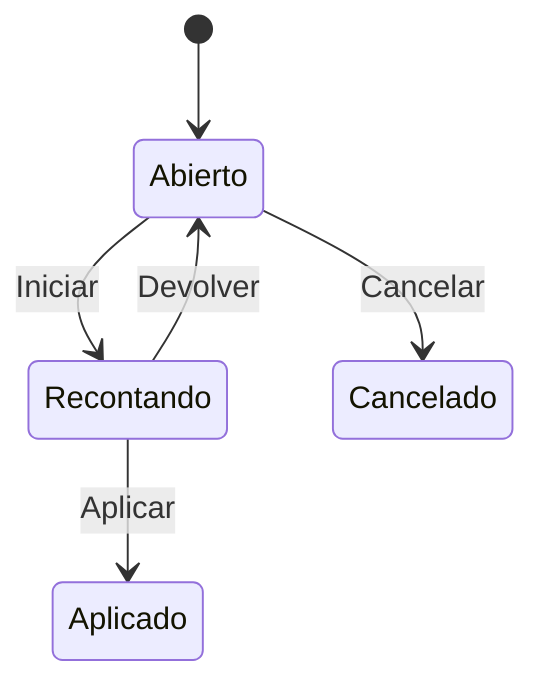

# Gestión de regularizaciones de almacén

Una regularización recoge un **recuento de existencias** de un almacén para cuadrar el stock y el valor con la realidad. Hay tres tipos,
con el mismo flujo:

- **Inventario Inicial** (`INV`): da de alta el stock inicial de un almacén.
- **Recuentos** (`RCT`): cuenta las existencias y regulariza las diferencias.
- **Ajustes de precio** (`APR`): corrige el precio de las existencias.

## El ciclo de vida (resumen del flujo)

El detalle está en la ayuda del proceso (el **?** de la ficha *Regularizaciones de almacén* del panel de control).

| Estado | Qué significa | Qué se puede hacer |
|---|---|---|
| **RAL: Abierto** | Creada, sin recuento. | *Iniciar* o *Cancelar*. |
| **RAL: Recontando** | El almacén está **en inventario** (bloqueado para los movimientos normales). | Añadir líneas a mano, **Importar recuento**, **Aplicar recuento**, *Devolver*. |
| **RAL: Aplicado** | Recuento aplicado; el almacén vuelve a abierto. | Sólo consulta. |
| **RAL: Cancelado** | No se hizo. | Sólo consulta. |

- Sólo puede haber **una regularización en curso por almacén** (se comprueba al crearla).
- **Iniciar**: el almacén ha de estar **abierto**; pasa a *en inventario*.
- **Devolver** (recontando → abierto): no deja si ya tiene líneas (bórrelas antes); el almacén vuelve a abierto.
- Mientras está en curso el almacén no se puede cerrar ni cancelar.

## ¿Cómo hago...?

### ...para hacer un recuento completo?

1. Desde el **Inventario** del almacén, menú contextual → **Preparar recuento**: recibirá por correo un Excel con el inventario de hoy
   (también se anexa al almacén). Rellene *Cantidad* (lo contado) y, si hace falta, *Precio*.
2. **Crear** la regularización del almacén y del tipo que corresponda, y aplicar **Iniciar**.
3. Menú de la edición → **Importar recuento**: elija el Excel y la **Fecha del recuento** (fecha de todas las líneas; se propone hoy).
   Se importa en segundo plano y crea las **líneas**. El enlace al trabajo queda en las observaciones de la regularización.
4. Revise las líneas (puede añadir o corregir a mano: se propone la fecha de la última línea).
5. Menú de la edición → **Aplicar recuento** (permiso de gestor, con líneas): en segundo plano genera los **movimientos de almacén** de
   las líneas, con sus preasientos y el recálculo de los movimientos posteriores, y pasa la regularización a **aplicada** (el almacén
   vuelve a abierto). Si algo falla no se aplica nada y sigue recontando.

*Importar recuento* y *Aplicar recuento* sólo están disponibles con la regularización **recontando**.

### ...para dar de alta el stock inicial de un almacén nuevo?

Igual que un recuento, con el tipo **Inventario Inicial**: cada línea genera un movimiento de **stock inicial** (almacén, material,
cantidad y precio de la línea).

### ...para corregir sólo precios?

Tipo **Ajustes de precio**: al preparar el recuento con esta clase, la cantidad sale bloqueada con el stock de hoy y sólo se cambia el
precio.

---

#### Detalle técnico

- Controlador: `RegularizacionesController` (Controllers/Logistica). Vista: `Views/Logistica/CrudRegularizaciones.cshtml`.
  Dto: `RegularizacionDto`.
- Descriptor: `DescriptorDeRegularizaciones`: filtro de almacén, ampliación de líneas, modal *Seleccionar el recuento a importar*
  (`RecuentoDto`), opciones *Importar recuento* y *Aplicar recuento* (gestor).
- Reglas: `ExtensorDeRegularizaciones` y los trabajos de `TrabajosDeRegularizaciones` (*Importar un recuento desde Excel*, *Preparar
  recuento*, *Aplicar recuento*, con semáforo y en una transacción). Flujo: `wwwroot/ayuda/procesos/Regularizacion/*.md`.
- ts: `wwwroot/ts/Logistica/Regularizaciones.ts`: somete los trabajos de importar y aplicar, habilita esas opciones sólo recontando y
  propone orden y fecha de las líneas.
