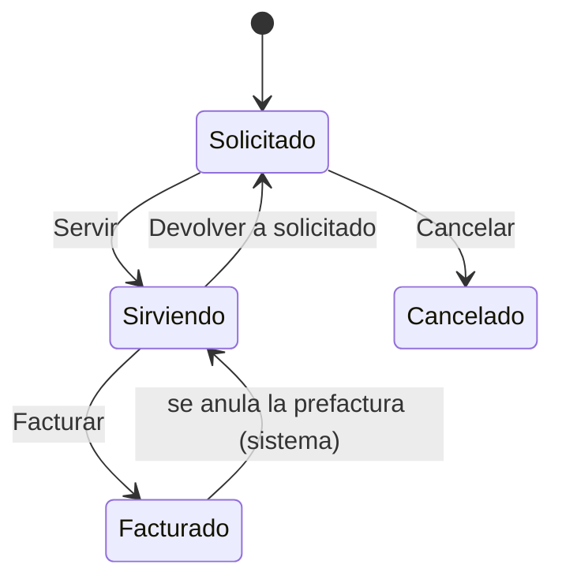

# Gestión de documentos de venta (documentos de salida)

Un documento de venta recoge el material que se vende a un cliente desde un almacén: sus **líneas** (material, cantidad, precio,
descuento). Al **servirlo** el material sale del almacén; al **facturarlo** se crea la prefactura al cliente. Si el cliente devuelve
material, se tramita una **devolución de venta** desde aquí.

## El ciclo de vida de un documento de venta (resumen del flujo)

| Estado | Qué significa | Qué se puede hacer |
|---|---|---|
| **DSA: Solicitado** | Preparándose; no ha salido nada del almacén. | Es el **único estado en que se cambian las líneas**. *Servir*, *Cancelar*, *Cambiar datos*. |
| **DSA: Sirviendo** | Servido: ya hay salidas del almacén. | *Facturar*, *Devolver a solicitado*, **modificar lo servido** (icono *Devolver* de la línea), *Cambiar datos* si no tiene devoluciones. |
| **DSA: Facturado** | Tiene prefactura o factura. | **Devolver** líneas (crea devoluciones de venta), aceptar o cancelar devoluciones. |
| **DSA: Cancelado** | No se sirvió. | Sólo consulta. |

- **Servir**: exige líneas; crea una **salida del almacén** por línea a la fecha de servicio (por defecto hoy). La fecha de servicio no
  puede ser anterior a la de solicitud ni posterior a hoy. Se valida el stock: no se puede vender más de lo que hay ese día.
- **Facturar**: crea la **prefactura** al cliente (del tipo de factura que indica el tipo de documento de venta) con una línea por cada
  línea vendida, al precio y descuento de la venta.
- **Devolver a solicitado**: deshace el servicio; no se puede si alguna salida tiene el preasiento contabilizado.
- **Cancelar** (solicitado): pide el motivo.
- Si se **anula la prefactura**, el documento vuelve a *Sirviendo*.

## ¿Cómo hago...?

### ...para vender material?

1. **Crear**: cliente, almacén (ha de estar activo) y nombre.
2. En el apartado de **líneas** añada el material, la cantidad, el precio y el descuento. Se muestran el *Precio almacén* (valor
   medio del stock) y el margen.
3. Aplique **Servir** y, cuando toque, **Facturar**.

Reglas de cada línea: cantidad mayor que cero, precio no negativo, fecha no posterior a hoy ni anterior al último cierre contable, y
que haya existencias suficientes en el almacén a esa fecha.

### ...para corregir lo servido (antes de facturar)?

Con el documento **servido** y sin prefacturar, el icono **Devolver** de la línea abre **Modificar lo servido**: indique la cantidad
realmente servida y el precio.

- Si la salida está en un **periodo abierto**, se corrige la salida del almacén (se recalcula el inventario y su preasiento).
- Si está en un **periodo cerrado** (antes o en el último cierre contable, o con el preasiento contabilizado), la salida no se toca:
  lo que se deja de servir se mete en una **devolución nueva en tramitación**, que se acepta desde el apartado *Devoluciones*. Tras el
  cierre no se puede aumentar lo servido.

### ...para registrar que el cliente devuelve material (ya facturado)?

Con el documento **facturado**, el icono rojo **Devolver** de la línea abre **Devolver línea**: indique la cantidad (como mucho lo
vendido menos lo ya devuelto) y, si quiere, una devolución del cliente que esté en tramitación; si no, se crea una nueva. Después
acéptela con el **check verde** del apartado **Devoluciones** (o cancélela). Al aceptarla el material vuelve al almacén y se regulariza
la factura (ver el manual de *Devoluciones de venta*).

Una factura **no se puede emitir** mientras alguna de sus líneas vendidas tenga una devolución pendiente de aceptar, ni si su base
imponible no coincide con lo vendido menos lo devuelto.

### ...para cambiar el cliente, el nombre o la fecha de servicio?

Menú de la edición → **Cambiar datos**. Sólo en *Solicitado*, o en *Sirviendo* sin prefactura y sin devoluciones. Si está servido, se
rehacen las salidas del almacén a la nueva fecha (y si la oferta estaba impresa se reimprime). No se puede si alguna salida tiene el
preasiento contabilizado o si hay un cierre contable en o después de la fecha anterior o la nueva.

## Filtros propios

Bloque **Datos de ventas**: *Almacén*, *Unitario* (documentos con alguna línea de ese material), *Importe* (rango de base imponible) y
*Factura emitida* (con / sin factura).

---

#### Detalle técnico

- Controlador: `VentasController` (Controllers/Logistica; `epModificarLineaServida`, `epCambiarDatos`). Vista:
  `Views/Logistica/CrudVentas.cshtml`. Dto: `VentaDto`.
- Descriptor: `DescriptorDeVentas`: filtros, ampliaciones de líneas y devoluciones, modales *Devolver línea*, *Modificar lo servido*
  y *Cambiar datos del documento de venta*.
- Reglas: `ExtensorDeVentas` (Servicios/GestorDeElementos/Extensores/Logistica: validación de la venta, servir, facturar, devolver a
  solicitado, cambiar datos, modificar lo servido, validaciones antes de emitir la factura) y `GestorDeVentas`. Etapas
  `enumEtapasDeVenta` (`DSA_Etapa_Solicitud`, `DSA_Etapa_Servicio`, `DSA_Etapa_Facturacion`, `DSA_Etapa_Cancelacion`); estados y
  transiciones en `Inicializador/Procesos/Logistica/InzVentas.cs`.
- ts: `wwwroot/ts/Logistica/Ventas.ts`: modales de devolver y modificar lo servido (proponen lo pendiente y validan que no se devuelva
  de más), check de aceptar y cancelar del grid de devoluciones, *Cambiar datos* sólo en las etapas permitidas, líneas editables sólo en
  solicitud.
