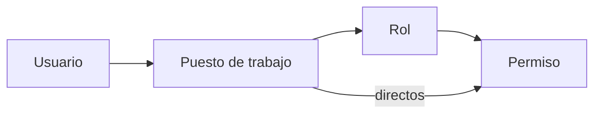

# Gestión de puestos de trabajo

El **puesto de trabajo** es lo que se asigna a los usuarios y por donde les llegan **todos los permisos**: un usuario tiene la unión de los
permisos de sus puestos. Cada puesto pertenece a un **centro gestor** (se muestra como `CG: Nombre`) y recibe permisos de dos formas: por
sus **roles** y por **permisos directos** (casos sueltos, como un buzón concreto).

Recordatorio del modelo (detalle en el documento *Modelo de seguridad*, `ayuda/seguridad/ModeloDeSeguridad.md`):

- **Seguridad funcional**: poder abrir una pantalla (permisos `VISTA: ...`, que dan los roles **AFB** del menú).
- **Seguridad de datos**: qué registros se ven y en qué modo (*Consultor*, *Gestor*, *Interventor*, *Administrador*), por negocio, tipo,
  centro gestor, estado o transición.

## ¿Cómo hago...?

### ...para dar acceso a un usuario a una parte de la aplicación?

1. Cree (o elija) el **puesto** en el centro gestor que corresponda.
2. Añádale los **roles**: los **AFB** (opciones de menú) y los de datos (p. ej. *Gestor de pedidos*). Ver *Roles de un puesto*.
3. Si hace falta algo suelto, añada **permisos directos**.
4. Asigne el puesto al **usuario** (*Usuarios de un puesto* o *Puestos de un usuario*).

### ...para ver qué permisos tiene un puesto?

Filtros **Rol**, **Usuario** y **Permisos**; y *Permisos heredados* (todos los permisos que le llegan al puesto, por roles y directos).

---

#### Detalle técnico

- Controlador: `PuestoDeTrabajoController` (Controllers/Seguridad). Vista: `Views/Seguridad/CrudPuestoDeTrabajo.cshtml`.
- Descriptor: `DescriptorDePuestoDeTrabajo` (filtros por rol, usuario y permisos; relaciones con roles, usuarios y permisos).
- Documentación del modelo: `wwwroot/ayuda/seguridad/ModeloDeSeguridad.md` y `RolesFuncionales.md`.
