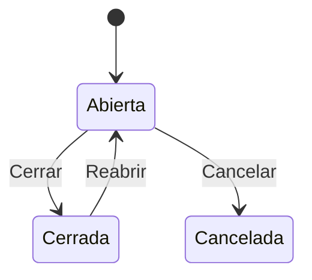

# Actividades formativas

Una actividad formativa es un **circuito documental** (tipo *AFR: Actividad formativa*) que recoge una formación de la organización con
sus participantes: **inscritos** (alumnos) y **voluntarios**, y su información complementaria. Pertenece a un expediente de actividades
(*Gestión de actividades*).

## El ciclo de vida

## ¿Cómo hago...?

### ...para dar de alta una actividad formativa?

Desde el expediente de actividades o **Crear** aquí. Complete la **información complementaria** y añada **inscritos** (*Alumno*) y
**voluntarios** en sus apartados.

### ...para cerrar la actividad?

**Cerrar** cuando termine; **Reabrir** si hay que corregir algo.

---

#### Detalle técnico

- Controlador: `CircuitosDocController` (vista `CrudActividadesFormativas`). Dto: `CircuitoDocDto`.
- Descriptor: `DescriptorDeActividadesFormativas`: datos de la actividad, inscritos y voluntarios. Tipo en el parámetro
  `CAD_Tipos_Para_Actividades_Formativas`. Flujo: `wwwroot/ayuda/procesos/CircuitoDoc/CircuitoDoc_AFR_Actividad_formativa.md`.
- ts: `wwwroot/ts/SistemaDocumental/ActividadesFormativas.ts`.
