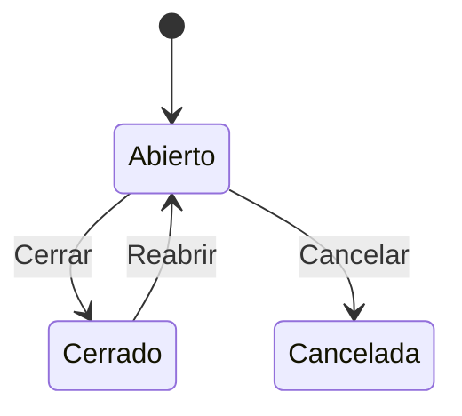

# Gestión de circuitos documentales

Un circuito documental agrupa **documentos que siguen un mismo recorrido**. Hay varios tipos, con vista propia: *Actividades formativas*,
*Fichadas*, *Estimaciones directas* y *Lotes contables*. Esta vista muestra los circuitos genéricos (**CAD: General**) y, en la edición, los
**preasientos** asociados.

## El ciclo de vida (CAD: General)

Sin lógica propia: se abre, se cierra (y reabre) o se cancela. El detalle de cada tipo está en la ayuda del proceso (el **?** de la ficha
*Circuitos documentales* del panel de control).

## ¿Cómo hago...?

### ...para crear un circuito?

**Crear**: tipo, centro gestor y nombre; anexe los documentos en el visor de archivos.

---

#### Detalle técnico

- Controlador: `CircuitosDocController` (Controllers/SistemaDocumental), que también sirve las vistas de actividades formativas,
  fichadas, estimaciones directas y lotes contables. Vista: `Views/SistemaDocumental/CrudCircuitosDoc.cshtml`. Dto: `CircuitoDocDto`.
- Descriptor: `DescriptorDeCircuitosDoc` (span de preasientos). Flujos: `wwwroot/ayuda/procesos/CircuitoDoc/*.md`.
- ts: `wwwroot/ts/SistemaDocumental/CircuitosDoc.ts`.
