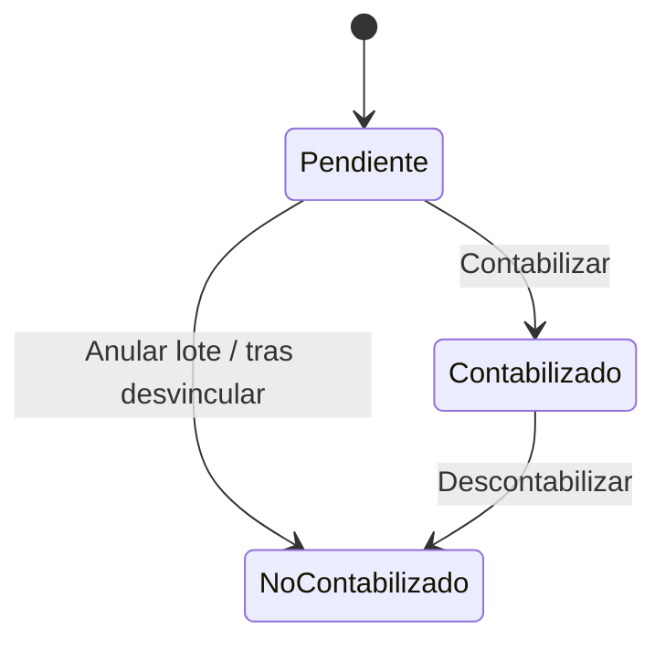

# Estimaciones directas

Un lote de **estimación directa** agrupa las **facturas emitidas**, **facturas recibidas** y **pagos** de un ejercicio de la sociedad de un
**autónomo** para su declaración en estimación directa. Es un circuito documental de tipo *LED: Estimación directa*.

## El ciclo de vida

## ¿Cómo hago...?

### ...para generar la estimación directa?

Menú contextual → **Generar estimación directa** (gestor): elija la **Sociedad** (de autónomo) y el **Ejercicio contable**. Se crea el lote con
los movimientos del ejercicio; en la edición se ven sus apartados de facturas emitidas, recibidas y pagos.

### ...para anularla?

**Anular estimación.** (administrador): se somete un trabajo que anula el lote.

---

#### Detalle técnico

- Controlador: `CircuitosDocController` (vista `CrudEstimacionesDirectas`). Descriptor: `DescriptorDeEstimacionesDirectas`
  (fichero `DescriptorDeEstimacionesDirecta.cs`), modal `EstimacionDirectaDto`. Tipo en el parámetro `CAD_Tipo_Para_Estimacion_Directa`.
  Flujo: `wwwroot/ayuda/procesos/CircuitoDoc/CircuitoDoc_LED_Estimacion_directa.md`.
- ts: `wwwroot/ts/SistemaDocumental/EstimacionesDirectas.ts`.
