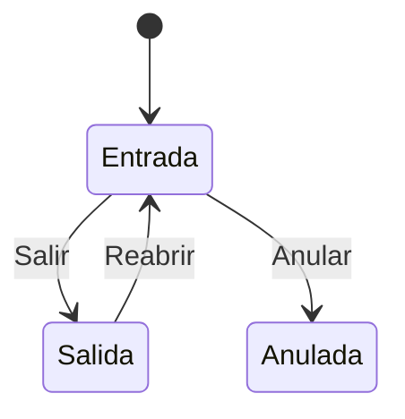

# Fichadas

Una fichada registra la **jornada de un trabajador**: se abre con la **entrada** y se cierra con la **salida**. Es un circuito documental de
tipo *FIC: Fichada*.

## El ciclo de vida

## ¿Cómo hago...?

### ...para fichar la entrada?

**Crear** la fichada: queda en **Entrada**.

### ...para fichar la salida?

Abra la fichada de hoy y aplique **Salir**. Si se equivocó, **Reabrir** (vuelve a entrada) o **Anular**.

---

#### Detalle técnico

- Controlador: `CircuitosDocController` (vista `CrudFichadas`). Descriptor: `DescriptorDeFichadas`. Tipo en el parámetro
  `CAD_IdsDeTiposDeFichadas`. Flujo: `wwwroot/ayuda/procesos/CircuitoDoc/CircuitoDoc_FIC_Fichada.md`.
- ts: `wwwroot/ts/SistemaDocumental/Fichadas.ts`.
