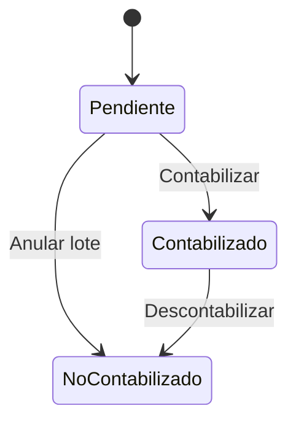

# Lotes contables

Un lote contable agrupa los **preasientos que se envían a la contabilidad** externa (NCS, ContaSol). Normalmente lo crea el **cierre
contable** de la sociedad. Es un circuito documental de tipo *LPR: Preasientos*; en la edición se ven sus preasientos (tipo, preasiento,
importe) y el fichero generado.

## El ciclo de vida

## ¿Cómo hago...?

### ...para buscar un lote?

Filtro **Varios**: `l:` nombre del lote, `p:` referencia de un preasiento incluido.

### ...para crear un lote a mano?

Menú contextual → **Crear lote contable** (gestor): **Sociedad**, **Ejercicio contable** y, opcionalmente, una **fecha contable** que
reemplace la de los preasientos, **Respetar fechas contables** (los de periodos pasados mantienen su fecha; si no, el primer día del
periodo abierto) y **Descontabilizar** antes los que ya lo estuvieran. Lo habitual es hacerlo con *Cierres contables*.

### ...para anular o regenerar un lote?

**Anular lote contable** (administrador; se somete un trabajo) o **Regenerar lote contable** (administrador). Si el lote es de un cierre,
sólo se puede anular el del último cierre de la sociedad.

---

#### Detalle técnico

- Controlador: `CircuitosDocController` (vista `CrudLotesContables`). Descriptor: `DescriptorDeLotesContables`: filtro *Varios*, modal
  `CrearLoteContableDto`, anular y regenerar. Tipo en el parámetro `CAD_Tipo_Para_Lote_de_Preasientos`. Flujo:
  `wwwroot/ayuda/procesos/CircuitoDoc/CircuitoDoc_LPR_Preasientos.md`.
- ts: `wwwroot/ts/SistemaDocumental/LotesContables.ts`.
