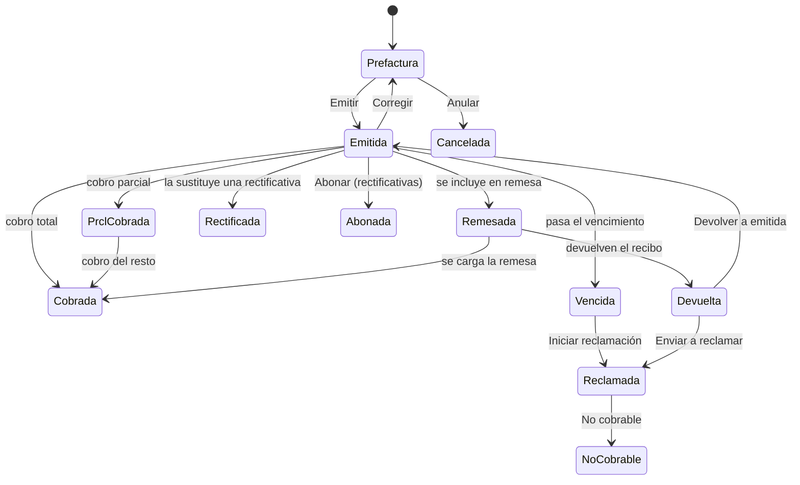

# Gestión de facturas emitidas

Facturas de venta a clientes: desde que son prefactura hasta que se emiten, se comunican a la AEAT (Verifactu) y se cobran o abonan.
Se pueden crear a mano, copiándolas de otra, o generarlas desde partes de trabajo, contratos, presupuestos o documentos de salida.

## El ciclo de vida de una factura (resumen del flujo)

El detalle de cada transición está en la ayuda del proceso (el **?** de la ficha *Facturas emitidas* del panel de control). En resumen:

| Estado | Qué significa | Qué se puede hacer |
|---|---|---|
| **Prefactura** | Borrador, sin número. | Es el **único estado en que se modifica**: datos, líneas, *Facturar tareas*, *Cambiar Datos*. Se emite o se anula. |
| **Emitida** | Con número correlativo, firmada, con preasiento y comunicándose o comunicada a la AEAT. | Cobrar, remesar, rectificar, *Cambiar vencimiento*. *Corregir* sólo en casos concretos (ver abajo). |
| **Prcl. Cobrada** | Tiene cobros pero queda importe pendiente. | Seguir cobrando, *Cambiar vencimiento*. |
| **Vencida** | Pasó el vencimiento sin cobrarse del todo. | Cobrar, *Cambiar vencimiento* (vuelve a emitida o prcl. cobrada), *Iniciar reclamación*. |
| **Reclamada** | En reclamación al cliente. | Cobrar o darla por *No cobrable*. |
| **Remesada** | Incluida en una remesa de cobro. | Esperar al cargo; excluirla de la remesa mientras esta está en *Inicial*. |
| **Devuelta** | El cliente devolvió el recibo de la remesa. | *Devolver a emitida* (para cobrarla o remesarla otra vez) o *Enviar a reclamar*. |
| **Cobrada**, **Rectificada**, **Abonada**, **No Cobrable**, **Cancelada** | Estados finales. | Sólo consulta (anular un cobro o una remesa puede hacerla retroceder). |

Las transiciones **manuales** (las aplica usted con las flechas de *transitar* / *devolver* de la edición) son: *Emitir*, *Anular*,
*Corregir*, *Abonar*, *Iniciar reclamación*, *No cobrable*, *Devolver a emitida* y *Enviar a reclamar*. Las demás las aplica el sistema
al registrar o anular un cobro, al trabajar con remesas, al hacer una rectificativa o con los trabajos diarios (*Pasar a vencidas las
facturas impagadas*, *Actualización de facturas emitidas*).

### ¿Qué hace y qué pide cada transición manual?

- **Emitir** (prefactura → emitida): asigna el **número correlativo** de la sociedad y serie, la fecha de emisión, calcula el
  vencimiento, genera el **preasiento** y la **firma**, da por facturados los partes de trabajo, actualiza el avance del contrato o la
  planificación y anota el vencimiento en la agenda. **No deja emitir** si la factura no tiene líneas, si sus tareas no están
  terminadas, si falla la validación de IVA / IRPF / SII / dirección fiscal, si el centro administrativo no está activo, si el tipo
  exige periodo de facturación y no lo tiene, si la fecha de devengo es posterior a la de emisión o si otra factura se está emitiendo
  en ese momento (inténtelo de nuevo).
- **Anular** (prefactura → cancelada): pide el **motivo de anulación**; libera los partes de trabajo, las tareas facturadas y el
  presupuesto asociado.
- **Corregir** (emitida → prefactura): pide el **motivo de corrección**. Sólo con la **última factura de su serie**, sin cobros, que no
  sea rectificativa, que no venga de un parte de trabajo y que **no se haya comunicado ni se esté comunicando a la AEAT**. Anula su
  preasiento y borra el pdf y la firma.
- **Abonar** (rectificativa emitida → abonada): sólo si no queda nada pendiente de devolver.
- **Iniciar reclamación** (vencida → reclamada) y **Enviar a reclamar** (devuelta → reclamada): piden el motivo y exigen que la factura
  tenga **archivador de reclamación con al menos un archivo** (el archivador se crea solo al pasar a vencida).
- **No cobrable** (reclamada → no cobrable): pide los motivos; sólo cambia el estado.
- **Devolver a emitida** (devuelta → emitida): pide el motivo de devolución.

## ¿Cómo hago...?

### ...para buscar una factura?

El filtro de texto se llama **Varios** y admite prefijos:

- `c:texto` → por concepto.
- `d:texto` → por nombre del cliente.
- `n:año-serie-nº` → por número de factura.
- Sin prefijo → por referencia o concepto; si escribe un número de factura (`2026-A-15`) se busca ese número.

El botón de criterio y los símbolos se aplican al texto que va detrás del prefijo (`d:!garcia`: facturas de clientes que no se
llaman García). En `n:` no se aplican: se busca siempre ese número exacto.

Además, en los bloques de filtro:

- **Datos de las facturas**: *Importe con IVA*, *Cliente*, *Emitida* (entre fechas), *Vence el* (entre fechas), *Números de factura*
  (rango de la misma serie) e *Importe cobrado*.
- **Relaciones con las facturas**: por *Presupuesto*, *Planificación de venta*, *Parte de trabajo*, *Documento de salida* o *Contrato*.

### ...para crear una factura copiando otra?

Menú contextual → **Copiar Factura**: elija la factura o plantilla de origen. También, con una factura abierta, **Copiar factura** en el
menú de la edición (no disponible para rectificativas ni facturas rectificadas).

### ...para facturar las tareas pendientes?

Abra la prefactura y use **Facturar tareas** en el menú de la edición. Sólo está disponible mientras la factura es prefactura.

### ...para cambiar el vencimiento?

**Cambiar vencimiento** en el menú de la edición. Necesita permiso de interventor; no está disponible en las prefacturas ni en las
facturas terminadas. La factura ha de estar en etapa de cobro (emitida, prcl. cobrada, vencida o reclamada) y la nueva fecha ha de ser
posterior a hoy y al vencimiento actual. Si estaba **vencida**, vuelve a emitida (o a prcl. cobrada si tiene cobros).

### ...para corregir una factura ya emitida?

Si es la última de su serie y cumple las condiciones de **Corregir** (ver arriba), use la flecha de *devolver* de la edición: vuelve a
prefactura, la modifica y la emite de nuevo. Si no se puede (ya comunicada a la AEAT, con cobros, no es la última...), haga una
**rectificativa**.

### ...para reclamar una factura impagada?

Cuando pasa el vencimiento, el trabajo diario la pasa a **vencida** y le crea el **archivador de reclamación**. Anexe en ese archivador
la documentación de la reclamación (al menos un archivo) y aplique **Iniciar reclamación**. El archivador de reclamación y el archivo
original de la emisión no se pueden quitar de la factura.

### ...para cambiar los datos de una prefactura?

**Cambiar Datos** en el menú de la edición. Necesita permiso de interventor y que la factura sea prefactura, no sea rectificativa
ni esté rectificada.

### ...para hacer una factura rectificativa?

Abra la factura emitida y use **Hacer rectificativa** (permiso de interventor). No está disponible en las prefacturas. En la
rectificativa se ve el apartado de *facturas rectificadas*.

### ...para registrar un cobro?

Desde el grid: seleccione la factura y use **Añadir cobro** en el menú individual. Sólo se activa si la factura tiene importe
pendiente y no está cancelada, comunicándose con la AEAT, ni es rectificativa ni prefactura. También se pueden añadir cobros desde el
apartado de *Cobros* de la edición. Los abonos de las rectificativas se registran en el apartado de *Abonos*.

### ...para ver los totales de varias facturas?

Selecciónelas y use, en el menú contextual, **Mostrar totales**.

### ...para ir a los documentos relacionados?

Menú de relaciones: **Partes de trabajo**, **Documentos de salida**, **Presupuestos** y **Contratos** de la factura seleccionada.

## La edición de una factura

Apartados que se despliegan debajo de los datos principales:

- **IRPF** (sólo si la factura tiene retención), **Enlaces** (presupuesto, contrato... de los que procede), **Periodo**,
  **Verifactu**, **Rectificativas**, **Líneas**, **Tareas**, **Cobros**, **Abonos** y **Remesas**.

Al crear o editar una línea, según su tipo se bloquean unos campos u otros (por ejemplo, en una línea de artículo el precio y la
naturaleza salen del artículo; en una línea libre se escribe el concepto y el precio) y el importe de la línea se calcula solo.

### ¿Por qué no puedo modificar la factura?

- Si **se está comunicando a la AEAT** se avisa con un mensaje y no se puede cambiar nada hasta que termine.
- Si está **cancelada**.
- Si ya **no es prefactura** (está emitida): los datos y las líneas quedan sólo de consulta; los interventores aún pueden anexar archivos.

## Opciones sólo para administradores

**Generar Ubl** (factura electrónica) y, si está activo, **Sincronizar con la AEAT**.

---

#### Detalle técnico

- Controlador: `FacturasEmtController` (Controllers/Venta). Vista: `Views/Venta/CrudFacturasEmt.cshtml`. Dto: `FacturaEmtDto`.
- Descriptor: `DescriptorDeFacturasEmt` (Descriptores/DescriptoresDeVentas): cambia el filtro de nombre por *Varios*, añade los bloques
  de filtro, las ampliaciones de la edición, las modales de pedir datos (cambiar vencimiento, copiar, rectificativa, facturar tareas,
  cambiar datos, totales) y las opciones de menú propias.
- Reglas de negocio y de los cambios de etapa: `GestorDeFacturasEmt` (GestoresDeNegocio/Venta/Factura: sólo se modifica en
  `FAE_Etapa_Prefactura`, cambiar vencimiento exige `FAE_Etapa_De_Cobro`, emitir/corregir con semáforo para que no se procesen dos a la
  vez...) y `ExtensorDeFacturasEmt` (Servicios/GestorDeElementos/Extensores/Venta). El flujo completo, transición a transición, en
  `wwwroot/ayuda/procesos/FacturaEmitida/FacturaEmitida_FAE_General.md`.
- ts: `wwwroot/ts/Venta/FacturasEmt.ts`:
  - `CrudDeFacturasEmt extends Crud.CrudMnt`: activa *Añadir cobro* según el elemento seleccionado, tramita las opciones de menú
    propias y sus modales.
  - `CrudCreacionFacturaEmt extends Crud.CrudCreacion`: al crear desde un presupuesto o cliente rellena sus datos.
  - `CrudEdicionFacturaEmt extends Crud.CrudEdicion`: bloquea o desbloquea opciones y paneles según sea prefactura, rectificativa,
    rectificada, terminada, cancelada o se esté comunicando a la AEAT; aplica el tipo de línea y calcula sus importes.
