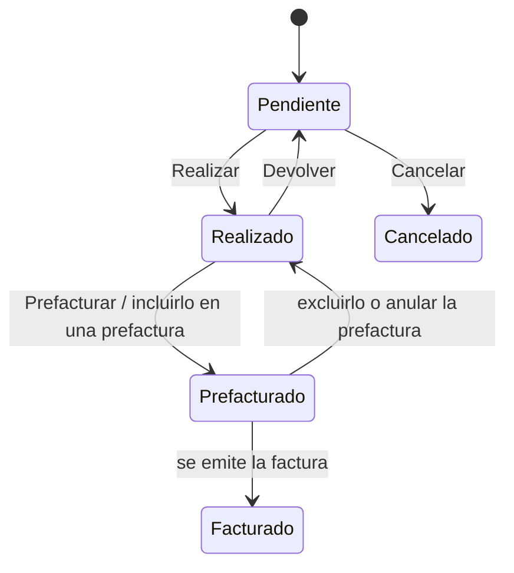

# Gestión de partes de trabajo

Un parte de trabajo recoge un servicio que hay que prestar a un cliente: qué se va a hacer (sus **líneas**, con cantidades y precios) y
quién lo hace y cuándo (las **asignaciones** a trabajadores). Una vez realizado se factura, con su propia prefactura o como línea de
otra factura. Puede venir de un presupuesto, de un contrato o de una planificación de venta.

## El ciclo de vida de un parte (resumen del flujo)

El detalle está en la ayuda del proceso (el **?** de la ficha *Partes de trabajo* del panel de control).

| Estado | Qué significa | Qué se puede hacer |
|---|---|---|
| **Pendiente** | Servicio por prestar. | Es el **único estado en que se añaden o cambian líneas y asignaciones**. Realizar o cancelar. |
| **Realizado** | Servicio prestado, pendiente de facturar. | *Prefacturar*, incluirlo en una prefactura, o *Devolver* a pendiente para corregirlo. |
| **Prefacturado** | Está en una prefactura. | Sólo consulta. Si se quita de la prefactura o esta se anula, vuelve a realizado. |
| **Facturado** | La factura se ha emitido. | Sólo consulta. |
| **Cancelado** | No se prestó. | Sólo consulta. |

Transiciones manuales y qué exigen:

- **Realizar**: el parte ha de tener **líneas**, sus **tareas vinculadas finalizadas** y los datos de ejecución y duración de las
  asignaciones válidos. Si el parte es de un contrato (o de una planificación con contrato), **recalcula el avance del contrato**.
- **Cancelar**: pide el motivo; no deja si alguna asignación está iniciada, finalizada o con duración o medición, o si hay tareas
  vinculadas sin terminar. Borra las asignaciones planificadas a partir de mañana.
- **Devolver** (realizado → pendiente): limpia las fechas de inicio/fin y la duración de las asignaciones y revierte el avance del contrato.
- **Prefacturar**: repite las comprobaciones de *Realizar* y **crea la prefactura** del parte.

## ¿Cómo hago...?

### ...para crear un parte desde un presupuesto?

Desde el presupuesto (el presupuesto ha de estar en la etapa que permite asociar partes y ser de la misma sociedad). Al crear el parte
se rellenan solos la sociedad y el departamento, el tipo de parte por defecto del presupuesto, el nombre, la descripción y el cliente
(el solicitante del presupuesto). El presupuesto de un parte no se puede cambiar después: elimine o cancele el parte y cree otro.

### ...para añadir lo que hay que hacer (líneas)?

Abra el parte (en estado **pendiente**) y, en el apartado **Detalle** (*Lineas del parte de trabajo*), cree las líneas. Según el tipo de
línea se bloquean unos campos u otros: en una línea de unitario (artículo) el concepto, el precio, la naturaleza y la unidad salen del
unitario; en una línea libre se escriben a mano. El parte totaliza la base imponible y el importe.

### ...para asignar el trabajo a un trabajador?

Apartado **Trabajadores** (*Asignaciones de un parte de trabajo*): trabajador, *Cuando empezar* y *Cuando terminar*. Las columnas
*Empezó*, *Terminó* y *Tiempo dedicado* se rellenan al ejecutarse. Las asignaciones aparecen también como eventos en la agenda.

### ...para facturar un parte?

Cuando esté **realizado**:

- **Prefacturar** (flecha de transitar): crea una prefactura sólo con este parte.
- O inclúyalo como línea en una prefactura existente (desde la factura o desde la facturación del contrato).

El parte pasa a **prefacturado** y, al emitirse la factura, a **facturado**.

### ...para ir a los documentos relacionados?

Menú de relaciones: **Planificación de venta**, **Facturas emitidas**, **Presupuestos** y **Contratos** del parte seleccionado.

## Filtros propios

Bloque **Elementos relacionados**: por *Unitario*, *Contrato*, *Presupuesto*, *Planificación de venta*, *Factura emitida* y *Tarea*. Los
de contrato, presupuesto, planificación, factura y tarea permiten además elegir *con*, *sin* o *con o sin* esa relación (p. ej. partes
sin factura).

## ¿Por qué no puedo añadir líneas o asignaciones?

Sólo se puede en estado **pendiente** y con permiso de gestor. Si el parte está realizado, prefacturado o facturado, use *Devolver*
(si aún está realizado) o rectifique en la factura.

---

#### Detalle técnico

- Controlador: `PartesTrController` (Controllers/Venta). Vista: `Views/Venta/CrudPartesDeTrabajo.cshtml`. Dto: `ParteTrDto`.
- Descriptor: `DescriptorDePartesTr`: menú de relaciones, bloque de filtros *Elementos relacionados*, ampliaciones *Detalle* (líneas)
  y *Trabajadores* (asignaciones).
- Reglas: `GestorDePartesTr` (presupuesto no modificable, misma sociedad, etapa `PPT_Etapa_AsociarParteTr` del presupuesto) y las
  transiciones del negocio. Flujo: `wwwroot/ayuda/procesos/ParteDeTrabajo/ParteDeTrabajo_GEN_Parte.md`.
- ts: `wwwroot/ts/Venta/PartesTr.ts`: `CrudCreacionParteTr` copia los datos del presupuesto y su cliente; `CrudEdicionParteTr`
  bloquea la creación de líneas y asignaciones fuera de `PTR_Etapa_Pendiente` o sin permiso de gestor, aplica el tipo de línea y
  recalcula la cabecera al cambiar las líneas.
