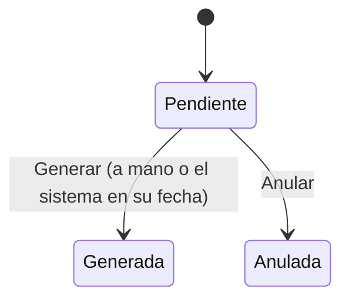

# Gestión de planificaciones de venta

Una planificación de venta es una ejecución prevista de un **planificador de ventas** (normalmente de un contrato): en su **fecha de
ejecución** genera un **parte de trabajo** o una **prefactura** al cliente con sus líneas. Las planificaciones las crea el
planificador de ventas a partir de sus propias líneas; aquí se consultan, se ajustan mientras están pendientes, se generan a demanda o
se anulan. Por defecto se ordenan por fecha de ejecución ascendente (las más próximas primero).

## El ciclo de vida de una planificación (resumen del flujo)

El detalle está en la ayuda del proceso (el **?** de la ficha *Planificaciones de venta* del panel de control).

| Estado | Qué significa | Qué se puede hacer |
|---|---|---|
| **Pendiente** | Ejecución prevista, con su evento en la agenda. | Cambiar líneas y fecha de ejecución; *Generar* o *Anular*. |
| **Generada** | Ya tiene su parte de trabajo o su prefactura. | Sólo consulta; ir al parte o a la factura. |
| **Anulada** | No se ejecutará. | Sólo consulta. |

- **Generar**: crea el **parte de trabajo** (si la planificación indica tipo de parte) o la **prefactura** (si indica tipo de factura)
  y la asocia. No deja si ya tiene uno generado o si no indica qué generar. Al llegar la fecha de ejecución lo hace el sistema solo.
- **Anular**: pide el motivo, quita los eventos de la agenda y, si es de un contrato, **recalcula el avance** del contrato.

## ¿Cómo hago...?

### ...para adelantar la ejecución de una planificación?

Ábrala (pendiente) y aplique **Generar** con la flecha de transitar: se crea ya el parte o la prefactura, sin esperar a la fecha.

### ...para cambiar lo que se va a facturar?

Con la planificación **pendiente**, apartado **Detalle** (*lineas de la planificación*): cambie o añada líneas. Una línea de unitario
toma el concepto, la naturaleza y la unidad del unitario; una línea libre se escribe a mano. **No se admiten partidas alzadas.**

### ...para ver qué se ha generado?

Menú de relaciones: **Partes de trabajo** y **Facturas emitidas** de la planificación seleccionada.

### ...para ver lo que se va a generar en un periodo?

Filtre por fechas de ejecución y, en **Elementos relacionados**, por *Planificador de ventas* o *Contrato*. Con los filtros de relación
puede ver, por ejemplo, las planificaciones **sin** parte o **sin** factura.

## Filtros propios

Bloque **Elementos relacionados**: *Unitario*, *Planificador de ventas*, *Contrato*, *Parte de trabajo* y *Factura emitida* (los cuatro
últimos con la opción *con / sin / con o sin* relación).

---

#### Detalle técnico

- Controlador: `PlanificacionesDeVentaController` (Controllers/Venta). Vista: `Views/Venta/CrudPlanificacionesDeVenta.cshtml`.
  Dto: `PlanificacionDeVentaDto`.
- Descriptor: `DescriptorDePlanificacionesDeVenta`: orden inicial por `EjecutarEl`, bloque de filtros, ampliación *Detalle* y menú de
  relaciones.
- Flujo: `wwwroot/ayuda/procesos/PlanificacionDeVenta/PlanificacionDeVenta_PLG_General.md`.
- ts: `wwwroot/ts/Venta/PlanificacionDeVenta.ts`: aplica el tipo de línea en la modal de líneas y rechaza las partidas alzadas.
