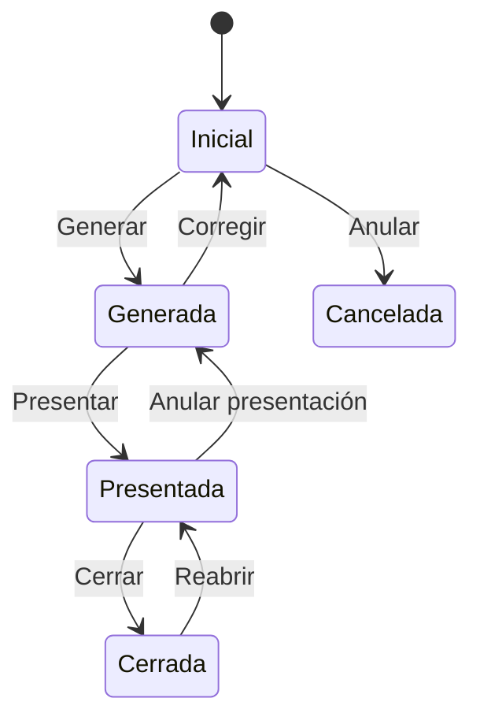

# Gestión de remesas de cobro

Una remesa de cobro agrupa facturas emitidas para cobrarlas por domiciliación bancaria (adeudos SEPA). Se crea, se le incluyen las
facturas, se genera el fichero SEPA, se presenta al banco y, cuando el banco carga los recibos, las facturas quedan cobradas.

## El ciclo de vida de una remesa (resumen del flujo)

El detalle de cada transición está en la ayuda del proceso (el **?** de la ficha *Remesas de cobro* del panel de control).

| Estado | Qué significa | Qué se puede hacer |
|---|---|---|
| **Inicial** (cumplimentación) | Se está preparando. | Es el **único estado en que se modifica** la remesa y se **incluyen o excluyen facturas**. Se genera o se anula. |
| **Generada** | Fichero SEPA (`Rem-<referencia>.xml`) generado y anexado, sin enviar al banco. | *Presentar* o *Corregir* (vuelve a inicial y quita el fichero). |
| **Presentada** | Enviada al banco. | *Cargar la remesa*, *Anular cargo*, registrar **devoluciones** de facturas, *Cerrar*. |
| **Cerrada** | Pasado el plazo de devoluciones. | Sólo consulta; *Reabrir* si hace falta. |
| **Cancelada** | Anulada antes de generarse. | Sólo consulta. |

Qué exige cada transición:

- **Generar**: al menos una factura. Calcula la **fecha de cargo** = fecha de generación + `REM_DiasDeEsperaDeCargo` días.
- **Anular**: pide el motivo; no deja si la remesa tiene facturas (quítelas antes).
- **Corregir**: pide el motivo de apertura; borra las fechas de generación y de cargo y el fichero SEPA.
- **Presentar**: exige fecha de cargo y que esta sea al menos `REM_DiasDeEsperaDeCargo` días posterior a la presentación.
- **Cerrar**: sólo cuando ha pasado la **fecha máxima de devolución** (fecha de cargo + `REM_MesesDeEsperaDeDevolucionDeCargos` meses).

## ¿Cómo hago...?

### ...para crear una remesa?

**Crear**: indique la sociedad (centro gestor), la **cuenta de abono** (ha de ser una cuenta de la sociedad marcada como de *ingreso*
o *ambas*) y la **clase** de remesa:

- **Emitidas**: para cobrar facturas en estado *emitida*.
- **Devueltas**: para volver a remesar facturas *devueltas*.

La clase no se puede cambiar cuando la remesa ya tiene facturas.

### ...para incluir facturas en la remesa?

Abra la remesa (en estado inicial) y, en el apartado **Facturas**, use **Incluir facturas a la remesa** y seleccione las facturas. Sólo
se admiten facturas:

- de la **misma sociedad** que la remesa,
- en la etapa que pide la clase de la remesa (*emitida* o *devuelta*),
- con importe distinto de cero,
- cuyo cliente tenga **cuenta bancaria de pago**,
- y que no estén ya en otra remesa viva.

Al incluirla, la factura pasa a **remesada**; al excluirla (sólo en estado inicial) vuelve a **emitida**.

### ...para generar y enviar la remesa al banco?

1. Con las facturas incluidas, aplique **Generar** (flecha de transitar): se genera y anexa el fichero SEPA.
2. Descárguelo del visor de archivos y envíelo al banco.
3. Aplique **Presentar**.

### ...para dar la remesa por cobrada (cargar)?

No suele hacer falta: el trabajo diario **Cargar y cierra las remesa de facturas** da por cargadas las remesas presentadas en su fecha
de cargo prevista, crea los cobros de clase *Remesa* (con su preasiento) y las facturas pasan a **cobrada**. Ese mismo trabajo cierra
las remesas cuando ha pasado el plazo de devoluciones.

Para cargarla a mano: menú de la edición → **Cargar la remesa** (permiso de interventor, remesa *presentada*). La fecha de cargo no
puede ser anterior a la de generación ni posterior a hoy. Para cambiar una fecha de cargo ya puesta, **Anular cargo** y volver a cargar.

### ...para registrar que un cliente ha devuelto un recibo?

En el apartado **Facturas** de la remesa (presentada), edite la factura e indique la **fecha de devolución** y el **motivo** (obligatorio).
La factura pasa a **devuelta** (si ya se había cargado, se elimina su cobro). Reglas:

- La fecha no puede ser anterior a la presentación de la remesa.
- Después de la fecha máxima de devolución o antes del cargo, sólo un interventor.
- Para anular una devolución, borre la fecha e indique un motivo distinto del anterior.

Las facturas devueltas se pueden cobrar directamente, reclamar o incluir en una remesa de clase **Devueltas**.

### ...para ver qué facturas lleva la remesa?

Apartado **Facturas** de la edición, o desde el menú de la vista ir a las *facturas de una remesa*. Las columnas *Abonada*,
*Cargada El*, *Devuelta El* y *Dev. Hasta* (fecha máxima de devolución) indican la situación de cada una. La etiqueta de la fecha de
cargo cambia según el caso: *se cargará el*, *se debería haber cargado el* o *cargada el*.

## Filtros propios

- **Datos de las remesas**: *Importe de la remesa*, *Fec. de generación*, *Fec. de cargo*.
- **Relaciones con las remesas**: por *Factura emitida* incluida.

## ¿Por qué no puedo modificar la remesa?

Sólo se modifica en estado **inicial**. En los demás estados los datos y el apartado de facturas son de consulta (salvo las
devoluciones y el cargo, en *presentada*). El fichero SEPA anexado no se puede quitar de la remesa.

---

#### Detalle técnico

- Controlador: `RemesasFaeController` (Controllers/Venta). Vista: `Views/Venta/CrudRemesasFae.cshtml`. Dto: `RemesaFaeDto`.
- Descriptor: `DescriptorDeRemesasFae` (Descriptores/DescriptoresDeVentas): bloques de filtro, modales *Cargar la remesa* y
  *Anular cargo* (interventor).
- Reglas: `GestorDeRemesasFae` (sólo se modifica en `REM_Etapa_De_Cumplimentacion`, cuenta de ingreso, cargo sólo en
  `REM_Etapa_De_Presentacion`...), `GestorDeFacturasEmtDeUnaRemesa` (incluir, excluir, devolver) y el trabajo
  `TrabajosDeRemesasFae` (carga y cierre automáticos). Flujo: `wwwroot/ayuda/procesos/RemesaFae/RemesaFae_REM_General.md`.
- ts: `wwwroot/ts/Venta/RemesasFae.ts`: `CrudEdicionRemesaFae` pone en consulta la remesa fuera de cumplimentación, habilita
  *Cargar* / *Anular cargo* sólo a interventores en presentación y, en la edición de una factura de la remesa, bloquea la factura y la
  fecha de cargo y ajusta la etiqueta de la fecha.
