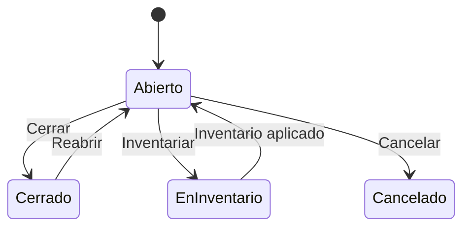

# Flujo del negocio 'Almacenes' para el tipo 'ALM: General'

Un almacén guarda existencias de materiales. Solo en estado abierto admite movimientos (entradas de compra, salidas, devoluciones...). Cuando se hace un recuento o inventario, el almacén queda bloqueado en **En inventario** hasta que se aplica. El estado inicial del tipo es **ALM: Abierto**.

Las transiciones marcadas **(manual)** las aplica el usuario desde el almacén. Las marcadas **(sistema)** las aplica el propio sistema desde una regularización de almacén (recuento) y no se ejecutan a mano.

## Flujo

| Estado | Etapa | Observaciones |
|---|---|---|
| ALM: Abierto | `ALM_Etapa_Activo` | Estado inicial. Admite movimientos de almacén. |
| ALM: En inventario | `ALM_Etapa_En_Inventario` | Se está recontando; solo admite los movimientos del stock inicial del inventario. |
| ALM: Cerrado | `ALM_Etapa_Cerrado` | Estado terminado: sin movimientos. Se puede reabrir. |
| ALM: Cancelado | `ALM_Etapa_Cancelado` | Estado final: el almacén no se usa. |

## Transiciones

### ALM: Abierto ---> ALM: Cerrar --> ALM: Cerrado  (manual)
Cierra el almacén para que no admita más movimientos.
- No deja si el almacén tiene una **regularización en curso** (iniciada o recontando).

### ALM: Abierto ---> ALM: Inventariar --> ALM: En inventario  (sistema)
Se aplica al **iniciar el recuento** de una regularización de almacén.
- Solo se puede iniciar un recuento con el almacén abierto, y no si ya se está recontando en otra regularización.
- Mientras está en inventario, los movimientos normales del almacén se rechazan.

### ALM: En inventario ---> ALM: Inventario aplicado --> ALM: Abierto  (sistema)
Se aplica al **cerrar la regularización** (cuando se aplica el recuento) o al devolverla a su etapa inicial: el almacén vuelve a abierto y admite movimientos.

### ALM: Abierto ---> ALM: Cancelar --> ALM: Cancelado  (manual)
Da de baja el almacén. Pide el **motivo de cancelación**.
- No deja si el almacén tiene una **regularización en curso**.

### ALM: Cerrado ---> ALM: Reabrir --> ALM: Abierto  (manual)
Reabre un almacén cerrado. No ejecuta ninguna comprobación ni cambio propio: solo cambia de estado.

## Comportamiento común a todas las transiciones
- Cada transición queda anotada en el historial (hitos) del almacén.
- Solo pueden aplicarla los usuarios con permiso sobre la transición.
- Las entradas y salidas de stock (compras, devoluciones, ventas, consumos, regularizaciones...) solo se admiten con el almacén abierto, salvo el stock inicial de un inventario, que exige el almacén en inventario.
- Además, pueden existir **acciones de transición** definidas por el parametrizador (se ven al pinchar la flecha en el visor de flujo del estado), que se ejecutan antes o después de las anteriores.
