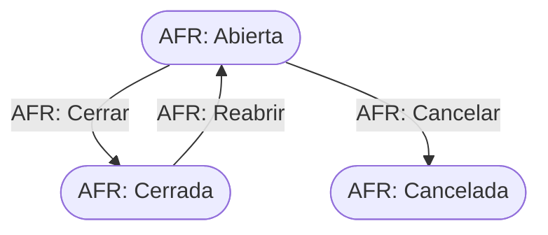

# Flujo del negocio 'Circuitos documentales' para el tipo 'AFR: Actividad formativa'

Este tipo de circuito recoge una actividad formativa de la organización, con los datos de sus participantes. Su id está registrado en el parámetro `CAD_Tipos_Para_Actividades_Formativas`. El estado inicial del tipo es **AFR: Abierta**.

La transición *Cerrar* es **del sistema**: no se ejecuta a mano.

## Flujo

| Estado | Etapa | Observaciones |
|---|---|---|
| AFR: Abierta | `CAD_Etapa_Abierto` | Estado inicial. Se pueden editar los datos de la actividad. |
| AFR: Cerrada | `CAD_Etapa_Cerrado` | Estado terminado. |
| AFR: Cancelada | `CAD_Etapa_Cancelado` | Estado final: actividad anulada. |

## Transiciones

### AFR: Abierta ---> AFR: Cerrar --> AFR: Cerrada  (sistema)
Cierra la actividad. Es una transición del sistema; en el código revisado no se ha localizado qué proceso la aplica ni comprobaciones propias, por lo que solo cambia el estado.

### AFR: Abierta ---> AFR: Cancelar --> AFR: Cancelada  (manual)
Anula la actividad. Pide el **motivo de cancelación**. No ejecuta ninguna comprobación ni cambio propio: solo cambia de estado.

### AFR: Cerrada ---> AFR: Reabrir --> AFR: Abierta  (manual)
Reabre la actividad. Pide el **motivo de apertura**. No ejecuta ninguna comprobación ni cambio propio: solo cambia de estado.

## Comportamiento común a todas las transiciones
- Cada transición queda anotada en el historial (hitos) del circuito.
- Solo pueden aplicarla los usuarios con permiso sobre la transición.
- Además, pueden existir **acciones de transición** definidas por el parametrizador (se ven al pinchar la flecha en el visor de flujo del estado), que se ejecutan antes o después de las anteriores.
