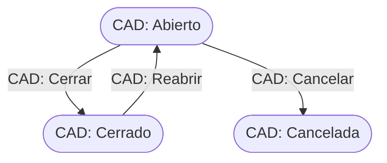

# Flujo del negocio 'Circuitos documentales' para el tipo 'CAD: General'

Un circuito documental agrupa documentos que siguen un mismo recorrido. El tipo **CAD: General** es el circuito genérico, sin lógica propia más allá de abrirse, cerrarse o cancelarse. El estado inicial del tipo es **CAD: Abierto**.

## Flujo

| Estado | Etapa | Observaciones |
|---|---|---|
| CAD: Abierto | `CAD_Etapa_Abierto` | Estado inicial. El circuito admite cambios. |
| CAD: Cerrado | `CAD_Etapa_Cerrado` | Estado terminado. |
| CAD: Cancelada | `CAD_Etapa_Cancelado` | Estado final: circuito anulado. |

## Transiciones

### CAD: Abierto ---> CAD: Cerrar --> CAD: Cerrado
Cierra el circuito. No ejecuta ninguna comprobación ni cambio propio: solo cambia de estado.

### CAD: Abierto ---> CAD: Cancelar --> CAD: Cancelada
Anula el circuito. Pide el **motivo de cancelación**.
- Tras transitar, si el circuito es un lote de preasientos o una estimación directa, deshace su contabilización (ver los tipos *LPR: Preasientos* y *LED: Estimación directa*). En un circuito general no hace nada más.

### CAD: Cerrado ---> CAD: Reabrir --> CAD: Abierto
Reabre un circuito cerrado. Pide el **motivo de apertura**. No ejecuta ninguna comprobación ni cambio propio: solo cambia de estado.

## Comportamiento común a todas las transiciones
- Cada transición queda anotada en el historial (hitos) del circuito.
- Solo pueden aplicarla los usuarios con permiso sobre la transición.
- Los cinco tipos de circuito documental (*CAD: General*, *AFR: Actividad formativa*, *FIC: Fichada*, *LPR: Preasientos* y *LED: Estimación directa*) comparten las etapas `CAD_Etapa_Abierto`, `CAD_Etapa_Cerrado` y `CAD_Etapa_Cancelado`; cada uno tiene sus propios estados y transiciones.
- Además, pueden existir **acciones de transición** definidas por el parametrizador (se ven al pinchar la flecha en el visor de flujo del estado), que se ejecutan antes o después de las anteriores.
