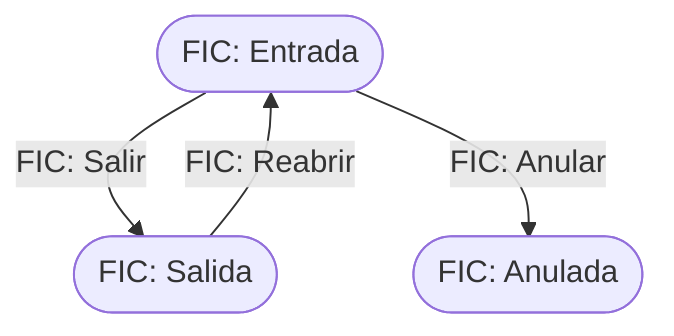

# Flujo del negocio 'Circuitos documentales' para el tipo 'FIC: Fichada'

Una fichada registra la jornada de un trabajador: se abre con la **entrada** y se cierra con la **salida**. Su tipo está registrado en el parámetro `CAD_IdsDeTiposDeFichadas`. El estado inicial del tipo es **FIC: Entrada**.

## Flujo

| Estado | Etapa | Observaciones |
|---|---|---|
| FIC: Entrada | `CAD_Etapa_Abierto` | Estado inicial. El trabajador ha fichado la entrada y está dentro. |
| FIC: Salida | `CAD_Etapa_Cerrado` | Estado terminado: jornada cerrada. |
| FIC: Anulada | `CAD_Etapa_Cancelado` | Estado final: fichada anulada. |

## Transiciones

### FIC: Entrada ---> FIC: Salir --> FIC: Salida  (sistema)
Registra la salida. Es una transición del sistema.
- Se aplica al **fichar la salida** y también, de forma automática, por el trabajo diario que cierra las fichadas que se quedaron abiertas: la fecha de salida se calcula como la de entrada más 8 horas, sin pasar de la hora de cierre del parámetro `CAD_HoraDeCierre` (19 horas por defecto). Ese trabajo ignora las fichadas del propio día.
- Al crear la fichada se valida que el usuario sea un trabajador identificable.

### FIC: Entrada ---> FIC: Anular --> FIC: Anulada  (manual)
Anula la fichada. Pide el **motivo de cancelación**. No ejecuta ninguna comprobación ni cambio propio: solo cambia de estado.

### FIC: Salida ---> FIC: Reabrir --> FIC: Entrada  (manual)
Reabre una fichada cerrada. Pide el **motivo de apertura**. No ejecuta ninguna comprobación ni cambio propio: solo cambia de estado.

## Comportamiento común a todas las transiciones
- Cada transición queda anotada en el historial (hitos) del circuito.
- Solo pueden aplicarla los usuarios con permiso sobre la transición.
- Un trabajo diario («Crear histórico de fichadas») conserva el histórico de las fichadas cerradas.
- Además, pueden existir **acciones de transición** definidas por el parametrizador (se ven al pinchar la flecha en el visor de flujo del estado), que se ejecutan antes o después de las anteriores.
