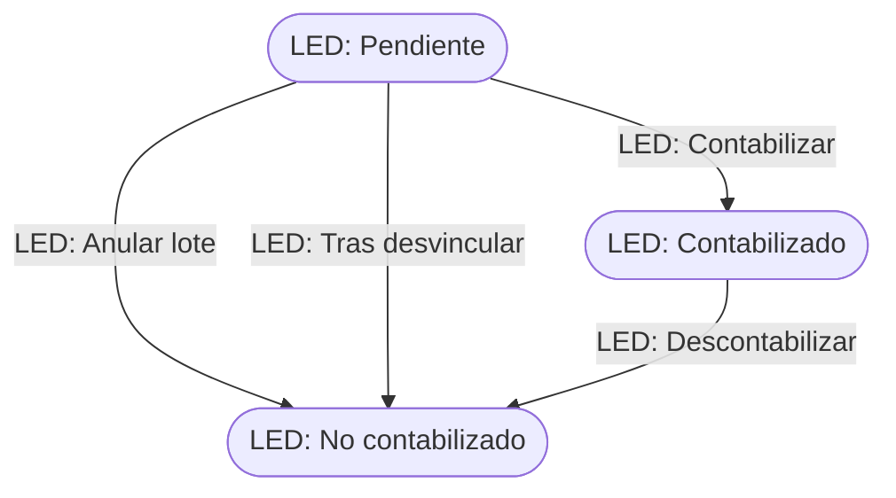

# Flujo del negocio 'Circuitos documentales' para el tipo 'LED: Estimación directa'

Un lote de estimación directa agrupa las facturas emitidas, las facturas recibidas y los pagos de un periodo para la declaración en estimación directa. Su tipo está registrado en el parámetro `CAD_Tipo_Para_Estimacion_Directa`. El estado inicial del tipo es **LED: Pendiente**.

## Flujo

| Estado | Etapa | Observaciones |
|---|---|---|
| LED: Pendiente | `CAD_Etapa_Abierto` | Estado inicial. Se le vinculan facturas y pagos. |
| LED: Contabilizado | `CAD_Etapa_Cerrado` | Estado terminado. |
| LED: No contabilizado | `CAD_Etapa_Cancelado` | Estado final: lote anulado; sus documentos vuelven a estar pendientes de estimación directa. |

## Transiciones

### LED: Pendiente ---> LED: Contabilizar --> LED: Contabilizado  (manual)
Da por contabilizado el lote. No ejecuta ninguna comprobación ni cambio propio: solo cambia de estado.

### LED: Pendiente ---> LED: Anular lote --> LED: No contabilizado  (manual)
Anula el lote. Pide el **motivo de no contabilización**.
- Tras transitar **elimina los vínculos** del lote con sus facturas emitidas, facturas recibidas y pagos: todos vuelven a estar pendientes de estimación directa.

### LED: Pendiente ---> LED: Tras desvincular --> LED: No contabilizado  (sistema)
Se aplica cuando el lote se queda **sin documentos vinculados** (se desvincula el último). Mismo tratamiento que *Anular lote*.

### LED: Contabilizado ---> LED: Descontabilizar --> LED: No contabilizado  (manual)
Deshace la contabilización. Pide el **motivo de descontabilización**.
- Antes de transitar deja la traza «Anulación de contabilización» indicando que las facturas emitidas, recibidas y pagos vuelven a estar pendientes de estimación directa.
- Tras transitar elimina los vínculos del lote con esos documentos.

## Comportamiento común a todas las transiciones
- Cada transición queda anotada en el historial (hitos) del circuito.
- Solo pueden aplicarla los usuarios con permiso sobre la transición.
- Además, pueden existir **acciones de transición** definidas por el parametrizador (se ven al pinchar la flecha en el visor de flujo del estado), que se ejecutan antes o después de las anteriores.
