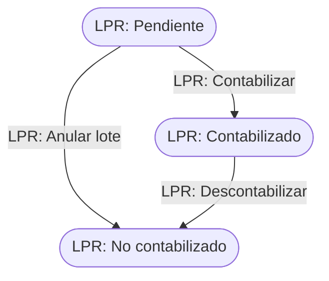

# Flujo del negocio 'Circuitos documentales' para el tipo 'LPR: Preasientos'

Un lote contable de preasientos agrupa los preasientos que se envían a la contabilidad externa (por ejemplo, al hacer un cierre contable). Su tipo está registrado en el parámetro `CAD_Tipo_Para_Lote_de_Preasientos`. El estado inicial del tipo es **LPR: Pendiente**.

## Flujo

| Estado | Etapa | Observaciones |
|---|---|---|
| LPR: Pendiente | `CAD_Etapa_Abierto` | Estado inicial. Se descargan e importan los ficheros en la contabilidad, o se regenera el lote. |
| LPR: Contabilizado | `CAD_Etapa_Cerrado` | Estado terminado: el usuario confirma que ya está traspasado. |
| LPR: No contabilizado | `CAD_Etapa_Cancelado` | Estado final: lote anulado; sus preasientos vuelven a pendiente. |

## Transiciones

### LPR: Pendiente ---> LPR: Contabilizar --> LPR: Contabilizado  (manual)
El usuario confirma que el lote ya se ha traspasado a la contabilidad. No ejecuta ninguna comprobación ni cambio propio: solo cambia de estado.

### LPR: Pendiente ---> LPR: Anular lote --> LPR: No contabilizado  (sistema)
Se aplica al **eliminar el cierre contable** (o anular el lote) cuando aún no se había contabilizado.
- Tras transitar **desasocia los preasientos** del lote: cada preasiento contabilizado vuelve a **SPR: Pendiente**.

### LPR: Contabilizado ---> LPR: Descontabilizar --> LPR: No contabilizado  (sistema)
Se aplica al **eliminar el cierre contable** de un lote ya contabilizado (solo se puede eliminar el último cierre de la sociedad).
- Antes de transitar deja la traza «Anulación de contabilización» indicando que se han desasociado sus preasientos.
- Tras transitar los preasientos del lote vuelven a **SPR: Pendiente**.

## Comportamiento común a todas las transiciones
- Cada transición queda anotada en el historial (hitos) del circuito.
- Solo pueden aplicarla los usuarios con permiso sobre la transición.
- Un lote solo se puede regenerar si es de preasientos, está abierto (pendiente) y quien lo hace es administrador del lote.
- Además, pueden existir **acciones de transición** definidas por el parametrizador (se ven al pinchar la flecha en el visor de flujo del estado), que se ejecutan antes o después de las anteriores.
- Más detalle del proceso en el manual *Proceso de cierre contable*.
