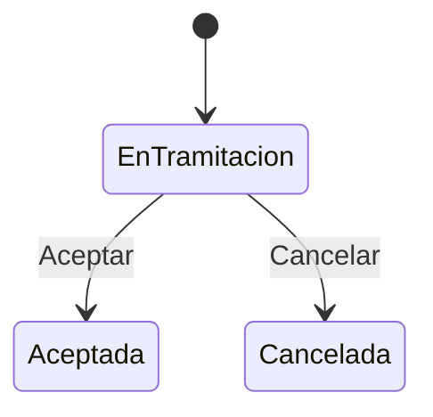

# Flujo del negocio 'Devoluciones de venta' para el tipo 'DDV: General'

Una devolución de venta recoge lo que un cliente devuelve de las líneas de sus documentos de venta (documentos de salida) ya servidos o facturados. Mientras se tramita se le añaden líneas; al aceptarla **el material vuelve a entrar en el almacén** y se **regularizan las facturas** de las ventas afectadas. El estado inicial del tipo es **DDV: En tramitación**.

El tipo con el que se crean las devoluciones desde un documento de venta es el indicado en su **tipo de documento de venta** (campo *Tipo de devolución*, en el mantenimiento de tipos de documentos de venta). Si no está indicado, no se puede devolver y se pide parametrizarlo.

Nunca se emite ninguna factura al aceptar una devolución: solo se crean **prefacturas**, que no se comunican a Hacienda hasta que se emiten desde la factura.

## Cómo se crea una devolución

- **Desde la devolución de venta**: se crea indicando el cliente y se le añaden líneas eligiendo la línea vendida de un documento de venta del mismo cliente.
- **Desde el documento de venta facturado**: el icono rojo **Devolver** de una línea abre la modal *Devolver línea*, en la que se indica la cantidad y, si se quiere, una devolución del cliente que aún esté en tramitación. Si no se indica, se crea una nueva.
- **Desde el documento de venta servido**: el icono **Devolver** abre *Modificar lo servido* (cantidad y precio). Si la salida del almacén está en un periodo cerrado (su preasiento está contabilizado, o es anterior o igual al último cierre contable), la salida no se modifica y lo que se deja de servir se mete en una devolución nueva en tramitación.

Al guardar una línea se valida que:
- la línea vendida sea de un documento de venta **servido o facturado** y del **mismo cliente** que la devolución;
- no se devuelva más de lo que queda por devolver (lo vendido menos lo ya devuelto en otras devoluciones que no estén canceladas);
- el precio y el descuento son los de la venta (no se pueden cambiar).

Las devoluciones de un documento de venta se ven en su expansor **Devoluciones**: referencia de la devolución, artículo devuelto, cantidad y estado (*Solicitada*, *Aceptada* o *Cancelada*). Desde ahí se puede aceptar (check verde), cancelar o abrir la devolución. El check y el cancelar solo están activos mientras la devolución se tramita.

## Flujo

| Estado | Etapa | Observaciones |
|---|---|---|
| DDV: En tramitación | `DDV_Etapa_Tramitacion` | Estado inicial. Se editan sus datos y sus líneas. Lo que tiene ya cuenta como devuelto al calcular lo que queda por devolver, pero aún no ha entrado nada en el almacén ni se ha tocado ninguna factura. |
| DDV: Aceptada | `DDV_Etapa_Aceptada` | Estado terminado. El material ha entrado en el almacén y las facturas están regularizadas. Solo consulta. |
| DDV: Cancelada | `DDV_Etapa_Cancelada` | Estado final. La devolución no se hace: no hay movimientos ni cambios en facturas, y lo que tenía deja de contar como devuelto. Solo consulta. |

## Transiciones

### DDV: En tramitación ---> DDV: Aceptar --> DDV: Aceptada  (manual)
Se acepta lo devuelto: **entra en el almacén, se preasienta y se regularizan las facturas**. También se aplica con el check verde del expansor *Devoluciones* del documento de venta.
- Antes de transitar:
  - la devolución ha de tener líneas, y cada una se vuelve a validar (venta servida o facturada, mismo cliente, no más de lo pendiente);
  - se fija la fecha de la devolución (`DevueltaEl`): la indicada o, si no lo está, hoy. No puede ser posterior a hoy ni anterior a la fecha en que se sirvieron las ventas;
  - si la fecha cae en un **periodo cerrado** (en o antes del último cierre contable de la sociedad del almacén), la devolución se hace el **día siguiente al cierre**, de modo que sus movimientos y preasientos van al periodo abierto;
  - se valida que las facturas de las ventas afectadas se puedan regularizar: han de tener lo que se devuelve y, si están emitidas, no pueden ser rectificativas ni estar ya rectificadas.
- Después de transitar:
  - por cada línea se crea una **entrada en el almacén** de la venta a la fecha de la devolución, valorada al precio al que salió (el de la salida de la venta). Al crearla se recalcula el inventario, se **preasienta** al revés que la salida si el almacén no usa la variación de existencias, y se **barren** los movimientos posteriores del material;
  - se **regularizan las facturas** de las ventas devueltas (ver más abajo);
  - se genera el **documento de la devolución** en PDF y se anexa a los archivos de la devolución;
  - queda anotado en la traza (entradas en el almacén y facturas regularizadas).

### DDV: En tramitación ---> DDV: Cancelar --> DDV: Cancelada  (manual)
La devolución no se hace. También se aplica con el icono de cancelar del expansor *Devoluciones* del documento de venta, que sustituye al borrado.
- No se crean movimientos en el almacén ni se toca ninguna factura.
- Lo que tenía deja de contar como devuelto: esas cantidades se pueden volver a devolver y no impiden cambiar los datos del documento de venta.

## Regularización de las facturas al aceptar

Para cada factura a la que apuntan los documentos de venta devueltos:

- **Si es una prefactura** (aún no comunicada a Hacienda) se le **quita lo devuelto**: cada línea que factura una línea devuelta se queda con lo que no se devuelve o, si se devuelve todo, se borra. Queda anotado en la traza de la prefactura.
- **Si está emitida** se rectifica por completo con una **prefactura rectificativa total** (por sustitución) y, si no se ha devuelto todo, se crea una **prefactura de sustitución** con lo que realmente se vende. Los documentos de venta pasan a apuntar a la prefactura de sustitución, de modo que una devolución posterior regulariza esta, que no está rectificada. No se hacen rectificativas por diferencias.
- **Si el documento de venta no está facturado** no hay factura que regularizar. Al facturarlo, la prefactura ya descuenta lo devuelto en devoluciones aceptadas.

Cada línea de factura recuerda la línea vendida que factura, y la rectificativa y la prefactura de sustitución la conservan. Así se sabe en todo momento qué se ha facturado de cada línea vendida.

**Lo que se devuelve solo se devuelve desde el documento de venta.** En una prefactura, el usuario no puede cambiar el material, la cantidad, el precio ni el descuento de una línea que factura una línea vendida, ni borrarla: eso solo lo hace el sistema al aceptar una devolución. Tampoco se puede copiar una factura que factura material de documentos de venta (sería facturar material que no ha salido del almacén). Una factura no se puede emitir mientras alguna de las líneas vendidas que factura tenga una devolución **en tramitación**: emitirla facturaría material devuelto y dejaría el almacén con menos existencias de las que hay, así que antes hay que aceptar o cancelar la devolución. Al emitir se sigue validando, como red de seguridad, que la base imponible sea lo vendido menos lo devuelto en devoluciones aceptadas.

## Comportamiento común a todas las transiciones
- Cada transición queda anotada en el historial (hitos) de la devolución.
- Solo pueden aplicarla los usuarios con permiso sobre la transición.
- Además, pueden existir **acciones de transición** definidas por el parametrizador (se ven al pinchar la flecha en el visor de flujo del estado), que se ejecutan antes o después de las anteriores.
- El flujo del documento de venta del que se devuelve está descrito en la ayuda del flujo *Documentos de venta*.
