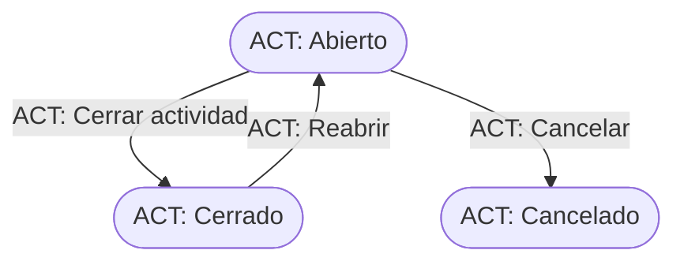

# Flujo del negocio 'Expedientes' para el tipo 'ACT: Actividades formativas'

Un expediente de actividades formativas recoge una actividad formativa de la organización. Es un expediente con valoración que usa presupuestos y está registrado en el parámetro `EXP_Tipos_Para_Actividades`. El estado inicial del tipo es **ACT: Abierto**.

Todas las transiciones de este flujo las aplica el usuario desde el expediente.

## Flujo

| Estado | Etapa | Observaciones |
|---|---|---|
| ACT: Abierto | `EXP_Etapa_Inicial`, `EXP_Etapa_Asociar_Tareas`, `EXP_Etapa_Asociar_Presupuestos`, `EXP_Etapa_Ejecucion` | Estado inicial. Se asocian tareas y presupuestos. |
| ACT: Cerrado | `EXP_Etapa_Terminada` | Estado terminado. |
| ACT: Cancelado | `EXP_Etapa_Cancelada` | Estado final: actividad anulada. |

## Transiciones

### ACT: Abierto ---> ACT: Cerrar actividad --> ACT: Cerrado
Cierra la actividad (es la transición por defecto del estado). Exige que no haya **tareas en proceso** ni **presupuestos sin terminar** asociados.

### ACT: Abierto ---> ACT: Cancelar --> ACT: Cancelado
Cancela la actividad. Pide el **motivo de cancelación**. No deja si el expediente tiene tareas realizadas o en proceso, ni elementos dependientes (presupuestos, facturas...).

### ACT: Cerrado ---> ACT: Reabrir --> ACT: Abierto
Reabre la actividad. Pide el **motivo de reapertura**. No ejecuta ninguna comprobación ni cambio propio: solo cambia de estado.

## Comportamiento común a todas las transiciones
- Cada transición queda anotada en el historial (hitos) del expediente.
- Solo pueden aplicarla los usuarios con permiso sobre la transición.
- Un expediente de cliente no transita si el cliente está de baja.
- Además, pueden existir **acciones de transición** definidas por el parametrizador (se ven al pinchar la flecha en el visor de flujo del estado), que se ejecutan antes o después de las anteriores.
