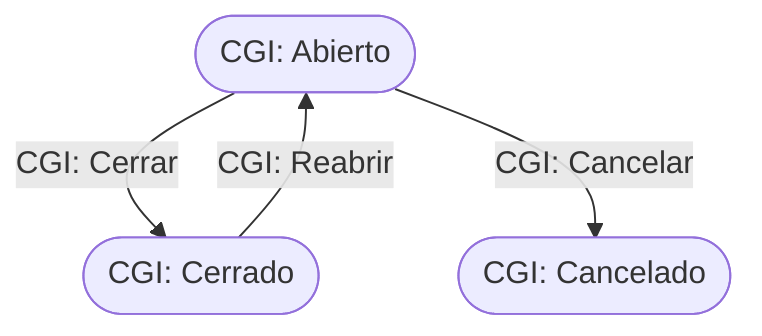

# Flujo del negocio 'Expedientes' para el tipo 'CGI: Contabilización'

Un expediente de contabilización lleva la contabilidad de un cliente. Al crearlo se crean los **archivadores** de gastos, ingresos y contabilizados del año en curso. El estado inicial del tipo es **CGI: Abierto**.

Todas las transiciones de este flujo las aplica el usuario desde el expediente.

## Flujo

| Estado | Etapa | Observaciones |
|---|---|---|
| CGI: Abierto | `EXP_Etapa_Inicial`, `EXP_Etapa_Asociar_Tareas`, `EXP_Etapa_Ejecucion` | Estado inicial. |
| CGI: Cerrado | `EXP_Etapa_Terminada` | Estado terminado. |
| CGI: Cancelado | `EXP_Etapa_Cancelada` | Estado final: expediente anulado. |

## Transiciones

### CGI: Abierto ---> CGI: Cerrar --> CGI: Cerrado
Cierra el expediente. Exige que no haya tareas en proceso ni presupuestos sin terminar.
- Antes de transitar **bloquea los archivadores** de gastos, ingresos y contabilizados.

### CGI: Abierto ---> CGI: Cancelar --> CGI: Cancelado
Cancela el expediente. Pide el **motivo de cancelación**. No deja si tiene tareas realizadas o en proceso, ni elementos dependientes.
- Antes de transitar **da de baja** los archivadores de gastos, ingresos y contabilizados.

### CGI: Cerrado ---> CGI: Reabrir --> CGI: Abierto
Reabre el expediente. Pide el **motivo de reapertura**.
- Tras transitar **desbloquea** los archivadores de gastos, ingresos y contabilizados.

## Comportamiento común a todas las transiciones
- Cada transición queda anotada en el historial (hitos) del expediente.
- Solo pueden aplicarla los usuarios con permiso sobre la transición.
- Un expediente de cliente no transita si el cliente está de baja.
- Además, pueden existir otras **acciones de transición** definidas por el parametrizador (se ven al pinchar la flecha en el visor de flujo del estado), que se ejecutan antes o después de las anteriores.
