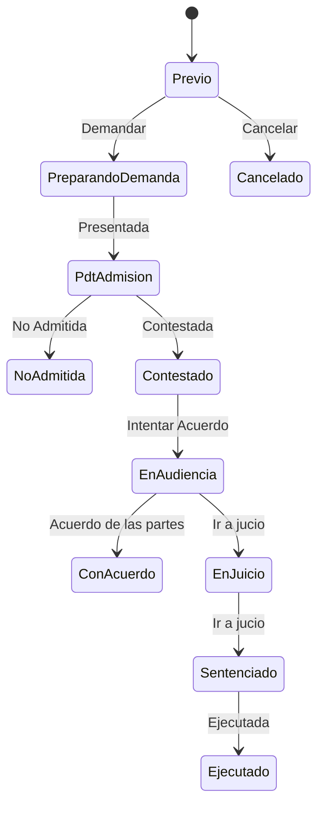

# Flujo del negocio 'Expedientes' para el tipo 'CIV: Procedimiento Civil'

Un expediente de procedimiento civil sigue una demanda civil desde la fase previa hasta la sentencia y su ejecución. Es un expediente jurídico (clase *juridico*) que usa presupuestos y datos jurídicos (NIG y número de procedimiento). El estado inicial del tipo es **CIV: Previo**.

Todas las transiciones de este flujo las aplica el usuario desde el expediente.

## Flujo

En el diagrama, *PreparandoDemanda* es **CIV: Preparando demanda**, *PdtAdmision* es **CIV: Pdt de admisión**, *EnAudiencia* es **CIV: En audiencia** y *EnJuicio* es **CIV: En jucio** (el nombre tiene esa errata en el código).

| Estado | Etapa | Observaciones |
|---|---|---|
| CIV: Previo | `EXP_Etapa_Inicial`, `EXP_Etapa_Asociar_Presupuestos` | Estado inicial. Se asocian los presupuestos. |
| CIV: Preparando demanda | `EXP_Etapa_Asociar_Tareas`, `EXP_Etapa_Ejecucion` | Se redacta la demanda. |
| CIV: Pdt de admisión | `EXP_Etapa_En_Juzgado`, `EXP_Etapa_Ejecucion` | Presentada en el juzgado; a la espera de admisión. |
| CIV: Contestado | `EXP_Etapa_En_Juzgado`, `EXP_Etapa_Ejecucion` | La parte contraria ha contestado. |
| CIV: En audiencia | `EXP_Etapa_En_Juzgado`, `EXP_Etapa_Ejecucion` | Audiencia previa; se intenta un acuerdo. |
| CIV: En jucio | `EXP_Etapa_En_Juzgado`, `EXP_Etapa_Ejecucion` | En juicio. |
| CIV: Sentenciado | `EXP_Etapa_En_Juzgado`, `EXP_Etapa_Ejecucion` | Hay sentencia. |
| CIV: Ejecutado | `EXP_Etapa_Terminada` | Estado terminado: sentencia ejecutada. |
| CIV: No admitida | `EXP_Etapa_Terminada` | Estado terminado: el juzgado no admite la demanda. |
| CIV: Con acuerdo | `EXP_Etapa_Terminada` | Estado terminado: acuerdo entre las partes. |
| CIV: Cancelado | `EXP_Etapa_Cancelada` | Estado final: expediente anulado antes de demandar. |

## Transiciones

### CIV: Previo ---> CIV: Demandar --> CIV: Preparando demanda
Empieza a preparar la demanda (transición por defecto del estado). Si el expediente tiene presupuestos, exige una dirección de contacto o fiscal activa asociada.

### CIV: Previo ---> CIV: Cancelar --> CIV: Cancelado
Cancela el expediente. Pide el **motivo de cancelación**. No deja si tiene tareas realizadas o en proceso, ni elementos dependientes.

### CIV: Preparando demanda ---> CIV: Presentada --> CIV: Pdt de admisión
Presenta la demanda en el juzgado. A partir de aquí el expediente está **en juzgado**: los datos jurídicos exigen **NIG** y **número de procedimiento**, y el NIG debe cumplir la expresión regular configurada.

### CIV: Pdt de admisión ---> CIV: No Admitida --> CIV: No admitida
El juzgado no admite la demanda. Pide el **motivo de no admisión**. Exige que no haya tareas en proceso ni presupuestos sin terminar.

### CIV: Pdt de admisión ---> CIV: Contestada --> CIV: Contestado
La parte contraria contesta a la demanda. No ejecuta ninguna comprobación ni cambio propio: solo cambia de estado.

### CIV: Contestado ---> CIV: Intentar Acuerdo --> CIV: En audiencia
Pasa a la audiencia previa para intentar un acuerdo. No ejecuta ninguna comprobación ni cambio propio: solo cambia de estado.

### CIV: En audiencia ---> CIV: Acuerdo de las partes --> CIV: Con acuerdo
Las partes llegan a un acuerdo (transición por defecto del estado). Exige que no haya tareas en proceso ni presupuestos sin terminar.

### CIV: En audiencia ---> CIV: Ir a jucio --> CIV: En jucio
No hay acuerdo y se va a juicio. Pide el **motivo del no acuerdo**.

### CIV: En jucio ---> CIV: Ir a jucio --> CIV: Sentenciado
Dicta sentencia. La transición se llama igual que la anterior (*Ir a jucio*) en el código. No ejecuta ninguna comprobación ni cambio propio: solo cambia de estado.

### CIV: Sentenciado ---> CIV: Ejecutada --> CIV: Ejecutado
Da por ejecutada la sentencia. Exige que no haya tareas en proceso ni presupuestos sin terminar.

## Comportamiento común a todas las transiciones
- Cada transición queda anotada en el historial (hitos) del expediente.
- Solo pueden aplicarla los usuarios con permiso sobre la transición.
- Además, pueden existir **acciones de transición** definidas por el parametrizador (se ven al pinchar la flecha en el visor de flujo del estado), que se ejecutan antes o después de las anteriores.
