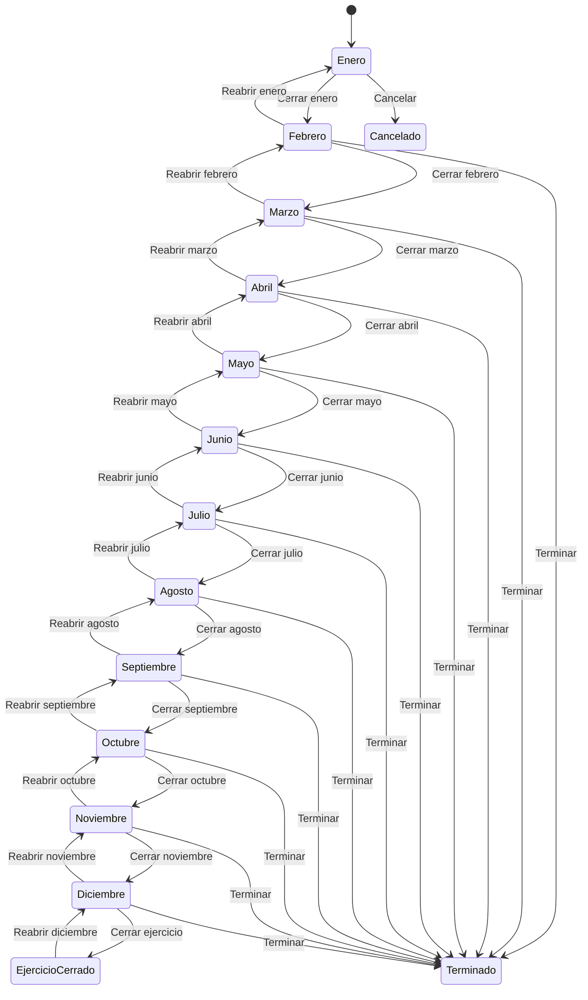

# Flujo del negocio 'Expedientes' para el tipo 'FCT: Facturación'

Un expediente de facturación agrupa las facturas de un cliente durante un ejercicio, mes a mes. Se abre en **enero**, se va cerrando cada mes (lo que cierra el archivador de facturas de ese mes y abre el de los siguientes) y al cerrar diciembre se abre automáticamente el expediente del ejercicio siguiente. El estado inicial del tipo es **FCT: Enero**.

Todas las transiciones de este flujo las aplica el usuario desde el expediente.

## Flujo

| Estado | Etapa | Observaciones |
|---|---|---|
| FCT: Enero | `EXP_Etapa_Inicial`, `EXP_Etapa_Ejecucion`, `EXP_Etapa_Asociar_Tareas` | Estado inicial. Admite tareas. |
| FCT: Febrero ... FCT: Diciembre | `EXP_Etapa_Ejecucion`, `EXP_Etapa_Asociar_Tareas` | Un estado por mes abierto. |
| FCT: Ejercicio cerrado | `EXP_Etapa_Terminada` | Estado terminado: ejercicio cerrado; el expediente del ejercicio siguiente ya está abierto. |
| FCT: Terminado | `EXP_Etapa_Terminada` | Estado terminado: se da por concluido antes de acabar el ejercicio. |
| FCT: Cancelado | `EXP_Etapa_Cancelada` | Estado final: expediente anulado (solo desde enero). |

## Transiciones

### FCT: Enero ---> FCT: Cerrar enero --> FCT: Febrero
Cierra enero y pasa al mes siguiente. Tras transitar **cierra el archivador de facturas de enero** y **abre el de marzo**.

### FCT: Febrero ---> FCT: Reabrir enero --> FCT: Enero
Vuelve a enero. Pide el **motivo de reapertura**. Tras transitar **reabre el archivador de facturas de enero** y vuelve a cerrar el de marzo.

### FCT: Febrero ---> FCT: Cerrar febrero --> FCT: Marzo
Cierra febrero y pasa al mes siguiente. Tras transitar **cierra el archivador de facturas de febrero** y **abre el de abril**.

### FCT: Marzo ---> FCT: Reabrir febrero --> FCT: Febrero
Vuelve a febrero. Pide el **motivo de reapertura**. Tras transitar **reabre el archivador de facturas de febrero** y vuelve a cerrar el de abril.

### FCT: Marzo ---> FCT: Cerrar marzo --> FCT: Abril
Cierra marzo y pasa al mes siguiente. Tras transitar **cierra el archivador de facturas de marzo** y **abre el de mayo**.

### FCT: Abril ---> FCT: Reabrir marzo --> FCT: Marzo
Vuelve a marzo. Pide el **motivo de reapertura**. Tras transitar **reabre el archivador de facturas de marzo** y vuelve a cerrar el de mayo.

### FCT: Abril ---> FCT: Cerrar abril --> FCT: Mayo
Cierra abril y pasa al mes siguiente. Tras transitar **cierra el archivador de facturas de abril** y **abre el de junio**.

### FCT: Mayo ---> FCT: Reabrir abril --> FCT: Abril
Vuelve a abril. Pide el **motivo de reapertura**. Tras transitar **reabre el archivador de facturas de abril** y vuelve a cerrar el de junio.

### FCT: Mayo ---> FCT: Cerrar mayo --> FCT: Junio
Cierra mayo y pasa al mes siguiente. Tras transitar **cierra el archivador de facturas de mayo** y **abre el de julio**.

### FCT: Junio ---> FCT: Reabrir mayo --> FCT: Mayo
Vuelve a mayo. Pide el **motivo de reapertura**. Tras transitar **reabre el archivador de facturas de mayo** y vuelve a cerrar el de julio.

### FCT: Junio ---> FCT: Cerrar junio --> FCT: Julio
Cierra junio y pasa al mes siguiente. Tras transitar **cierra el archivador de facturas de junio** y **abre el de agosto**.

### FCT: Julio ---> FCT: Reabrir junio --> FCT: Junio
Vuelve a junio. Pide el **motivo de reapertura**. Tras transitar **reabre el archivador de facturas de junio** y vuelve a cerrar el de agosto.

### FCT: Julio ---> FCT: Cerrar julio --> FCT: Agosto
Cierra julio y pasa al mes siguiente. Tras transitar **cierra el archivador de facturas de julio** y **abre el de septiembre**.

### FCT: Agosto ---> FCT: Reabrir julio --> FCT: Julio
Vuelve a julio. Pide el **motivo de reapertura**. Tras transitar **reabre el archivador de facturas de julio** y vuelve a cerrar el de septiembre.

### FCT: Agosto ---> FCT: Cerrar agosto --> FCT: Septiembre
Cierra agosto y pasa al mes siguiente. Tras transitar **cierra el archivador de facturas de agosto** y **abre el de octubre**.

### FCT: Septiembre ---> FCT: Reabrir agosto --> FCT: Agosto
Vuelve a agosto. Pide el **motivo de reapertura**. Tras transitar **reabre el archivador de facturas de agosto** y vuelve a cerrar el de octubre.

### FCT: Septiembre ---> FCT: Cerrar septiembre --> FCT: Octubre
Cierra septiembre y pasa al mes siguiente. Tras transitar **cierra el archivador de facturas de septiembre** y **abre el de noviembre**.

### FCT: Octubre ---> FCT: Reabrir septiembre --> FCT: Septiembre
Vuelve a septiembre. Pide el **motivo de reapertura**. Tras transitar **reabre el archivador de facturas de septiembre** y vuelve a cerrar el de noviembre.

### FCT: Octubre ---> FCT: Cerrar octubre --> FCT: Noviembre
Cierra octubre y pasa al mes siguiente. Tras transitar **cierra el archivador de facturas de octubre** y **abre el de diciembre**.

### FCT: Noviembre ---> FCT: Reabrir octubre --> FCT: Octubre
Vuelve a octubre. Pide el **motivo de reapertura**. Tras transitar **reabre el archivador de facturas de octubre** y vuelve a cerrar el de diciembre.

### FCT: Noviembre ---> FCT: Cerrar noviembre --> FCT: Diciembre
Cierra noviembre y pasa a diciembre. Tras transitar **cierra el archivador de facturas de noviembre**.

### FCT: Diciembre ---> FCT: Reabrir noviembre --> FCT: Noviembre
Vuelve a noviembre. Pide el **motivo de reapertura**. Tras transitar **reabre el archivador de facturas de noviembre**.

### FCT: Diciembre ---> FCT: Cerrar ejercicio --> FCT: Ejercicio cerrado
Cierra el ejercicio. Tras transitar cierra el archivador de facturas de diciembre y **crea el expediente de facturación del ejercicio siguiente**, enlazado con este.

### FCT: Ejercicio cerrado ---> FCT: Reabrir diciembre --> FCT: Diciembre
Reabre el ejercicio y vuelve a diciembre.

### FCT: Enero ---> FCT: Cancelar --> FCT: Cancelado
Cancela el expediente. Pide el **motivo de cancelación**. No deja si tiene tareas realizadas o en proceso ni elementos dependientes.

### FCT: Febrero ---> FCT: Terminar --> FCT: Terminado
Da el expediente por terminado sin esperar a fin de ejercicio. Pide el **motivo de terminación**.

### FCT: Marzo ---> FCT: Terminar --> FCT: Terminado
Da el expediente por terminado sin esperar a fin de ejercicio. Pide el **motivo de terminación**.

### FCT: Abril ---> FCT: Terminar --> FCT: Terminado
Da el expediente por terminado sin esperar a fin de ejercicio. Pide el **motivo de terminación**.

### FCT: Mayo ---> FCT: Terminar --> FCT: Terminado
Da el expediente por terminado sin esperar a fin de ejercicio. Pide el **motivo de terminación**.

### FCT: Junio ---> FCT: Terminar --> FCT: Terminado
Da el expediente por terminado sin esperar a fin de ejercicio. Pide el **motivo de terminación**.

### FCT: Julio ---> FCT: Terminar --> FCT: Terminado
Da el expediente por terminado sin esperar a fin de ejercicio. Pide el **motivo de terminación**.

### FCT: Agosto ---> FCT: Terminar --> FCT: Terminado
Da el expediente por terminado sin esperar a fin de ejercicio. Pide el **motivo de terminación**.

### FCT: Septiembre ---> FCT: Terminar --> FCT: Terminado
Da el expediente por terminado sin esperar a fin de ejercicio. Pide el **motivo de terminación**.

### FCT: Octubre ---> FCT: Terminar --> FCT: Terminado
Da el expediente por terminado sin esperar a fin de ejercicio. Pide el **motivo de terminación**.

### FCT: Noviembre ---> FCT: Terminar --> FCT: Terminado
Da el expediente por terminado sin esperar a fin de ejercicio. Pide el **motivo de terminación**.

### FCT: Diciembre ---> FCT: Terminar --> FCT: Terminado
Da el expediente por terminado sin esperar a fin de ejercicio. Pide el **motivo de terminación**.

## Comportamiento común a todas las transiciones
- Cada transición queda anotada en el historial (hitos) del expediente.
- Solo pueden aplicarla los usuarios con permiso sobre la transición.
- Un expediente de cliente no transita si el cliente está de baja.
- Al terminar el expediente no puede haber tareas en proceso ni presupuestos sin terminar.
- Al crear el expediente se crean los archivadores de facturas de enero y febrero.
- Además, pueden existir **acciones de transición** definidas por el parametrizador (se ven al pinchar la flecha en el visor de flujo del estado), que se ejecutan antes o después de las anteriores.
