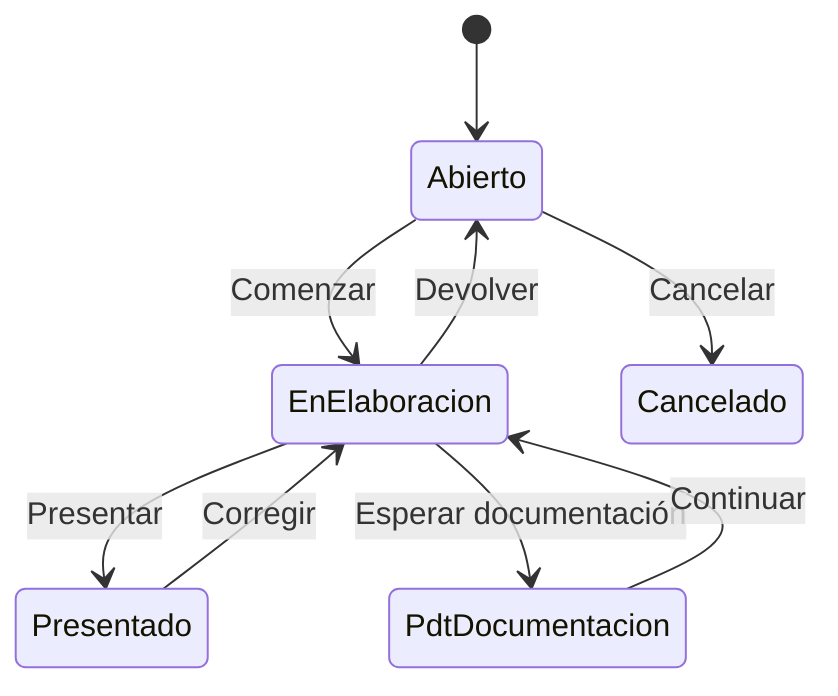

# Flujo del negocio 'Expedientes' para el tipo 'IRPF: Renta'

Un expediente de renta gestiona la declaración del IRPF de un cliente: se recoge la documentación, se elabora la declaración y se presenta. Al crearlo se crea un archivador para la documentación del IRPF del año en curso. El estado inicial del tipo es **IRPF: Abierto**.

Todas las transiciones de este flujo las aplica el usuario desde el expediente.

## Flujo

En el diagrama, *EnElaboracion* es **IRPF: En elaboración** y *PdtDocumentacion* es **IRPF: Pdt de documentación**.

| Estado | Etapa | Observaciones |
|---|---|---|
| IRPF: Abierto | `EXP_Etapa_Inicial`, `EXP_Etapa_Asociar_Tareas` | Estado inicial. Se recoge la documentación. |
| IRPF: En elaboración | `EXP_Etapa_Asociar_Tareas`, `EXP_Etapa_Ejecucion` | Se elabora la declaración. |
| IRPF: Pdt de documentación | `EXP_Etapa_Asociar_Tareas` | A la espera de documentación del cliente. |
| IRPF: Presentado | `EXP_Etapa_Terminada` | Estado terminado: declaración presentada. |
| IRPF: Cancelado | `EXP_Etapa_Cancelada` | Estado final: expediente anulado. |

## Transiciones

### IRPF: Abierto ---> IRPF: Comenzar --> IRPF: En elaboración
Empieza la elaboración de la declaración. No ejecuta ninguna comprobación ni cambio propio: solo cambia de estado.

### IRPF: Abierto ---> IRPF: Cancelar --> IRPF: Cancelado
Cancela el expediente. Pide el **motivo de cancelación**. No deja si tiene tareas realizadas o en proceso, ni elementos dependientes.
- Antes de transitar **cierra el archivador** del IRPF (lo da de baja).

### IRPF: En elaboración ---> IRPF: Presentar --> IRPF: Presentado
Presenta la declaración. Exige que no haya tareas en proceso ni presupuestos sin terminar.
- Antes de transitar **cierra el archivador** de la documentación del IRPF.

### IRPF: En elaboración ---> IRPF: Devolver --> IRPF: Abierto
Devuelve el expediente a abierto. Pide el **motivo de devolución**. No ejecuta ninguna comprobación ni cambio propio: solo cambia de estado.

### IRPF: En elaboración ---> IRPF: Esperar documentación --> IRPF: Pdt de documentación
Pausa la elaboración a la espera de documentación. Pide el **motivo de espera**.

### IRPF: Pdt de documentación ---> IRPF: Continuar --> IRPF: En elaboración
Reanuda la elaboración al recibir la documentación. No ejecuta ninguna comprobación ni cambio propio: solo cambia de estado.

### IRPF: Presentado ---> IRPF: Corregir --> IRPF: En elaboración
Reabre una declaración presentada para corregirla. Pide el **motivo de corrección**.
- Antes de transitar **reabre el archivador** del IRPF.

## Comportamiento común a todas las transiciones
- Cada transición queda anotada en el historial (hitos) del expediente.
- Solo pueden aplicarla los usuarios con permiso sobre la transición.
- Un expediente de cliente no transita si el cliente está de baja.
- Además, pueden existir otras **acciones de transición** definidas por el parametrizador (se ven al pinchar la flecha en el visor de flujo del estado), que se ejecutan antes o después de las anteriores.
