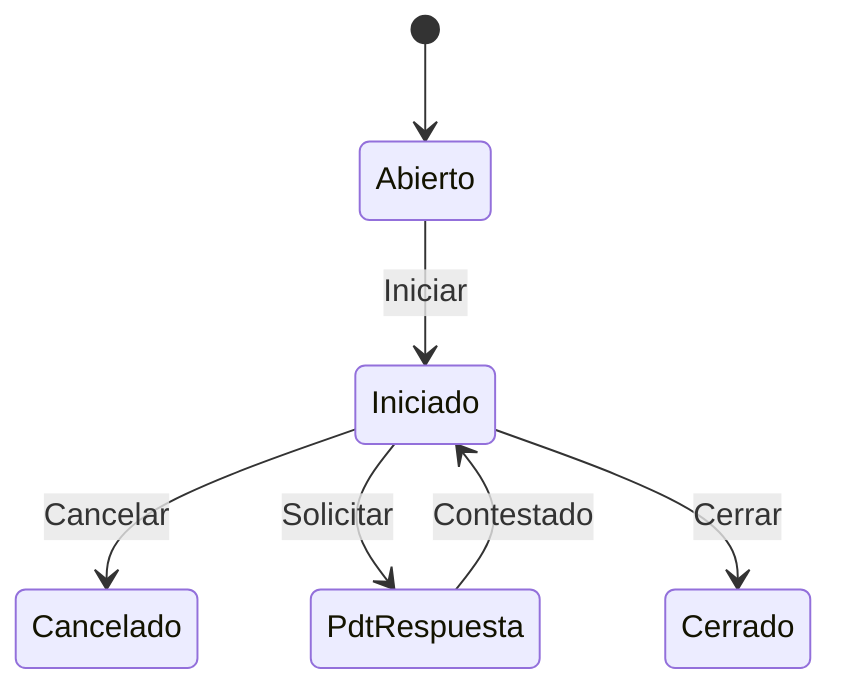

# Flujo del negocio 'Expedientes' para el tipo 'JUR: Jurídico'

Un expediente jurídico recoge un asunto jurídico genérico (clase *juridico*). Mientras se tramita puede quedar a la espera de la respuesta de un tercero. El estado inicial del tipo es **JUR: Abierto**.

La transición *Contestado* es **del sistema**; las demás las aplica el usuario desde el expediente.

## Flujo

En el diagrama, *PdtRespuesta* es **JUR: Pdt de respuesta**.

| Estado | Etapa | Observaciones |
|---|---|---|
| JUR: Abierto | `EXP_Etapa_Inicial`, `EXP_Etapa_Asociar_Tareas`, `EXP_Etapa_Asociar_Presupuestos` | Estado inicial. |
| JUR: Iniciado | `EXP_Etapa_Asociar_Tareas`, `EXP_Etapa_Asociar_Presupuestos` | En tramitación. |
| JUR: Pdt de respuesta | `EXP_Etapa_Asociar_Tareas`, `EXP_Etapa_Asociar_Presupuestos` | A la espera de que alguien conteste. |
| JUR: Cerrado | `EXP_Etapa_Terminada` | Estado terminado. |
| JUR: Cancelado | `EXP_Etapa_Cancelada` | Estado final: expediente anulado. |

## Transiciones

### JUR: Abierto ---> JUR: Iniciar --> JUR: Iniciado
Inicia la tramitación. Si el expediente tiene presupuestos, exige una dirección de contacto o fiscal activa asociada.

### JUR: Iniciado ---> JUR: Cancelar --> JUR: Cancelado
Cancela el expediente. Pide el **motivo de cancelación** (con observación). Solo se comprueba la cancelación completa (tareas y dependientes) cuando se cancela desde la etapa de asociar presupuestos.

### JUR: Iniciado ---> JUR: Solicitar --> JUR: Pdt de respuesta
Queda a la espera de una respuesta. Pide **a la espera de qué** se queda («A la espera de»). No ejecuta ninguna comprobación ni cambio propio: solo cambia de estado.

### JUR: Iniciado ---> JUR: Cerrar --> JUR: Cerrado
Cierra el expediente. Pide el **resultado**. Exige que no haya tareas en proceso ni presupuestos sin terminar.

### JUR: Pdt de respuesta ---> JUR: Contestado --> JUR: Iniciado  (sistema)
Se aplica al recibir la respuesta. Pide anotar **qué han contestado**. Es una transición del sistema: en el código revisado no se ha localizado qué proceso la aplica.

## Comportamiento común a todas las transiciones
- Cada transición queda anotada en el historial (hitos) del expediente.
- Solo pueden aplicarla los usuarios con permiso sobre la transición.
- Además, pueden existir **acciones de transición** definidas por el parametrizador (se ven al pinchar la flecha en el visor de flujo del estado), que se ejecutan antes o después de las anteriores.
