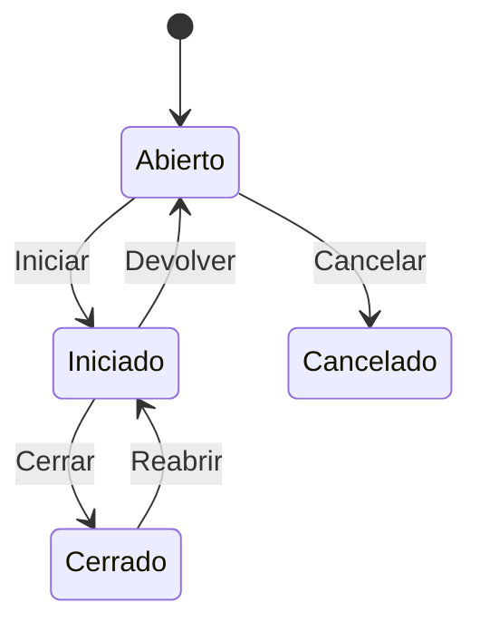

# Flujo del negocio 'Expedientes' para el tipo 'OBR: Obra'

Un expediente de obra agrupa los presupuestos, tareas y gastos de una obra. Es un expediente con valoración que usa presupuestos. El estado inicial del tipo es **OBR: Abierto**.

Todas las transiciones de este flujo las aplica el usuario desde el expediente.

## Flujo

| Estado | Etapa | Observaciones |
|---|---|---|
| OBR: Abierto | `EXP_Etapa_Inicial`, `EXP_Etapa_Asociar_Tareas`, `EXP_Etapa_Asociar_Presupuestos` | Estado inicial. Se asocian presupuestos y tareas. |
| OBR: Iniciado | `EXP_Etapa_Asociar_Tareas`, `EXP_Etapa_Asociar_Presupuestos`, `EXP_Etapa_Ejecucion` | La obra está en ejecución. |
| OBR: Cerrado | `EXP_Etapa_Terminada` | Estado terminado. |
| OBR: Cancelado | `EXP_Etapa_Cancelada` | Estado final: obra anulada. |

## Transiciones

### OBR: Abierto ---> OBR: Iniciar --> OBR: Iniciado
Pone la obra en ejecución. Si el expediente tiene presupuestos, exige una **dirección de contacto o fiscal** activa asociada.

### OBR: Abierto ---> OBR: Cancelar --> OBR: Cancelado
Cancela la obra. Pide el **motivo de cancelación**. No deja si tiene tareas realizadas o en proceso, ni elementos dependientes (presupuestos, facturas...).

### OBR: Iniciado ---> OBR: Devolver --> OBR: Abierto
Devuelve la obra a abierto. Pide el **motivo de devolución a inicial**. No ejecuta ninguna comprobación ni cambio propio: solo cambia de estado.

### OBR: Iniciado ---> OBR: Cerrar --> OBR: Cerrado
Cierra la obra. Pide la **anotación de cierre**. Exige que no haya tareas en proceso ni presupuestos sin terminar.

### OBR: Cerrado ---> OBR: Reabrir --> OBR: Iniciado
Reabre la obra. Pide la **anotación de reapertura**. No ejecuta ninguna comprobación ni cambio propio: solo cambia de estado.

## Comportamiento común a todas las transiciones
- Cada transición queda anotada en el historial (hitos) del expediente.
- Solo pueden aplicarla los usuarios con permiso sobre la transición.
- Un expediente de cliente no transita si el cliente está de baja.
- Además, pueden existir **acciones de transición** definidas por el parametrizador (se ven al pinchar la flecha en el visor de flujo del estado), que se ejecutan antes o después de las anteriores.
