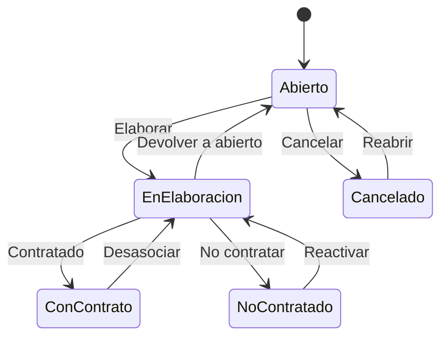

# Flujo del negocio 'Expedientes' para el tipo 'SCC: Compra'

Un expediente de solicitud de contrato de compra recoge la necesidad de contratar un servicio o suministro con un proveedor. Se le asocian contratos de compra. El estado inicial del tipo es **SCC: Abierto**.

Las transiciones *Contratado* y *Desasociar* son **del sistema**; las demás las aplica el usuario desde el expediente.

> A diferencia de *SCV: Venta*, en el código de inicialización no se han definido acciones de transición (validaciones sobre los contratos) para este tipo: solo se definen para el de venta.

## Flujo

En el diagrama, *EnElaboracion* es **SCC: En elaboración**, *ConContrato* es **SCC: Con contrato** y *NoContratado* es **SCC: No contratado**.

| Estado | Etapa | Observaciones |
|---|---|---|
| SCC: Abierto | `EXP_Etapa_Inicial`, `EXP_Etapa_Asociar_Tareas` | Estado inicial. |
| SCC: En elaboración | `EXP_Etapa_Asociar_Tareas`, `EXP_Etapa_Asociar_SC_Compra` | Se asocian los contratos de compra. |
| SCC: Con contrato | `EXP_Etapa_Terminada` | Estado terminado: tiene contrato. |
| SCC: No contratado | `EXP_Etapa_Terminada` | Estado terminado: la solicitud no ha dado lugar a contrato. |
| SCC: Cancelado | `EXP_Etapa_Cancelada` | Estado final: solicitud anulada (se puede reabrir). |

## Transiciones

### SCC: Abierto ---> SCC: Elaborar --> SCC: En elaboración
Empieza a elaborar la solicitud. Si el expediente tiene presupuestos, exige una dirección de contacto o fiscal activa asociada.

### SCC: Abierto ---> SCC: Cancelar --> SCC: Cancelado
Cancela la solicitud. Pide el **motivo de cancelación**. No deja si tiene tareas realizadas o en proceso, ni elementos dependientes.

### SCC: En elaboración ---> SCC: Contratado --> SCC: Con contrato  (sistema)
Se aplica al asociar un contrato de compra a la solicitud. Al pasar a un estado terminado exige que no haya tareas en proceso ni presupuestos sin terminar.

### SCC: En elaboración ---> SCC: No contratar --> SCC: No contratado
La solicitud no da lugar a contrato. Pide el **motivo de no contratación**.

### SCC: En elaboración ---> SCC: Devolver a abierto --> SCC: Abierto
Devuelve la solicitud a abierto. Pide el **motivo de devolución**. No ejecuta ninguna comprobación ni cambio propio: solo cambia de estado.

### SCC: Cancelado ---> SCC: Reabrir --> SCC: Abierto
Reabre una solicitud cancelada. Pide el **motivo de reapertura**. No ejecuta ninguna comprobación ni cambio propio: solo cambia de estado.

### SCC: No contratado ---> SCC: Reactivar --> SCC: En elaboración
Vuelve a elaborar una solicitud que no se había contratado. Pide el **motivo de activación**.

### SCC: Con contrato ---> SCC: Desasociar --> SCC: En elaboración  (sistema)
Se aplica cuando se desasocian los contratos de la solicitud: vuelve a elaboración.

## Comportamiento común a todas las transiciones
- Cada transición queda anotada en el historial (hitos) del expediente.
- Solo pueden aplicarla los usuarios con permiso sobre la transición.
- Un expediente de cliente no transita si el cliente está de baja.
- Además, pueden existir otras **acciones de transición** definidas por el parametrizador (se ven al pinchar la flecha en el visor de flujo del estado), que se ejecutan antes o después de las anteriores.
