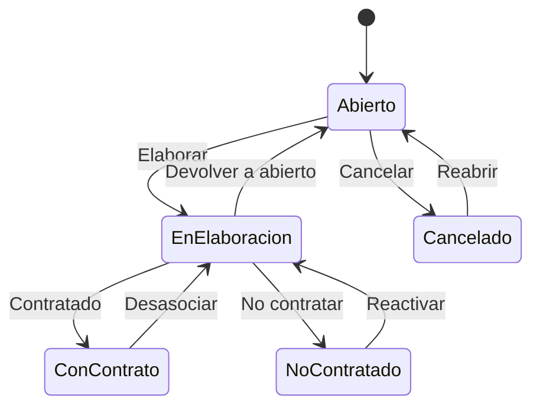

# Flujo del negocio 'Expedientes' para el tipo 'SCV: Venta'

Un expediente de solicitud de contrato de venta recoge la petición de un cliente que acabará (o no) en uno o varios contratos de venta. Usa presupuestos y se le asocian contratos de venta. El estado inicial del tipo es **SCV: Abierto**.

Las transiciones *Contratado* y *Desasociar* son **del sistema**; las demás las aplica el usuario desde el expediente.

## Flujo

En el diagrama, *EnElaboracion* es **SCV: En elaboración**, *ConContrato* es **SCV: Con contrato** y *NoContratado* es **SCV: No contratado**.

| Estado | Etapa | Observaciones |
|---|---|---|
| SCV: Abierto | `EXP_Etapa_Inicial`, `EXP_Etapa_Asociar_Tareas` | Estado inicial. |
| SCV: En elaboración | `EXP_Etapa_Asociar_Tareas`, `EXP_Etapa_Asociar_Presupuestos`, `EXP_Etapa_Asociar_SC_Venta` | Se preparan los presupuestos y se asocian los contratos de venta. |
| SCV: Con contrato | `EXP_Etapa_Terminada` | Estado terminado: tiene al menos un contrato. |
| SCV: No contratado | `EXP_Etapa_Terminada` | Estado terminado: la solicitud no ha dado lugar a contrato. |
| SCV: Cancelado | `EXP_Etapa_Cancelada` | Estado final: solicitud anulada (se puede reabrir). |

## Transiciones

### SCV: Abierto ---> SCV: Elaborar --> SCV: En elaboración
Empieza a elaborar la solicitud. Si el expediente tiene presupuestos, exige una dirección de contacto o fiscal activa asociada.

### SCV: Abierto ---> SCV: Cancelar --> SCV: Cancelado
Cancela la solicitud. Pide el **motivo de cancelación**. No deja si tiene tareas realizadas o en proceso, ni elementos dependientes.

### SCV: En elaboración ---> SCV: Contratado --> SCV: Con contrato  (sistema)
Se aplica al asociar un contrato a la solicitud.
- Antes de transitar valida que haya **al menos un contrato asociado no cancelado**.
- Al pasar a un estado terminado exige que no haya tareas en proceso ni presupuestos sin terminar.

### SCV: En elaboración ---> SCV: No contratar --> SCV: No contratado
La solicitud no da lugar a contrato. Pide el **motivo de no contratación**.
- Antes de transitar valida que no hay contratos asociados o, si los hay, que están cancelados.

### SCV: En elaboración ---> SCV: Devolver a abierto --> SCV: Abierto
Devuelve la solicitud a abierto. Pide el **motivo de devolución**.
- Antes de transitar valida que **no hay contratos** asociados.

### SCV: Cancelado ---> SCV: Reabrir --> SCV: Abierto
Reabre una solicitud cancelada. Pide el **motivo de reapertura**. No ejecuta ninguna comprobación ni cambio propio: solo cambia de estado.

### SCV: No contratado ---> SCV: Reactivar --> SCV: En elaboración
Vuelve a elaborar una solicitud que no se había contratado. Pide el **motivo de activación**.

### SCV: Con contrato ---> SCV: Desasociar --> SCV: En elaboración  (sistema)
Se aplica cuando se **desasocian los contratos** de la solicitud: antes de transitar los desasocia y la solicitud vuelve a elaboración.

## Comportamiento común a todas las transiciones
- Cada transición queda anotada en el historial (hitos) del expediente.
- Solo pueden aplicarla los usuarios con permiso sobre la transición.
- Un expediente de cliente no transita si el cliente está de baja.
- Además, pueden existir otras **acciones de transición** definidas por el parametrizador (se ven al pinchar la flecha en el visor de flujo del estado), que se ejecutan antes o después de las anteriores.
