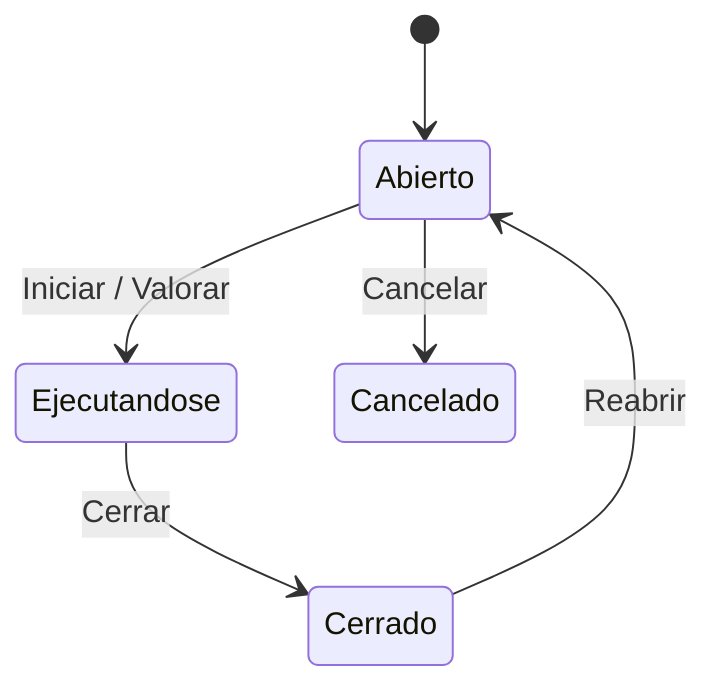

# Flujo del negocio 'Expedientes' para el tipo 'SPR: Sprint de Emuasa'

Un sprint de Emuasa agrupa las tareas evolutivas y correctivas que se planifican y valoran de una vez para un cliente. Al iniciarse se presupuestan las tareas asociadas. El estado inicial del tipo es **SPR: Abierto**.

Todas las transiciones de este flujo las aplica el usuario desde el expediente.

## Flujo

En el diagrama, *Ejecutandose* es **SPR: Ejecutándose**.

| Estado | Etapa | Observaciones |
|---|---|---|
| SPR: Abierto | `EXP_Etapa_Inicial`, `EXP_Etapa_Asociar_Tareas`, `EXP_Etapa_Asociar_Presupuestos` | Estado inicial. Se asocian las tareas del sprint. |
| SPR: Ejecutándose | `EXP_Etapa_Asociar_Presupuestos`, `EXP_Etapa_Ejecucion` | El sprint está en marcha y ya está valorado. |
| SPR: Cerrado | `EXP_Etapa_Terminada` | Estado terminado. |
| SPR: Cancelado | `EXP_Etapa_Cancelada` | Estado final: sprint anulado. |

## Transiciones

### SPR: Abierto ---> SPR: Iniciar --> SPR: Ejecutándose
Pone el sprint en marcha.
- Antes de transitar valida que el sprint tiene relacionada al menos una tarea de tipo *SSII: Correctivo* o *SSII: Evolutivo* activa o terminada, y que sus tareas planificables están planificadas.
- Crea una **valoración (presupuesto)** a partir de las tareas asociadas que aún no estuvieran presupuestadas.
- Después de transitar existe una acción (descrita como «valida que si el sprint se ha facturado, no permita abrirlo»).
- Si el expediente tiene presupuestos, exige una dirección de contacto o fiscal activa asociada.

### SPR: Abierto ---> SPR: Valorar --> SPR: Ejecutándose
Misma transición de estado que *Iniciar* (de abierto a ejecutándose), definida con otro nombre. No tiene acciones asociadas.

### SPR: Abierto ---> SPR: Cancelar --> SPR: Cancelado
Cancela el sprint. Pide el **motivo de cancelación**. No deja si tiene tareas realizadas o en proceso, ni elementos dependientes (presupuestos...).

### SPR: Ejecutándose ---> SPR: Cerrar --> SPR: Cerrado
Cierra el sprint. Exige que no haya tareas en proceso ni presupuestos sin terminar.

### SPR: Cerrado ---> SPR: Reabrir --> SPR: Abierto
Reabre el sprint. Pide el **motivo de reapertura**. No ejecuta ninguna comprobación ni cambio propio: solo cambia de estado.

## Comportamiento común a todas las transiciones
- Cada transición queda anotada en el historial (hitos) del expediente.
- Solo pueden aplicarla los usuarios con permiso sobre la transición.
- Un expediente de cliente no transita si el cliente está de baja.
- Además, pueden existir otras **acciones de transición** definidas por el parametrizador (se ven al pinchar la flecha en el visor de flujo del estado), que se ejecutan antes o después de las anteriores.
