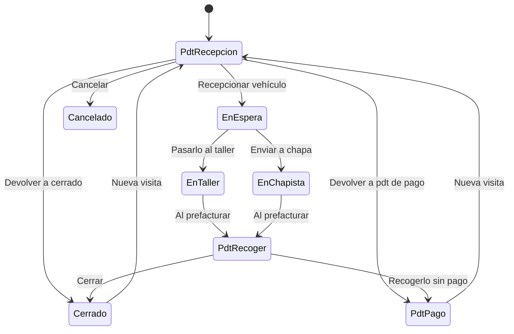

# Flujo del negocio 'Expedientes' para el tipo 'TLL: Reparación de vehiculos'

Un expediente de reparación de vehículos sigue un vehículo desde que llega al taller hasta que el cliente lo recoge y lo paga. Es un expediente con valoración (clase *ConValoracion*) que usa presupuestos. El estado inicial del tipo es **TLL: Pdt de reprepción** (el nombre del estado tiene esa errata en el código).

Todas las transiciones de este flujo las aplica el usuario desde el expediente.

## Flujo

En el diagrama, *PdtRecepcion* es **TLL: Pdt de reprepción**, *PdtRecoger* es **TLL: Pdt. de recoger** y *PdtPago* es **TLL: Pdt. de pago**.

| Estado | Etapa | Observaciones |
|---|---|---|
| TLL: Pdt de reprepción | `EXP_Etapa_Inicial`, `EXP_Etapa_Asociar_Tareas` | Estado inicial. A la espera de que llegue el vehículo. |
| TLL: En espera | `EXP_Etapa_Asociar_Tareas`, `EXP_Etapa_Ejecucion` | Vehículo recibido, pendiente de empezar. |
| TLL: En taller | `EXP_Etapa_Asociar_Tareas`, `EXP_Etapa_Ejecucion` | Se está reparando en el taller. |
| TLL: En chapista | `EXP_Etapa_Asociar_Tareas`, `EXP_Etapa_Ejecucion` | Enviado al chapista. |
| TLL: Pdt. de recoger | `EXP_Etapa_Asociar_Tareas`, `EXP_Etapa_Ejecucion` | Reparado y facturado; espera que el cliente lo recoja. |
| TLL: Pdt. de pago | `EXP_Etapa_Asociar_Tareas`, `EXP_Etapa_Ejecucion` | Retirado sin pagar; pendiente de cobro. |
| TLL: cerrado | `EXP_Etapa_Terminada` | Estado terminado: recogido y pagado. |
| TLL: Cancelado | `EXP_Etapa_Cancelada` | Estado final: expediente anulado. |

## Transiciones

### TLL: Pdt de reprepción ---> TLL: Recepcionar vehículo --> TLL: En espera
Registra la llegada del vehículo. Antes de pasar a ejecución, si el expediente tiene presupuestos, exige una dirección de contacto o fiscal activa asociada.

### TLL: Pdt de reprepción ---> TLL: Cancelar --> TLL: Cancelado
Cancela el expediente. Pide el **motivo de cancelación**. No deja si tiene tareas realizadas o en proceso, ni elementos dependientes (presupuestos, facturas...).

### TLL: Pdt de reprepción ---> TLL: Devolver a pdt de pago --> TLL: Pdt. de pago
Devuelve el expediente, que estaba pendiente de recepción, a pendiente de pago. Pide el **motivo de devolución**.

### TLL: Pdt de reprepción ---> TLL: Devolver a cerrado --> TLL: cerrado
Devuelve el expediente, que estaba pendiente de recepción, a cerrado. Pide el **motivo de devolución**. Al pasar a un estado terminado exige que no haya tareas en proceso ni presupuestos sin terminar.

### TLL: En espera ---> TLL: Pasarlo al taller --> TLL: En taller
El vehículo pasa a repararse en el taller. No ejecuta ninguna comprobación ni cambio propio: solo cambia de estado.

### TLL: En espera ---> TLL: Enviar a chapa --> TLL: En chapista
El vehículo se envía al chapista. No ejecuta ninguna comprobación ni cambio propio: solo cambia de estado.

### TLL: En taller ---> TLL: Al prefacturar --> TLL: Pdt. de recoger
Termina la reparación y deja el vehículo listo para recoger.
- Tras transitar **envía un correo al cliente** (solicitante del expediente) avisándole de que venga a recoger el vehículo.

### TLL: En chapista ---> TLL: Al prefacturar --> TLL: Pdt. de recoger
Igual que la anterior, cuando el vehículo vuelve del chapista (existe también una transición *Recibir de chapa* definida en el código sin uso en el flujo).

### TLL: Pdt. de recoger ---> TLL: Cerrar --> TLL: cerrado
El cliente recoge el vehículo y lo paga. Al pasar a un estado terminado exige que no haya tareas en proceso ni presupuestos sin terminar.

### TLL: Pdt. de recoger ---> TLL: Recogerlo sin pago --> TLL: Pdt. de pago
El cliente recoge el vehículo sin pagar. Pide el **motivo de retirada sin pago**.

### TLL: cerrado ---> TLL: Nueva visita --> TLL: Pdt de reprepción
El mismo vehículo vuelve al taller: se reabre el expediente en recepción.

### TLL: Pdt. de pago ---> TLL: Nueva visita --> TLL: Pdt de reprepción
El vehículo vuelve al taller con un pago pendiente. Pide el **motivo de nueva entrada**.

## Comportamiento común a todas las transiciones
- Cada transición queda anotada en el historial (hitos) del expediente.
- Solo pueden aplicarla los usuarios con permiso sobre la transición.
- Un expediente de cliente no transita si el cliente está de baja.
- Además, pueden existir **acciones de transición** definidas por el parametrizador (se ven al pinchar la flecha en el visor de flujo del estado), que se ejecutan antes o después de las anteriores.
