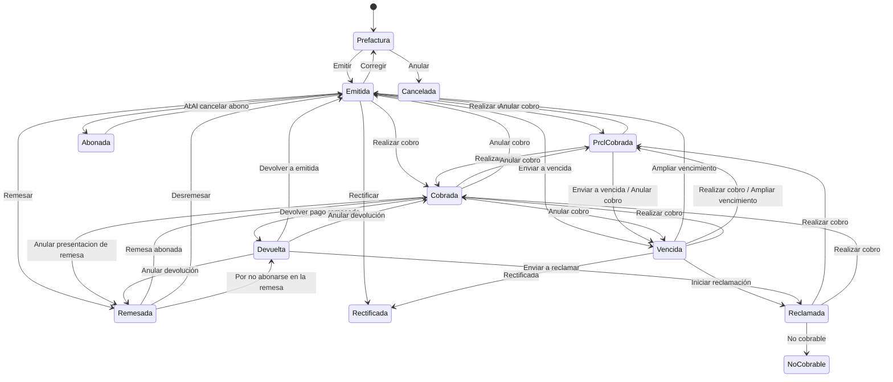

# Flujo del negocio 'Facturas emitidas' para el tipo 'FAE: General'

Una factura emitida nace como **prefactura**, se emite (con número, firma y comunicación a la AEAT), se cobra directamente o por remesa y termina cobrada, abonada, rectificada, no cobrable o cancelada. El estado inicial del tipo es **FAE: Prefactura**.

Las transiciones marcadas **(manual)** las aplica el usuario desde la factura. Las marcadas **(sistema)** las aplica el propio sistema como consecuencia de otra operación (un cobro, una remesa, un trabajo diario...) y no se ejecutan a mano.

## Flujo

| Estado | Etapa | Observaciones |
|---|---|---|
| FAE: Prefactura | `FAE_Etapa_Prefactura` | Estado inicial. Se edita, se imprime la prefactura, se emite o se anula. |
| FAE: Emitida | `FAE_Etapa_Emitida`, `FAE_Etapa_De_Cobro` | Con número y firma. Se puede cobrar, remesar, corregir o rectificar. |
| FAE: Prcl. Cobrada | `FAE_Etapa_De_Cobro` | Con cobros, pero queda importe pendiente. |
| FAE: Vencida | `FAE_Etapa_De_Cobro`, `FAE_Etapa_De_Reclamacion` | Ha pasado el vencimiento sin cobrarse del todo. |
| FAE: Reclamada | `FAE_Etapa_De_Cobro`, `FAE_Etapa_De_Reclamacion` | En reclamación al cliente. |
| FAE: Remesada | `FAE_Etapa_Remesada` | Incluida en una remesa de cobro, a la espera del cargo. |
| FAE: Devuelta | `FAE_Etapa_Devuelta` | El cliente devolvió el recibo de la remesa. |
| FAE: Cobrada | `FAE_Etapa_Cobrada` | Estado final: saldada. |
| FAE: Rectificada | `FAE_Etapa_Rectificada` | Estado final: la ha sustituido una rectificativa. |
| FAE: Abonada | `FAE_Etapa_Abonada` | Estado final: rectificativa totalmente abonada. |
| FAE: No Cobrable | `FAE_Etapa_No_Cobrable` | Estado final: se da por perdida. |
| FAE: Cancelada | `FAE_Etapa_Anulada` | Estado final: prefactura anulada. |

## Transiciones

### FAE: Prefactura ---> FAE: Emitir --> FAE: Emitida  (manual)
Emite la factura: le da número, la firma y la deja lista para comunicar a la AEAT.
- No deja emitir si no tiene líneas, si otra factura se está emitiendo en ese momento, o si las tareas asociadas no están terminadas.
- Valida el IVA, el IRPF, los requisitos del SII, la dirección fiscal, que el centro administrativo esté activo y, si el tipo lo exige, que tenga periodo de facturación.
- Anota la fecha de emisión, la serie y el año. Asigna el **número correlativo** de la sociedad y la serie, y comprueba que la fecha de devengo no sea posterior a la emisión.
- Calcula el vencimiento, la huella y la clase de emisión (en una rectificativa valida además la factura que rectifica).
- Genera el **preasiento** contable de la factura y la **firma** (XAdES).
- Tras transitar: actualiza el avance del contrato o la planificación si la factura viene de un parte o de un contrato, da por facturados los partes de trabajo y anota en la agenda el **evento de vencimiento**. Si es una rectificativa por el mismo importe, quita el evento de vencimiento de la rectificada.

### FAE: Prefactura ---> FAE: Anular --> FAE: Cancelada  (manual)
Anula una prefactura que no se va a emitir. Pide el **motivo de anulación**.
- Libera los partes de trabajo: si la factura o alguna de sus líneas venía de un parte, el parte retrocede y la factura deja de estar enganchada a él.
- Excluye de la factura las tareas facturadas (dejando una traza en cada tarea) y desengancha el presupuesto asociado (con traza).
- Si es una rectificativa, elimina los registros de rectificación.

### FAE: Emitida ---> FAE: Corregir --> FAE: Prefactura  (manual)
Devuelve la factura a prefactura para corregirla. Pide el **motivo de corrección**.
- Solo se puede con la **última factura de su serie**, y no si es rectificativa, si viene de un parte o tiene partes facturados en sus líneas, si tiene cobros o si ya se ha comunicado (o se está comunicando) a la AEAT.
- No deja si otra factura se está procesando en ese momento.
- Quita el evento de vencimiento, borra el archivo de la factura, la deja otra vez como prefactura y **anula su preasiento**.
- Tras transitar elimina el PDF y la firma generados y deja una traza: "Factura retrocedida para corrección".

### FAE: Emitida ---> FAE: Abonar --> FAE: Abonada  (manual)
Da por abonada una factura rectificativa.
- Comprueba que no quede nada pendiente de devolver; si queda, no deja.
- Quita el evento de vencimiento de la agenda.

### FAE: Emitida ---> FAE: Abonar al saldar --> FAE: Abonada  (sistema)
Lo mismo que *Abonar*, pero lo aplica el trabajo diario **Actualización de facturas emitidas** cuando una rectificativa queda totalmente abonada.

### FAE: Emitida ---> FAE: Realizar cobro --> FAE: Prcl. Cobrada  (sistema)
Se aplica al registrar un cobro que no salda la factura. La factura queda parcialmente cobrada.

### FAE: Emitida ---> FAE: Realizar cobro --> FAE: Cobrada  (sistema)
Se aplica al registrar un cobro que salda la factura.

### FAE: Emitida ---> FAE: Enviar a vencida --> FAE: Vencida  (sistema)
Lo aplica el trabajo diario **Pasar a vencidas las facturas impagadas** cuando ha pasado el vencimiento. No toca las rectificadas ni las rectificativas por diferencias.
- Tras transitar, si la factura no tiene **archivador de reclamación**, lo crea con el tipo definido en el parámetro `FAE_TipoArchivadorDeReclamacion`.

### FAE: Emitida ---> FAE: Rectificar --> FAE: Rectificada  (sistema)
Se aplica cuando una factura rectificativa emitida sustituye a esta.
- Borra la fecha de vencimiento y el evento de vencimiento de la agenda.

### FAE: Emitida ---> FAE: Remesar --> FAE: Remesada  (sistema)
Se aplica al **incluir la factura en una remesa de cobro**.

### FAE: Prcl. Cobrada ---> FAE: Realizar cobro --> FAE: Cobrada  (sistema)
Se aplica al registrar el cobro que salda lo que quedaba pendiente.

### FAE: Prcl. Cobrada ---> FAE: Anular cobro --> FAE: Emitida  (sistema)
Se aplica al eliminar el único cobro: la factura vuelve a emitida.

### FAE: Prcl. Cobrada ---> FAE: Enviar a vencida --> FAE: Vencida  (sistema)
Lo aplica el trabajo diario de vencimientos cuando una factura con cobros parciales pasa su vencimiento.

### FAE: Prcl. Cobrada ---> FAE: Anular cobro --> FAE: Vencida  (sistema)
Se aplica al eliminar un cobro cuando la factura ya está vencida.

### FAE: Vencida ---> FAE: Realizar cobro --> FAE: Prcl. Cobrada  (sistema)
Se aplica al registrar un cobro parcial sobre una factura vencida. Recalcula el vencimiento.

### FAE: Vencida ---> FAE: Realizar cobro --> FAE: Cobrada  (sistema)
Se aplica al registrar el cobro que salda una factura vencida.

### FAE: Vencida ---> FAE: Iniciar reclamación --> FAE: Reclamada  (manual)
Pasa la factura a reclamada. Pide los **motivos del pase a reclamación**.
- La factura debe tener **archivador de reclamación** y este debe contener al menos un archivo.

### FAE: Vencida ---> FAE: Ampliar vencimiento --> FAE: Emitida  (sistema)
Se aplica al cambiar el vencimiento (*Cambiar vencimiento*) de una factura vencida sin cobros: vuelve a emitida.

### FAE: Vencida ---> FAE: Ampliar vencimiento --> FAE: Prcl. Cobrada  (sistema)
Igual que la anterior, pero cuando la factura tiene cobros parciales.

### FAE: Vencida ---> FAE: Rectificada --> FAE: Rectificada  (sistema)
Se aplica cuando una rectificativa sustituye a una factura que estaba vencida.

### FAE: Reclamada ---> FAE: Realizar cobro --> FAE: Prcl. Cobrada  (sistema)
Se aplica al registrar un cobro parcial de una factura reclamada.

### FAE: Reclamada ---> FAE: Realizar cobro --> FAE: Cobrada  (sistema)
Se aplica al registrar el cobro que la salda. El trabajo **Actualización de facturas emitidas** también pasa a cobrada las reclamadas que ya lo están.

### FAE: Reclamada ---> FAE: No cobrable --> FAE: No Cobrable  (manual)
Da la factura por perdida. Pide los **motivos de por qué no es cobrable**. No ejecuta ninguna comprobación ni cambio propio: solo cambia de estado.

### FAE: Remesada ---> FAE: Remesa abonada --> FAE: Cobrada  (sistema)
Se aplica cuando se **carga la remesa** (el banco ha cargado los recibos): se crea el cobro de clase *Remesa*, con su preasiento de cobro, y la factura queda cobrada.

### FAE: Remesada ---> FAE: Desremesar --> FAE: Emitida  (sistema)
Se aplica al **excluir la factura de la remesa** (solo mientras la remesa está en *Inicial*).

### FAE: Remesada ---> FAE: Por no abonarse en la remesa --> FAE: Devuelta  (sistema)
Se aplica cuando el cliente **devuelve el recibo** de una factura remesada que aún no se había cargado.

### FAE: Cobrada ---> FAE: Anular cobro --> FAE: Prcl. Cobrada  (sistema)
Se aplica al eliminar un cobro de una factura cobrada cuando todavía quedan otros cobros.

### FAE: Cobrada ---> FAE: Anular cobro --> FAE: Vencida  (sistema)
Se aplica al eliminar el cobro de una factura cobrada cuando ya ha pasado el vencimiento.

### FAE: Cobrada ---> FAE: Anular cobro --> FAE: Emitida  (sistema)
Se aplica al eliminar el cobro de una factura cobrada que aún no está vencida.

### FAE: Cobrada ---> FAE: Devolver pago remesado --> FAE: Devuelta  (sistema)
Se aplica cuando el cliente devuelve un recibo **ya cargado**. Elimina el cobro de la remesa (y cancela su preasiento) y la factura queda devuelta.

### FAE: Cobrada ---> FAE: Anular presentacion de remesa --> FAE: Remesada  (sistema)
Se aplica al **anular el cargo** de la remesa: se eliminan los cobros de remesa y la factura vuelve a remesada.

### FAE: Devuelta ---> FAE: Devolver a emitida --> FAE: Emitida  (manual)
Deja la factura devuelta de nuevo como emitida, para cobrarla directamente o remesarla otra vez. Pide el **motivo de devolución**.

### FAE: Devuelta ---> FAE: Enviar a reclamar --> FAE: Reclamada  (manual)
Pasa la factura devuelta a reclamación. Pide el **motivo de reclamación** y exige el archivador de reclamación con archivos.

### FAE: Devuelta ---> FAE: Anular devolución --> FAE: Remesada  (sistema)
Se aplica al **anular una devolución** de una factura cuyo cargo no se había realizado.

### FAE: Devuelta ---> FAE: Anular devolución --> FAE: Cobrada  (sistema)
Se aplica al anular una devolución de una factura que sí se había cargado: se recrea el cobro de la remesa.

### FAE: Abonada ---> FAE: Al cancelar abono --> FAE: Emitida  (sistema)
Se aplica al cancelar el abono de la rectificativa: vuelve a emitida.

## Comportamiento común a todas las transiciones
- Cada transición queda anotada en el historial (hitos) de la factura.
- Solo pueden aplicarla los usuarios con permiso sobre la transición.
- Además, pueden existir **acciones de transición** definidas por el parametrizador (se ven al pinchar la flecha en el visor de flujo del estado), que se ejecutan antes o después de las anteriores.
- Más detalle del proceso (cobros, contabilidad, AEAT, remesas) en el manual *Proceso de una factura emitida*.
