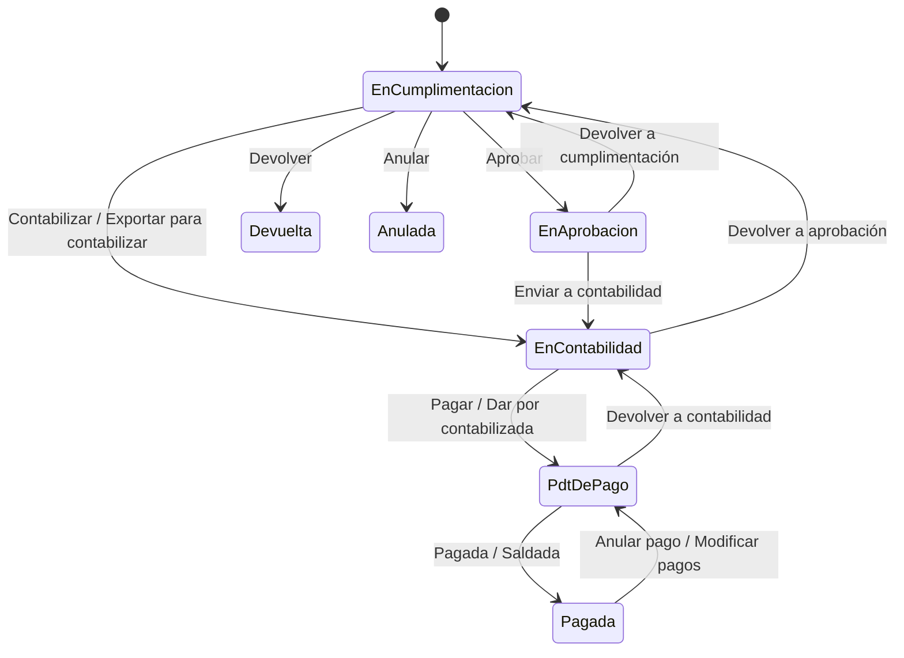

# Flujo del negocio 'Facturas recibidas' para el tipo 'FAR: General'

Una factura recibida es la factura de un proveedor. Entra en cumplimentación (a mano, por XML, por lectura con IA o desde el correo), se revisa y aprueba, se contabiliza generando su preasiento de gasto y se paga, directamente o mediante una remesa de pagos. El estado inicial del tipo es **FAR: En cumplimentación**.

Las transiciones marcadas **(manual)** las aplica el usuario desde la factura. Las marcadas **(sistema)** las aplica el propio sistema como consecuencia de otra operación (un pago, una exportación a contabilidad...).

## Flujo

| Estado | Etapa | Observaciones |
|---|---|---|
| FAR: En cumplimentación | `FAR_Etapa_De_Cumplimentacion`, `FAR_Etapa_De_Aprobacion` | Estado inicial. Se puede modificar todo: cabecera, líneas, archivo e imputaciones. |
| FAR: En aprobación | `FAR_Etapa_De_Aprobacion` | La revisa el responsable. |
| FAR: En contabilidad | `FAR_Etapa_De_Contabilizacion` | Se indica la fecha contable. |
| FAR: Pdt. de pago | `FAR_Etapa_De_Pago` | Contabilizada (con preasiento); se crean y realizan los pagos. |
| FAR: Pagada | `FAR_Etapa_Pagada` | Estado terminado: no queda nada por pagar. |
| FAR: Devuelta | `FAR_Etapa_Devuelta` | Estado terminado: devuelta al proveedor. No se reactiva, se crea de nuevo. |
| FAR: Anulada | `FAR_Etapa_Anulada` | Estado final: anulada. No se reactiva. |

## Transiciones

### FAR: En cumplimentación ---> FAR: Aprobar --> FAR: En aprobación  (manual)
Pasa la factura al responsable para que la valide.
- Antes comprueba que la factura está **bien formada**: CIF del proveedor válido, con líneas, base y total de las líneas coherentes con la cabecera y el IVA, **archivo de factura** anexo, fecha de emisión no anterior al año pasado y, si es negativa, indicada la factura que rectifica (salvo que `FAR_PermitirFacturasNegativas` lo permita).

### FAR: En cumplimentación ---> FAR: Contabilizar --> FAR: En contabilidad  (manual)
Salta la aprobación y pasa directamente a contabilidad.
- Comprueba que la factura está bien formada (igual que *Aprobar*).
- Antes de enviar a contabilidad, exige **naturaleza** en todas las líneas de base, decide la clase de una rectificativa (**por diferencias** si cambia la base, **por sustitución** si no) y avisa si el proveedor está de baja.

### FAR: En cumplimentación ---> FAR: Exportar para contabilizar --> FAR: En contabilidad  (sistema)
Lo mismo que *Contabilizar*, pero lo aplica el sistema al exportar la factura a contabilidad.

### FAR: En cumplimentación ---> FAR: Devolver --> FAR: Devuelta  (manual)
La factura es errónea y se devuelve al proveedor. Pide el **motivo de corrección**. Es definitivo: no se reactiva.
- Quita el contrato y el expediente imputados (salvo que `FAR_Quitar_Contrato_Al_Anular` o `FAR_Quitar_Expediente_Al_Anular` digan lo contrario, en cuyo caso no deja y hay que desasociarlos).
- Los pagos al contado se cancelan (parámetro `FAR_Quitar_Pagos_Al_Anular`); si hay un pago de otra clase, o con preasiento contabilizado, hay que cancelarlo antes.

### FAR: En cumplimentación ---> FAR: Anular --> FAR: Anulada  (manual)
La factura no procede. Pide el **motivo de anulación**. Es definitivo y aplica las mismas comprobaciones y limpiezas que *Devolver*.

### FAR: En aprobación ---> FAR: Enviar a contabilidad --> FAR: En contabilidad  (manual)
El responsable aprueba y pasa la factura a contabilidad. Exige naturaleza en todas las líneas de base, decide la clase de rectificativa y avisa si el proveedor está de baja.

### FAR: En aprobación ---> FAR: Devolver a cumplimentación --> FAR: En cumplimentación  (manual)
Devuelve la factura para corregirla. Quita el preasiento si lo hubiera.

### FAR: En contabilidad ---> FAR: Pagar --> FAR: Pdt. de pago  (manual)
Contabiliza la factura y la deja pendiente de pago.
- Si no tiene **fecha contable**, la pone con la de hoy (parámetro `FAR_Al_Contabilizar_Indicar_Fecha`, activo por defecto); si está desactivado, exige que se haya indicado.
- Genera el **preasiento de gasto**: gasto de cada naturaleza y IVA soportado al debe; proveedor, IRPF retenido y, si procede, IVA repercutido por inversión del sujeto pasivo al haber. Cada naturaleza necesita cuenta de gasto y la sociedad debe usar preasientos de facturas recibidas.
- Tras transitar, si la factura tiene un único pago al contado en curso por el total, lo da por pagado, y si con ello queda pagada, la pasa a **FAR: Pagada**.

### FAR: En contabilidad ---> FAR: Dar por contabilizada --> FAR: Pdt. de pago  (sistema)
Lo aplica el sistema cuando una factura que ya está pagada (por ejemplo, pagada al contado en el alta) llega a contabilidad y `FAR_Dar_Por_Contabilizada_Si_Pagada` está activo. Después pasa sola a pagada.

### FAR: En contabilidad ---> FAR: Devolver a aprobación --> FAR: En cumplimentación  (manual)
Contabilidad rechaza la factura. Pide el motivo («Rechazada por contabilidad»).
- Borra la fecha contable y la clase de rectificativa.
- No deja si hay pagos confirmados creados después del alta de la factura: hay que cancelarlos antes.
- Quita el preasiento.

### FAR: Pdt. de pago ---> FAR: Pagada --> FAR: Pagada  (sistema)
Se aplica cuando los pagos confirmados cubren el total a pagar (dentro de la tolerancia de importes), por ejemplo al dar por pagado el último pago o al cerrar una remesa de pagos.
- Archiva la factura y, si está imputada a un contrato, mueve su base de *facturado* a *cobrado* en el avance del contrato.

### FAR: Pdt. de pago ---> FAR: Saldada --> FAR: Pagada  (manual)
Da la factura por pagada sin necesidad de ir creando los pagos uno a uno.
- No deja si hay pagos en curso: hay que darlos por pagados o cancelarlos antes.
- Si falta la fecha contable la completa con la de hoy, crea el pago que salda lo pendiente, lo da por pagado y archiva la factura.

### FAR: Pdt. de pago ---> FAR: Devolver a contabilidad --> FAR: En contabilidad  (manual)
Devuelve la factura a contabilidad para corregirla. Pide el motivo («Devolver a contabilidad»). **Cancela el preasiento** de gasto.

### FAR: Pagada ---> FAR: Anular pago --> FAR: Pdt. de pago  (sistema)
Se aplica cuando se anula o devuelve un pago de una factura pagada (por ejemplo, al anular un pago de una remesa). Si la factura tiene contrato, devuelve su base de *cobrado* a *facturado*.

### FAR: Pagada ---> FAR: Modificar pagos --> FAR: Pdt. de pago  (manual)
Reabre una factura pagada para poder corregir sus pagos. Pide el **motivo de modificación**. Igual que la anterior, revierte el avance del contrato.

## Comportamiento común a todas las transiciones
- Cada transición queda anotada en el historial (hitos) de la factura.
- Solo pueden aplicarla los usuarios con permiso sobre la transición.
- Una factura devuelta o anulada no puede volver a transitar: hay que crearla de nuevo.
- Si la factura vuelve a cumplimentación, aprobación o contabilidad, su preasiento se anula.
- Además, pueden existir **acciones de transición** definidas por el parametrizador (se ven al pinchar la flecha en el visor de flujo del estado), que se ejecutan antes o después de las anteriores.
- Más detalle del proceso (altas, preasientos, pagos y remesas) en el manual *Proceso de una factura recibida*.
