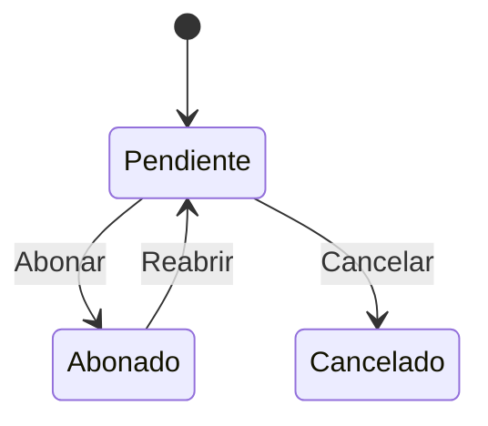

# Flujo del negocio 'Pagos' para el tipo 'ABO: General'

Un abono es el pago que se hace (o la devolución que se hace) a un cliente por una factura emitida abonada, es decir, una rectificativa de una factura de cliente. Comparte negocio con los pagos pero tiene su propio flujo, más corto. El estado inicial del tipo es **ABO: Pendiente**.

## Flujo

| Estado | Etapa | Observaciones |
|---|---|---|
| ABO: Pendiente | `PAG_Etapa_Pendiente` | Estado inicial. Es el único en el que se puede modificar el abono. |
| ABO: Abonado | `PAG_Etapa_Pagado` | Abono realizado. |
| ABO: Cancelado | `PAG_Etapa_Cancelado` | Estado final: el abono no se llegó a realizar. |

## Transiciones

### ABO: Pendiente ---> ABO: Abonar --> ABO: Abonado  (manual)
Da el abono por realizado. Aplica las mismas comprobaciones que el pago (*Pagar*):
- Valida importe, medio de pago y naturaleza (un abono a cliente no puede indicar naturaleza de gasto).
- Si no tiene fecha de «pagar el» pone la de hoy; en un abono de contado pone la de hoy como fecha de pago; en una transferencia exige cuentas y calcula la fecha según `REM_DiasDeEsperaDeCargo`.
- No deja si la fecha de pago es posterior a hoy.
- Genera el **preasiento** contable.

### ABO: Pendiente ---> ABO: Cancelar --> ABO: Cancelado  (manual)
Cancela un abono que no se va a realizar. Pide el **motivo de cancelación**.
- No deja si el abono tiene ya fecha de pago.
- Borra la fecha de «pagar el» y **cancela su preasiento**.
- Tras transitar, si la factura emitida abonada estaba en *FAE: Abonada*, la devuelve a **FAE: Emitida**.

### ABO: Abonado ---> ABO: Reabrir --> ABO: Pendiente  (manual)
Reabre un abono ya realizado. Pide el **motivo de reapertura** («Abono reabierto por:»).
- Restablece la fecha de «pagar el», borra la fecha de pago y **anula el preasiento**.

## Comportamiento común a todas las transiciones
- Cada transición queda anotada en el historial (hitos) del pago.
- Solo pueden aplicarla los usuarios con permiso sobre la transición.
- Además, pueden existir **acciones de transición** definidas por el parametrizador (se ven al pinchar la flecha en el visor de flujo del estado), que se ejecutan antes o después de las anteriores.
