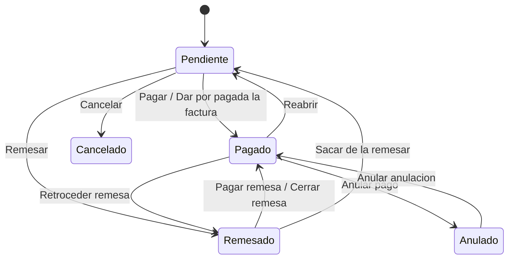

# Flujo del negocio 'Pagos' para el tipo 'PAG: General'

Un pago es la salida de dinero a un proveedor, trabajador o acreedor, normalmente para saldar una factura recibida. Puede ser de contado, por transferencia o formar parte de una remesa de pago. El estado inicial del tipo es **PAG: Pendiente**.

Las transiciones marcadas **(manual)** las aplica el usuario desde el pago. Las marcadas **(sistema)** las aplica el propio sistema como consecuencia de otra operación (una remesa de pago, una factura recibida...).

## Flujo

| Estado | Etapa | Observaciones |
|---|---|---|
| PAG: Pendiente | `PAG_Etapa_Pendiente` | Estado inicial. Es el único en el que se puede modificar el pago. |
| PAG: Remesado | `PAG_Etapa_Remesado` | Incluido en una remesa de pago, a la espera de que ésta se presente o cierre. |
| PAG: Pagado | `PAG_Etapa_Pagado` | Pago realizado. Estado terminado (se puede reabrir o retroceder). |
| PAG: Anulado | `PAG_Etapa_Anulacion` | Pago remesado que el banco no ha ejecutado o se ha devuelto. |
| PAG: Cancelado | `PAG_Etapa_Cancelado` | Estado final: el pago no se llegó a realizar. |

## Transiciones

### PAG: Pendiente ---> PAG: Pagar --> PAG: Pagado  (manual)
Da el pago por realizado.
- Valida el pago: que el importe no sea negativo ni mayor que el de la factura, que el medio de pago esté activo y que la naturaleza de gasto sea coherente.
- La factura asociada debe tener su detalle cumplimentado.
- Si es un pago de contado domiciliado, la factura debe tener archivo asociado; en los de contado o transferencia exige además un **justificante de pago** anexo (parámetro `PAG_Validar_Justificante_De_Pago`, activo por defecto).
- Si no tiene fecha de «pagar el» pone la de hoy; en un pago de contado pone como fecha de pago la de hoy; en una transferencia exige cuenta deudora y acreedora y calcula la fecha de pago sumando los días del parámetro `REM_DiasDeEsperaDeCargo`.
- No deja si el pago es de clase remesa (se paga al cerrar la remesa) ni si la fecha de pago es posterior a hoy.
- Genera el **preasiento** contable del pago.
- Tras transitar, si la factura recibida queda sin saldo pendiente, la pasa a **pagada**.

### PAG: Pendiente ---> PAG: Dar por pagada la factura --> PAG: Pagado  (sistema)
Lo mismo que *Pagar*, pero lo aplica el sistema cuando la factura recibida se da por pagada (por ejemplo, al transitar la factura a pagada) y arrastra consigo los pagos pendientes.

### PAG: Pendiente ---> PAG: Remesar --> PAG: Remesado  (sistema)
Se aplica al incluir el pago en una **remesa de pago**.
- Exige que el importe sea mayor que cero.

### PAG: Pendiente ---> PAG: Cancelar --> PAG: Cancelado  (manual)
Cancela un pago que no se va a realizar. Pide el **motivo de cancelación**.
- No deja si el pago está en una remesa (hay que quitarlo antes) ni si ya tiene fecha de pago.
- Quita del pago el fichero de la factura anexado, borra la fecha de «pagar el» y **cancela su preasiento**.
- Tras transitar, si el pago es el abono de una factura emitida que estaba abonada, la devuelve a emitida.

### PAG: Remesado ---> PAG: Pagar remesa --> PAG: Pagado  (sistema)
Se aplica cuando la remesa de pago se **presenta** y el pago queda realizado. Genera el preasiento del pago (exige fecha de pago) y actualiza la factura recibida a pagada si ya no debe nada.

### PAG: Remesado ---> PAG: Cerrar remesa --> PAG: Pagado  (sistema)
Se aplica al **cerrar la remesa de pago**: da por pagados todos los pagos que seguían remesados. Mismo tratamiento que *Pagar remesa*.

### PAG: Remesado ---> PAG: Sacar de la remesar --> PAG: Pendiente  (sistema)
Se aplica al **quitar el pago de la remesa**: vuelve a pendiente para poder pagarse por otra vía o incluirse en otra remesa. Tras transitar la factura recibida vuelve a pendiente de pago.

### PAG: Pagado ---> PAG: Reabrir --> PAG: Pendiente  (manual)
Reabre un pago ya realizado. Pide el **motivo de reapertura** («Pago reabierto por:»).
- No deja si el pago está en una remesa.
- Restablece la fecha de «pagar el» (la de vencimiento de la factura), borra la fecha de pago y **anula el preasiento**.
- Tras transitar la factura recibida vuelve a pendiente de pago.

### PAG: Pagado ---> PAG: Retroceder remesa --> PAG: Remesado  (sistema)
Se aplica al **retroceder la remesa** de pago a un estado anterior: el pago vuelve a remesado y se anula su preasiento. La factura recibida vuelve a pendiente de pago.

### PAG: Pagado ---> PAG: Anular pago --> PAG: Anulado  (sistema)
Se aplica al **anular un pago de una remesa** (por ejemplo, cuando el banco no lo ejecuta).
- Solo se pueden anular pagos de clase remesa.
- Anula el preasiento, borra la fecha de pago y devuelve la factura recibida a pendiente de pago.

### PAG: Anulado ---> PAG: Anular anulacion --> PAG: Pagado  (sistema)
Deshace la anulación y deja el pago otra vez como pagado. Vuelve a generar el preasiento (exige fecha de pago).

## Comportamiento común a todas las transiciones
- Cada transición queda anotada en el historial (hitos) del pago.
- Solo pueden aplicarla los usuarios con permiso sobre la transición.
- Los cambios de importes de pagos limpian las cachés de totales pagados de la factura recibida (y del expediente, si lo tiene).
- Además, pueden existir **acciones de transición** definidas por el parametrizador (se ven al pinchar la flecha en el visor de flujo del estado), que se ejecutan antes o después de las anteriores.
