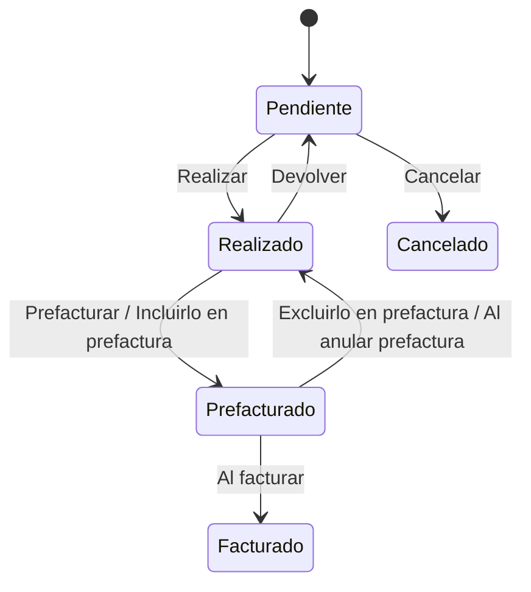

# Flujo del negocio 'Partes de trabajo' para el tipo 'GEN: Parte'

Un parte de trabajo recoge un servicio que hay que prestar a un cliente, con sus líneas y las asignaciones a técnicos. Se realiza, se factura (creando su propia prefactura o como línea de otra factura) y termina facturado. El estado inicial del tipo es **GEN: Pendiente**.

Las transiciones marcadas **(manual)** las aplica el usuario desde el parte. Las marcadas **(sistema)** las aplica el propio sistema como consecuencia de otra operación (incluir el parte en una factura, facturarla, anularla...).

## Flujo

| Estado | Etapa | Observaciones |
|---|---|---|
| GEN: Pendiente | `PTR_Etapa_Pendiente` | Estado inicial. Se editan las líneas y las asignaciones a técnicos. |
| GEN: Realizado | `PTR_Etapa_Pdt_Facturar` | Servicio prestado; pendiente de facturar. |
| GEN: Prefacturado | `PTR_Etapa_Facturado` | Incluido en una prefactura. Estado terminado. |
| GEN: Facturado | `PTR_Etapa_Facturado` | La factura se ha emitido. Estado terminado. |
| GEN: Cancelado | `PTR_Etapa_Cancelado` | Estado final: el servicio no se prestó. |

## Transiciones

### GEN: Pendiente ---> GEN: Realizar --> GEN: Realizado  (manual)
Da por prestado el servicio.
- Exige que el parte tenga **líneas** (lo realizado), que las **tareas vinculadas** estén finalizadas y que los datos de ejecución y de duración de las asignaciones sean válidos.
- Tras transitar, si el parte pertenece a una planificación de venta con contrato (o a un contrato directamente), **recalcula el avance del contrato** con el importe realizado.

### GEN: Pendiente ---> GEN: Cancelar --> GEN: Cancelado  (manual)
El servicio no se va a prestar. Pide el **motivo de cancelación**.
- No deja si alguna asignación está iniciada, finalizada o con duración o medición, ni si hay tareas vinculadas sin terminar o cancelar.
- Tras transitar elimina las asignaciones cuya planificación de inicio es posterior a hoy.

### GEN: Realizado ---> GEN: Devolver --> GEN: Pendiente  (manual)
Devuelve el parte a pendiente para corregirlo.
- Tras transitar limpia en las asignaciones las fechas de inicio y fin y la duración y medición, y **revierte el avance del contrato** si lo tenía.

### GEN: Realizado ---> GEN: Prefacturar --> GEN: Prefacturado  (manual)
Factura el parte creando su propia prefactura.
- Repite las comprobaciones de *Realizar* (líneas, tareas finalizadas, datos de ejecución y de duración).
- Si el parte no se factura como línea de otra factura, **crea la prefactura** y, tras transitar, guarda su identificador en el parte.

### GEN: Realizado ---> GEN: Incluirlo en prefactura --> GEN: Prefacturado  (sistema)
Se aplica cuando el parte se **incluye como línea** (partida alzada) en una prefactura existente, por ejemplo desde la factura o desde la facturación de un contrato. Guarda la factura en el parte.

### GEN: Prefacturado ---> GEN: Excluirlo en prefactura --> GEN: Realizado  (sistema)
Se aplica cuando el parte se **quita de la prefactura**. Borra el vínculo con la factura y deja una traza en el parte con el número de la prefactura cancelada y el usuario que lo hizo.

### GEN: Prefacturado ---> GEN: Al anular prefactura --> GEN: Realizado  (sistema)
Se aplica cuando se **anula la prefactura** que contenía el parte. Mismo tratamiento que *Excluirlo en prefactura*.

### GEN: Prefacturado ---> GEN: Al facturar --> GEN: Facturado  (sistema)
Se aplica cuando la factura que contiene el parte se **emite**: el parte pasa a facturado. No ejecuta ninguna comprobación ni cambio propio: solo cambia de estado.

## Comportamiento común a todas las transiciones
- Cada transición queda anotada en el historial (hitos) del parte.
- Solo pueden aplicarla los usuarios con permiso sobre la transición.
- Un parte creado a partir de un presupuesto exige que éste esté en la etapa que permite asociar partes y que sea de la misma sociedad.
- Además, pueden existir **acciones de transición** definidas por el parametrizador (se ven al pinchar la flecha en el visor de flujo del estado), que se ejecutan antes o después de las anteriores.
